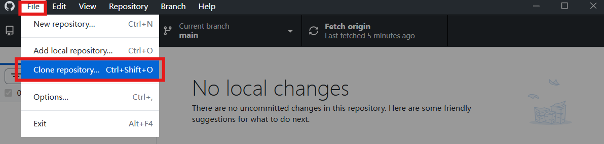
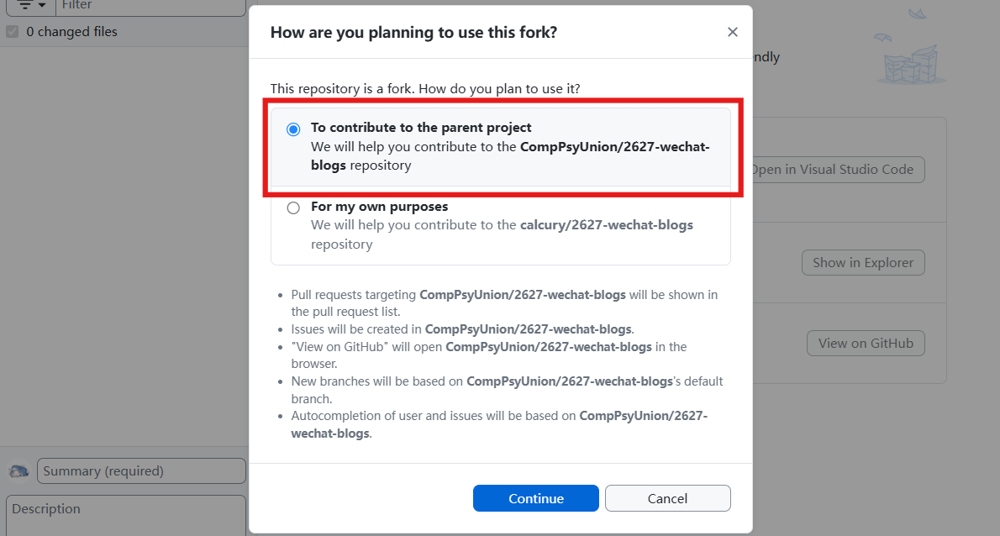
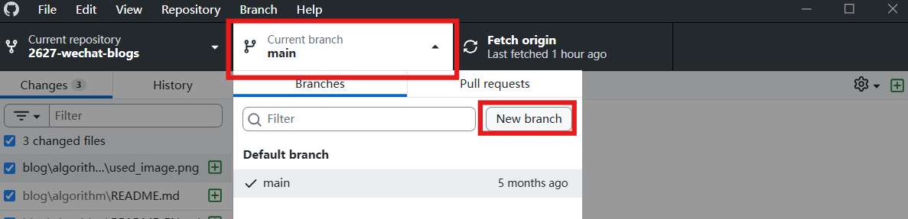
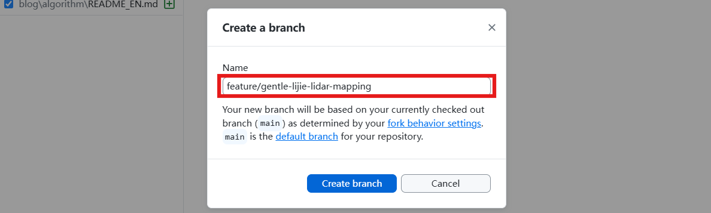
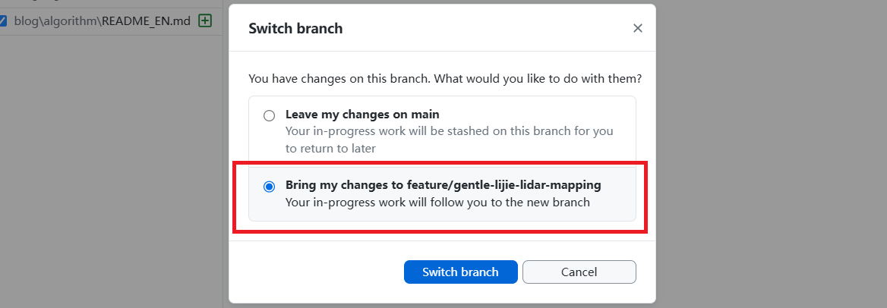

# Contribution Guidelines

[简体中文](#zh-cn) | [English](#en)

## zh-CN

欢迎为 CompPsyUnion 微信公众号贡献内容！你可以在 [Issue 页面](https://github.com/CompPsyUnion/2627-wechat-blogs/issues) 通过新建一个 issue 来提出你的公众号文章提议。

请仔细阅读下面的内容来了解我们的投稿流程。

### 一个投稿的标准流程

1. 提出文章标题和大纲
2. 文章标题和大纲审核通过
3. fork 并创建分支，通过 Pull Request 提交稿件
4. 完整稿件审核
5. 文章发布（第二周 周三或周五）

### 详细说明

#### 1. 提出文章标题和大纲

> 当然，如果你足够自信，你也可以直接跳过这一步，写好完整的内容直接从 [第三步](#3-完整稿件提交) 开始。反之如果你不确定你的推文内容是否合适，建议还是走完这个流程。大纲和 assignment 仍然在 Issue 中管理；从初稿开始，稿件必须转移到 Pull Request 中提交和修改。

你可以在 [Issue 页面](https://github.com/CompPsyUnion/2627-wechat-blogs/issues) 通过新建一个 issue 来提出你的公众号文章提议。

**Issue 标题格式：** 请在标题中简明扼要地写出你的文章标题。

**Issue 描述内容：** 在 issue 的 description 中添加你的文章内容大纲，不一定要写完。大纲应包括：

- 文章的主要小标题
- 每个小标题下的主要内容要点
- （可选）参考资料

**示例：**

```markdown
# 一个示例文章标题

大家好，今天我给大家带来的是一篇示例微信公众号文章

## 文章小标题 1

在提出这个提议的 issue 时，最好同时在 description 中添加一个文章内容的大纲，不一定要写完

## 文章小标题 2

提出的标题和这个大纲的内容，决定了我们是否会采纳你的提议。

## 结语
```

**Self-Assignment 说明：**

- 如果你只是想给文章提出一个建议，走到这一步就可以，我们可以在征得你的同意后将这个内容 assign 给我们 CPU 技术部的其他成员来完成。
- **如果你是想自己完成这个内容，请在这个 issue 创建后，把自己 assign 给自己（self-assign）**，这样我们就知道你会负责这个内容的后续工作。

**被动 Assignment：**

我们也可能通过主动创建一个 issue 然后 assign 给你来派发任务，这时你就需要新想出一个文章标题和大纲然后 Comment 到下方。收到 assignment 时你会收到通知。在你完成上面的操作后，我们会继续下面的审核流程。

#### 2. 文章标题和大纲审核

我们会在 3 个工作日内对你的文章标题和大纲进行审核。

**审核通过：**

- 我们会为这个 issue 添加上一个 `Task` 的 Type，一个 `in-review` 的标签（label）
- 我们会使用 milestone 给你排期
- 在 issue 下方留言告知你审核通过，例如："不错，请继续完成"
- 如果你被 assign 到了这个任务，你就可以 fork 并创建分支，并继续进行下一步的操作了

**重要提醒：** 只有你的 issue 被标注为了 `Task` 的 Type，你才能放心开始写完整内容（否则如果你的推文提议被拒绝，你可能面临工作白干的风险）。

**需要修改：**

- 我们会在 issue 下方留言并说明需要修改的地方
- 请你根据反馈进行修改并在评论中回复

**审核不通过：**

- 我们会在 issue 下方留言并说明原因，打上 `invalid` 标签
- 我们会随后关闭（close）这个 issue

##### 大纲要点

- 文章标题要简洁明了，能够吸引读者的注意力
- 文章大纲要包含文章的主要内容和结构，至少要有 2 个子版块
- 文章内容要符合公众号的定位和读者的兴趣，避免敏感话题
- 提出的标题和这个大纲的内容，决定了我们是否会采纳你的提议

#### 3. 完整稿件提交

**注意时间节点：**

- 请在上方我们给你标注的 milestone 的 due date 之前完成你的推文
- 如果长时间没给你标注 milestone，你也可以直接开始编写完整的推文内容，并通过 Pull Request 提交
- 越是完善的内容，我们越可能给你更早排期到位
- 如果超期未完成，你将面临被扣积分的风险

**编写建议：**

- 请在本地编辑器中撰写 Markdown 稿件，并通过 Pull Request 提交文件。

**提交步骤：**

从初稿开始，请使用 Pull Request 提交。下面分别介绍 GitHub Desktop 图形界面和命令行（CLI）投稿流程。

##### 使用 GitHub Desktop 投稿

GitHub Desktop 是 GitHub 官方桌面应用，可通过图形界面管理仓库、分支、commit 和 push。请搜索“GitHub Desktop”，从 GitHub 官方网站下载并安装。

1. **Fork 并克隆仓库：** 打开[仓库主页](https://github.com/CompPsyUnion/2627-wechat-blogs)，点击 **Fork** 将仓库 fork 到自己的 GitHub 账号。打开 GitHub Desktop 并登录，选择 **File → Clone repository…**，选中自己账号下的 `2627-wechat-blogs` fork（确认 owner 是自己的用户名，而非 `CompPsyUnion`），选择本地保存位置并点击 **Clone**。

   

   

   

2. **切换到最新 main 并创建分支：** 在 GitHub Desktop 选择仓库 `2627-wechat-blogs`，先切换到 `main`。如显示 **Fetch origin**，点击检查远端更新；若随后显示 **Pull origin**，点击拉取更新。然后点击 **Current Branch → New Branch**，输入符合[分支命名规范](#分支命名规范)的名称并点击 **Create Branch**。确认当前分支已切换为新分支，切勿直接在 `main` 上编辑或提交。

   

   

   

3. **创建并编辑文章文件夹：** 在文件资源管理器中打开本地仓库，根据文章类别创建目录 `blogs/software/<article_folder>/`、`blogs/hardware/<article_folder>/`、`blogs/algorithm/<article_folder>/` 或 `blogs/story/<article_folder>/`。文件夹名使用小写 snake_case。文件夹中应有中文稿 `README.md`、英文稿 `README_EN.md` 和图片目录 `img/`。英文稿需由投稿者翻译并通读确认；图片放入 `img/`，正文使用相对路径引用。格式、翻译及内容要求详见下方“Markdown 文章内容要求”部分。

4. **检查并 Commit：** 保存后返回 GitHub Desktop，在 **Changes** 中检查文件清单和 diff，确认只包含本次稿件及相关图片。填写 **Summary**（例如 `docs(blog): add article on cognitive biases`），可选填写 **Description**；遵守[提交信息规范](#提交信息规范)，不要添加 AI 署名 footer。确认当前分支不是 `main`，点击 **Commit to current branch**。

5. **Push 分支：** 点击 GitHub Desktop 顶部的 **Push origin**（首次可能显示 **Publish branch**），将分支推送到自己的 fork。

   

6. **创建 PR：** Push 完成后，点击 **Preview Pull Request** 或 **Create Pull Request**。在打开的 GitHub 页面确认 base repository 为 `CompPsyUnion/2627-wechat-blogs`、base branch 为 `main`、head repository 为自己的 fork、compare branch 为刚推送的工作分支。填写 PR 标题和描述，关联 Issue（如 `Closes #123` 或 `Refs #123`），说明稿件内容及检查结果，然后创建 PR。

7. **处理 review：** 如需修改，在同一分支本地编辑，在 GitHub Desktop 检查 diff、commit 并再次 **Push origin**；已有 PR 会自动更新。

##### 使用命令行（CLI）投稿

1. **Fork 仓库：** 打开 [仓库主页](https://github.com/CompPsyUnion/2627-wechat-blogs)，点击 **Fork**，将仓库复制到自己的 GitHub 账号下。
2. **克隆自己的 fork：**

    ```bash
    git clone https://github.com/<your-username>/2627-wechat-blogs.git
    cd 2627-wechat-blogs
    git remote add upstream https://github.com/CompPsyUnion/2627-wechat-blogs.git
    ```

3. **创建新分支：** 先同步 `main`，再创建符合[分支命名规范](#分支命名规范)的新分支：

    ```bash
    git fetch upstream
    git switch main
    git pull --ff-only upstream main
    git switch -c <branch-name> # Replace with your branch name
    ```

4. **创建并编辑文本：** 根据文章类别，在对应的 `blogs/` 子目录中创建一个文章文件夹：软件类放在 `blogs/software/`，硬件类放在 `blogs/hardware/`，算法类放在 `blogs/algorithm/`，故事类放在 `blogs/story/`。文件夹使用小写蛇形命名法描述文章标题，例如 `a_good_article_name/`。文件夹中需要包含中英文稿件 `README.md`、`README_EN.md`，以及存放文章图片的 `img/` 目录。图片应放在 `img/` 中，并在正文使用相对路径引用。结构如下：

    ```text
    2627-wechat-blogs/
    └── blogs/
        └── algorithm/
            └── a_good_article_name/
                ├── README.md       # 中文稿件
                ├── README_EN.md    # 英文稿件
                └── img/            # 文章需要用到的图片
                    └── example_image.png
    ```

    请将新文件夹放入与文章类别对应的目录，例如算法类文章放在 `blogs/algorithm/a_good_article_name/`。使用本地编辑器编写中英文稿件，并用 VSCode Markdownlint 插件检查。图片请放入该文章文件夹下的 `img/` 目录，正文中使用相对路径引用。

5. **Commit：** 检查并提交变更：

    ```bash
    git status
    git diff --check
    git add blogs/<category>/<article-folder>/
    git commit -m "docs(article-name): add article draft"
    ```

    commit message 请遵守[提交信息规范](#提交信息规范)。

6. **Push：** 将分支推送到自己的 fork：

   ```bash
   git push -u origin <branch-name>
   ```

7. **创建 PR：** 打开 `https://github.com/<your-username>/2627-wechat-blogs` ，从自己的 fork 向 `CompPsyUnion/2627-wechat-blogs` 的 `main` 分支创建 Pull Request。PR 描述中请关联 Issue（如 `Closes #123` 或 `Refs #123`），并说明检查结果。

8. **根据 review 修改：** 在同一个分支中编辑、commit 并 push，PR 会自动更新。

**Markdown 文章内容要求：**

- **英文稿件：** 每篇文章都必须提供英文稿件（`README_EN.md`）。提交者需完成中文稿件的英文翻译，并通读译文进行确认和必要的修订，确保内容准确、自然、完整，禁止未经检查就直接提交 AI 翻译结果。可参考 [translate-skill](https://github.com/CompPsyUnion/translate-skill) 辅助翻译。
- 文章长度在 400 到 2000 字之间
- 文章内容要有逻辑性和连贯性，避免语法错误和拼写错误
- 文章内容要有一定的原创性，避免大篇幅抄袭和引用。我们会使用工具来检测文章的原创性
- **图片插入：** 使用 Markdown 语法 `` 插入图片
  - 图片文件存放在文章文件夹的 `img/` 目录中，并使用相对路径引用
  - 确保图片的版权和来源合法
  - 提交前检查仓库预览中的图片路径是否有效
  - 图片清晰度足够、大小适中
- **代码块：** 如果包含代码，请使用 Markdown 代码块，并**标注语言**
  - 示例：` ```python` 而不是仅仅 ` ``` `
  - 确保代码的正确性和可读性
- **Markdown 语法规范：** 使用 VSCode 的 Markdownlint (DavidAnson.vscode-markdownlint) 插件检查语法
  - 由于微信对外部链接限制，外部链接请直接粘贴链接，**不要使用 markdown 语法插入链接**
  - 避免在公式块中特殊规定颜色，_这个需求我们做不了_
  - **不要插入 HTML 语句**，我们微信也没那么 6
  - 需要在本地格式化并检查通过后再通过 PR 提交（如不会请自行上网搜索，或者看第一次周常回放）
- 如需**特殊署名**，请在文章末尾标注作者，或者在 Pull Request 中提出请求。我们最终会以 `Robert(Siyuan) He` 或类似的形式呈现。
- 如果我们发现 Markdownlint 报错，你需要返工；自动格式化造成歧义时，也需要你自行决定如何排版。
- **参考资料：** 如果包含参考资料，请在文章末尾使用引用的方式列出，并确保版权和来源合法

#### 4. 完整稿件审核

我们会在 3 个工作日内对你的文章完整稿件进行审核，请关注 Pull Request 的 review 动态。

**审核通过：**

- 维护者会在 Pull Request 中留言确认，例如："好的，收到" 或类似内容
- 你的文案将移交宣传部
- 维护者会 close 这个 issue，你的任务就算彻底完成了

**需要修改：**

- 维护者会在 Pull Request 中提出修改意见
- 请按照 Pull Request 中的意见修改，在同一个分支中保存、commit 并 push，PR 会自动更新
- 我们也可能顺手帮你格式化了，需要返工的情况大概率是自动格式化时会产生歧义，需要你来自己决定如何排版

### 仓库进度管理

所有已经处于稳态的仓库禁止直接向 `main` 分支提交修改，请创建分支并使用 Pull Request 来提交修改。

### 分支命名规范

分支名统一使用小写字母，单词间使用 dash（`-`）分隔，不使用中文、空格、大写字母或下划线。

- 修复 bug：使用 `fix/[小写负责人用户名]-` 开头，按照 bug 名称命名，如 `fix/hnrobert-target-tracking`；多人参与时可以省略用户名，如 `fix/arm-control-error`。
- 新增功能：使用 `feature/[小写负责人用户名]-` 开头，按照功能名称命名，如 `feature/gentle-lijie-lidar-mapping`；多人参与时可以省略用户名，如 `feature/arm-control`。
- 其他修改：参考 commit message 规范，按照修改部分命名，如 `refactor/gimbal-control`、`docs/chassis-control`。

### 提交信息规范

推荐格式：

```text
<type>(<scope>): <subject>
<BLANK LINE>
<body>
<BLANK LINE>
<footer>
```

`scope`、`body` 和 `footer` 可选。以下示例展示了新增博客文章的提交信息：

```text
docs(blog): add article on cognitive biases

Explain common cognitive biases and their effects on decision-making.
Include references and practical examples.

Refs #123
```

- `type`：常见类型包括 `feat`、`fix`、`docs`、`style`、`refactor`、`test`、`chore`、`perf`、`ci` 和 `build`。
- `scope`：可选，用于说明影响范围，如 `blog`、`api`、`ui`。
- `subject`：不超过 50 字符，使用祈使句，首字母小写，结尾不要加标点。
- `body`：可选，说明原因、实现方式和上下文，建议每行不超过 72 字符。
- `footer`：可用于 `BREAKING CHANGE` 或 `Closes #123`、`Refs #456` 等 Issue 引用。

禁止出现指名 AI 的 `Co-Authored-By:` trailer（如 `Co-Authored-By: Claude ...`）或任何 `Generated with ...` 之类的 AI 署名 footer。

### 积分制度

- **主动提出并完成：** 如果是你主动提出此 issue，self-assign 并最后完成 pull request，你会得到 **3 点积分**
- **主动认领并完成：** 如果是你主动在 issue 区认领了一个已有的，没有被认领过的 issue，self-assign 并最后完成 pull request，你也可以得到 **3 点积分**
- **主动提出推文提议：** 如果是你主动提出一个 issue，你会得到 **1 点积分**
- **被动完成任务：** 如果开始时是我们 assign 给你一个 issue 对应的 pull request（不管 issue 初始是否为空），且你在最后完成，你可以得到 **2 点积分**
- **合作完成** 如果是多人合作完成一个 pull request，每人可以得到 **1-2 点积分（取决于是否为主动完成）**
- **逾期未完成：** 如果你长时间没有完成 milestone 的 due date，你将面临被扣积分的风险

### 关于 Issue 标签 (Labels) 和 种类 (Types)

- **种类**
  - `Task` 表示这个 issue 已经通过了标题和大纲的审核，可以开始写完整内容
- **标签**
  - 你可以自己添加的
    - `blogs-software` 软件类技术推文，如开发工具或者插件的介绍等
    - `blogs-hardware` 硬件类技术推文，如电脑硬件远离，DIY 相关等
    - `blogs-algorithm` 算法类技术推文，如机器学习、深度学习、数据分析等
    - `blogs-story` 历史、故事类技术推文，如计算机发展史、编程语言发展史等
  - 由组织管理者添加的
    - `duplicate` 表示这个 issue 是重复的，已经被关闭
    - `invalid` 表示这个 issue 的标题和大纲审核不通过，已经被关闭
    - `published` 表示这个 issue 的文章已经发布
    - `in-review` 表示这个 issue 的文章正在审核中
    - `publish-pending` 表示这个 issue 的文章正在排期发布

### 在你开始前

在开始前，也请查阅 [Issue #1](https://github.com/CompPsyUnion/2627-wechat-blogs/issues/1)，我们在这里提供了一个完整的工作流程示例。请参考这个示例的方法提出 issue。你也可以查看其他的 issue 来了解大家是如何提出文章提议的。

祝工作愉快 ；）

---

## en

Welcome to contribute content to CompPsyUnion's WeChat Official Account! You can propose your WeChat article by creating a new issue on the [Issue Page](https://github.com/CompPsyUnion/2627-wechat-blogs/issues).

Please read the following carefully to understand our submission process.

### Standard Submission Process

1. Propose article title and outline
2. Title and outline review approval
3. Fork the repository, create a branch, and submit the manuscript through a Pull Request
4. Complete manuscript review
5. Article publication

### Detailed Instructions

#### 1. Propose Article Title and Outline

> Of course, if you are confident enough, you can skip this step, write the complete content, and start from [Step 3](#3-complete-manuscript-submission). If you are unsure whether your article is appropriate, we recommend following this process. The outline and assignment remain managed in the Issue; from the first draft onward, submit and revise the manuscript through a Pull Request.

You can propose your WeChat article by creating a new issue on the [Issue Page](https://github.com/CompPsyUnion/2627-wechat-blogs/issues).

**Issue Title Format:** Write your article title concisely and clearly in the issue title.

**Issue Description Content:** Add your article outline in the issue description. It doesn't need to be complete. The outline should include:

- Main subheadings of the article
- Key points under each subheading
- (Optional) References

**Example:**

```markdown
# An Example Article Title

Hello everyone, today I'm bringing you an example WeChat Official Account article

## Article Subheading 1

When proposing this issue, it's best to add an outline of the article content in the description. It doesn't have to be complete.

## Article Subheading 2

The title and outline you propose determine whether we will adopt your proposal.

## Conclusion
```

**Self-Assignment Instructions:**

- If you just want to suggest an article idea, you can stop here. With your consent, we can assign this to other members of CPU's technical department to complete.
- **If you want to complete this content yourself, please self-assign yourself to this issue after creating it**. This way we know you'll be responsible for the subsequent work.

**Passive Assignment:**

We may also create an issue and assign it to you to delegate tasks. In this case, you'll need to come up with an article title and outline and comment below. You'll receive a notification when you get an assignment. After you complete the above, we'll proceed with the review process.

#### 2. Title and Outline Review

We will review your article title and outline within 3 working days.

**Review Approved:**

- We will add a `Task` Type and an `in-review` label to this issue
- We will schedule you using a milestone
- We'll comment below the issue to inform you of approval, e.g., "Great, please continue to complete it"
- If you're assigned to this task, fork the repository, create a branch, and proceed to the next step

**Important Reminder:** Only when your issue is typed with the `Task` tag can you confidently start writing the complete content (otherwise, if your article proposal is rejected, you may risk wasting your work).

**Needs Revision:**

- We will comment below the issue explaining what needs to be revised
- Please revise according to the feedback and reply in the comments

**Review Rejected:**

- We will comment below the issue explaining the reason and add an `invalid` label
- We will then close this issue

##### Outline Key Points

- Article title should be concise and clear, able to attract readers' attention
- Article outline should include the main content and structure of the article, with at least 2 subsections
- Article content should align with the Official Account's positioning and readers' interests, avoiding sensitive topics
- The proposed title and outline content determine whether we will adopt your proposal

#### 3. Complete Manuscript Submission

**Note on Timeline:**

- Please complete your article before the due date of the milestone we assigned to you
- If you haven't been assigned a milestone for a long time, you can still start writing the complete article and submit it through a Pull Request
- The more complete your content, the more likely we'll schedule you earlier
- If you fail to complete on time, you risk having points deducted

**Writing Recommendations:**

- Write and edit your Markdown manuscripts locally, then add them to your branch and submit them through a Pull Request.

**Submission Steps:**

From the first draft onward, submit your manuscript through a Pull Request. The instructions below cover both the GitHub Desktop graphical workflow and the command-line interface (CLI).

##### Submit with GitHub Desktop

GitHub Desktop is GitHub's official desktop application for managing repositories, branches, commits, and pushes through a graphical interface. Search for “GitHub Desktop” and download and install it from the official GitHub website.

1. **Fork and clone the repository:** Open the [repository homepage](https://github.com/CompPsyUnion/2627-wechat-blogs) and click **Fork** to fork it to your GitHub account. Open GitHub Desktop and sign in. Select **File → Clone repository…**, choose your `2627-wechat-blogs` fork (verify the owner is your username, not `CompPsyUnion`), select a local path, and click **Clone**.

   

   

   

2. **Switch to the latest main and create a branch:** Select the `2627-wechat-blogs` repository in GitHub Desktop and switch to `main`. If **Fetch origin** appears, click it to check for remote updates; if **Pull origin** appears afterward, click it to pull the updates. Then select **Current Branch → New Branch**, enter a name following the [branch naming conventions](#branch-naming-conventions), and click **Create Branch**. Confirm that the new branch is selected. Do not edit or commit directly on `main`.

   

   

   

3. **Create and edit the article folder:** Open the local repository in File Explorer and create a folder under the category directory: `blogs/software/<article_folder>/`, `blogs/hardware/<article_folder>/`, `blogs/algorithm/<article_folder>/`, or `blogs/story/<article_folder>/`. Use lowercase snake_case for the folder name. Include the Chinese manuscript `README.md`, English manuscript `README_EN.md`, and an `img/` directory. Contributors must translate and review the English manuscript; place images in `img/` and reference them using relative paths. See the **Markdown Article Content Requirements** section below for content, translation, and formatting rules.

4. **Review changes and commit:** Save your files and return to GitHub Desktop. Review the **Changes** list and diff, confirming that only the manuscript and relevant images are included. Enter a **Summary** (for example, `docs(blog): add article on cognitive biases`) and an optional **Description**. Follow the [commit message conventions](#commit-message-conventions) and do not add AI attribution footers. Confirm you are not on `main`, then click **Commit to current branch**.

5. **Push the branch:** Click **Push origin** at the top of GitHub Desktop (the first push may show **Publish branch**) to push the branch to your fork.

   

6. **Create a PR:** After pushing, click **Preview Pull Request** or **Create Pull Request**. On GitHub, confirm the base repository is `CompPsyUnion/2627-wechat-blogs`, the base branch is `main`, the head repository is your fork, and the compare branch is your working branch. Add a clear PR title and description, link the related Issue (for example, `Closes #123` or `Refs #123`), summarize the manuscript and checks, and create the PR.

7. **Address review comments:** If changes are requested, edit files locally on the same branch, review the diff in GitHub Desktop, commit, and click **Push origin** again. The existing PR updates automatically.

##### Submit with the command line (CLI)

1. **Fork the repository:** Open the [repository homepage](https://github.com/CompPsyUnion/2627-wechat-blogs), click **Fork**, and fork it to your GitHub account.
2. **Clone your fork:**

    ```bash
    git clone https://github.com/<your-username>/2627-wechat-blogs.git
    cd 2627-wechat-blogs
    git remote add upstream https://github.com/CompPsyUnion/2627-wechat-blogs.git
    ```

3. **Create a new branch:** Synchronize `main`, then create a branch following the [branch naming conventions](#branch-naming-conventions):

    ```bash
    git fetch upstream
    git switch main
    git pull --ff-only upstream main
    git switch -c <branch-name> # Replace with your branch name
    ```

4. **Create and edit the text:** Create an article folder in the `blogs/` subdirectory matching the article category: software in `blogs/software/`, hardware in `blogs/hardware/`, algorithms in `blogs/algorithm/`, and stories in `blogs/story/`. Name the folder in lowercase snake_case based on the article title, for example `a_good_article_name/`. It must contain the Chinese manuscript `README.md`, the English manuscript `README_EN.md`, and an `img/` directory for article images. The structure is:

    ```text
    2627-wechat-blogs/
    └── blogs/
        └── algorithm/
            └── a_good_article_name/
                ├── README.md       # Chinese manuscript
                ├── README_EN.md    # English manuscript
                └── img/            # Images that used in your article
                    └── example_image.png
    ```

    For example, create an algorithm article at `blogs/algorithm/a_good_article_name/`. Write both manuscripts locally, then check them with the VS Code Markdownlint extension. Place images in that article's `img/` directory and reference them using relative paths.

5. **Commit:** Check and commit the change:

    ```bash
    git status
    git diff --check
    git add blogs/<category>/<article-folder>/
    git commit -m "docs(article-name): add article draft"
    ```

    Follow the [commit message conventions](#commit-message-conventions).

6. **Push:** Push the branch to your fork:

    ```bash
    git push -u origin <branch-name>
    ```

7. **Open a PR:** Create a Pull Request from your fork to the `main` branch of `CompPsyUnion/2627-wechat-blogs`. Reference the Issue in the PR description, such as `Closes #123` or `Refs #123`, and include your check results.

8. **Address review comments:** Edit, commit, and push on the same branch; the PR updates automatically.

> If the repository maintainers designate a different article directory or structure, follow that structure.
>
> Store local article image files in the article's `img/` directory and reference them using relative paths. Check that image copyright and sources are legitimate.

**Markdown Article Content Requirements:**

- **English manuscript:** Every article must include an English version (`README_EN.md`). Contributors are responsible for translating the Chinese manuscript into English, then reading through the translation and making any necessary corrections to ensure it is accurate, natural, and complete. Do not submit unchecked AI-generated translations. The [translate-skill](https://github.com/CompPsyUnion/translate-skill) may be used as a translation aid.
- Article length between 400 and 2000 words
- Content should be logical and coherent, avoiding grammatical and spelling errors
- Content should have a certain level of originality, avoiding extensive plagiarism and quotation. We will use tools to detect originality
- **Image Insertion:** Use Markdown syntax `` to insert images
  - Store image files in the article folder's `img/` directory and reference them using relative paths
  - Ensure image copyright and sources are legitimate
  - Before submission, ensure image paths work in the repository preview
  - Images should be clear and appropriately sized
- **Code Blocks:** If including code, use Markdown code blocks and **specify the language**
  - Example: ` ```python` instead of just ` ``` `
  - Ensure code correctness and readability
- **Markdown Syntax Standards:** Use VS Code's Markdownlint (DavidAnson.vscode-markdownlint) extension to check syntax
  - Due to WeChat's restrictions on external links, paste external URLs directly into the article text — **do not use Markdown link syntax**
  - Avoid specifying special colours or styling inside formula/math blocks — custom colours cannot be supported in the published posts
  - **Do NOT insert HTML**
  - Format and validate the manuscripts locally before submitting them through a PR (if you don't know how, please search online or watch the first weekly meeting replay)
  - If we find Markdown lint errors, you will need to revise the manuscript. Revision may also be needed when auto-formatting creates ambiguity, requiring you to decide on the formatting
  - If you need a special author signature, mark the author at the end of your article or request it in the Pull Request description. We will present it in a format like `Robert(Siyuan) He` or similar.
- **References:** If including references, list them at the end of the article using citation format, ensuring copyright and sources are legitimate

#### 4. Complete Manuscript Review

We will review your complete manuscript within 3 working days. Please follow the Pull Request review updates.

**Review Approved:**

- Maintainers will confirm approval in the Pull Request with a comment such as "OK, received"
- Your content will be handed over to the publicity department
- Maintainers will close this issue, and your task is completely finished

**Needs Revision:**

- Maintainers will leave revision suggestions in the Pull Request
- Please revise according to the suggestions on the Pull Request, then save, commit, and push on the same branch; the PR will update automatically
- We may also help you format it, but rework is usually needed when auto-formatting creates ambiguity, requiring you to make formatting decisions

### Repository Progress Management

Stable repositories must not receive direct commits to the `main` branch. Create a branch and use a Pull Request for changes.

### Branch Naming Conventions

Use lowercase letters only and separate words with dashes (`-`). Do not use Chinese characters, spaces, uppercase letters, or underscores.

- Bug fixes: start with `fix/[lowercase-owner-username]-`, such as `fix/hnrobert-target-tracking`; when several people participate, the username may be omitted, such as `fix/arm-control-error`.
- New features: start with `feature/[lowercase-owner-username]-`, such as `feature/gentle-lijie-lidar-mapping`; when several people participate, the username may be omitted, such as `feature/arm-control`.
- Other changes: follow the commit message type and name the modified area, such as `refactor/gimbal-control` or `docs/chassis-control`.

### Commit Message Conventions

Recommended format:

```text
<type>(<scope>): <subject>
<BLANK LINE>
<body>
<BLANK LINE>
<footer>
```

`scope`, `body`, and `footer` are optional. Here is an example for adding a blog post:

```text
docs(blog): add article on cognitive biases

Explain common cognitive biases and their effects on decision-making.
Include references and practical examples.

Refs #123
```

The `type` may be `feat`, `fix`, `docs`, `style`, `refactor`, `test`, `chore`, `perf`, `ci`, or `build`. The `subject` should be an imperative sentence of no more than 50 characters, start with lowercase, and have no final punctuation. Keep body lines around 72 characters. The footer may contain `BREAKING CHANGE` or references such as `Closes #123` and `Refs #456`.

Do not include a named-AI `Co-Authored-By:` trailer (such as `Co-Authored-By: Claude ...`) or any `Generated with ...` AI attribution footer.

### Points System

- **Proactive proposal and completion:** If you propose an Issue, self-assign, and complete its Pull Request, you will receive **3 points**
- **Proactive claim and completion:** If you claim an existing, unclaimed Issue, self-assign, and complete its Pull Request, you will receive **3 points**
- **Proposal adopted:** If another member completes an Issue you proposed, you will receive **1 point**
- **Assigned task completion:** If we assign you an Issue and you complete its corresponding Pull Request, you will receive **2 points**
- **Collaborative completion:** If multiple people collaborate on a Pull Request, each contributor will receive **1–2 points**, depending on whether they completed it proactively
- **Overdue incompletion:** If you fail to complete the milestone by its due date for a long time, you risk having points deducted

### About Issue Types and Labels

- **Types**
  - `Task`: indicates the issue has passed title & outline review — you may start writing the full manuscript
- **Labels**
  - User-assignable labels (you can add these when appropriate):
    - `blogs-software` — software/tool oriented posts
    - `blogs-hardware` — hardware / DIY / electronics posts
    - `blogs-algorithm` — algorithm / ML / data-science posts
    - `blogs-story` — historical / narrative posts (history of computing, language evolution, etc.)
  - Maintainer-controlled labels
    - `duplicate` — this issue duplicates an existing one (will be closed)
    - `invalid` — title & outline did not pass review (will be closed)
    - `published` — the article from this issue has been published
    - `in-review` — the article is currently under review
    - `publish-pending` — the article is scheduled / pending publication

### Before You Start

Before starting, please also check [Issue #1](https://github.com/CompPsyUnion/2627-wechat-blogs/issues/1), where we provide a complete workflow example. Please refer to this example when proposing an Issue. You can also review other Issues to see how article proposals are written.

Happy contributing ；）
