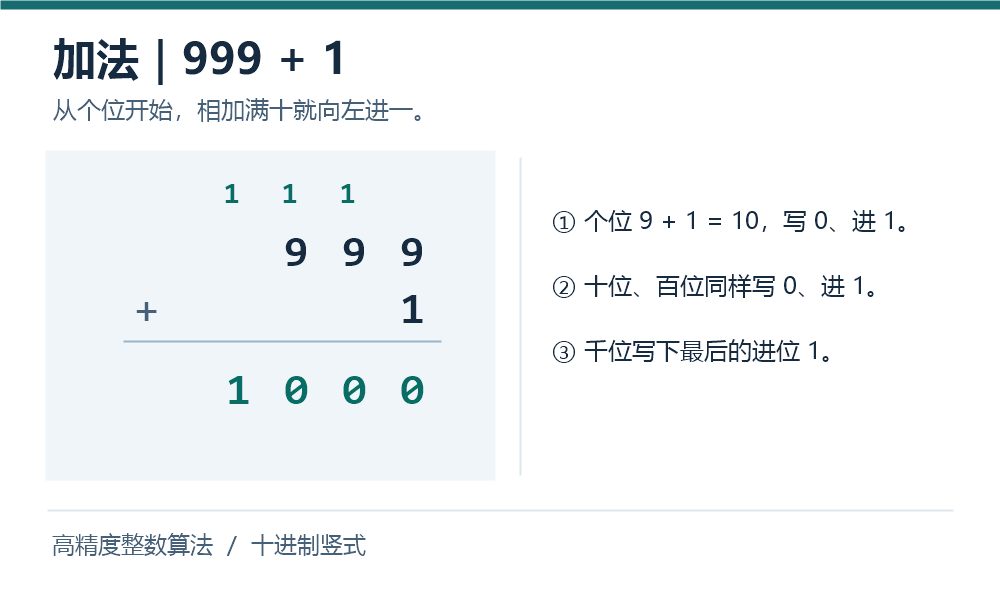
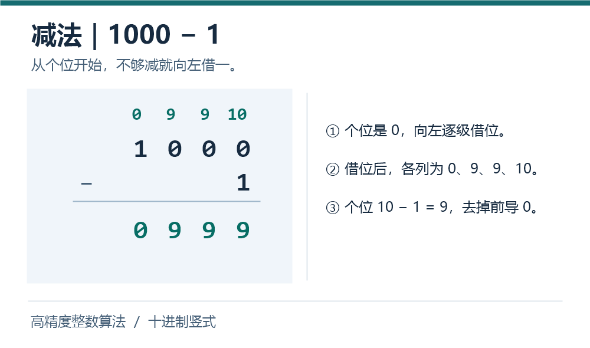
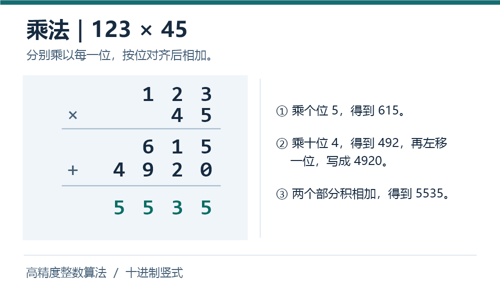
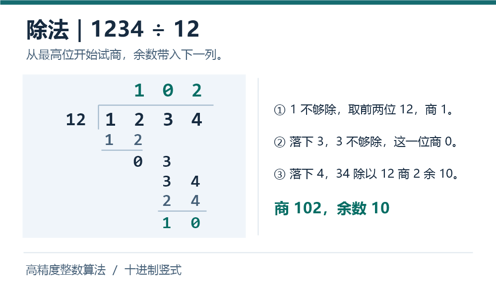

# 当整数超出计算机的表示范围：高精度算法入门

## 为什么需要高精度？

《崩坏：星穹铁道》的翁法罗斯剧情里，白厄的逐火之旅来到了第 33,550,336 次轮回。三千多万听起来已经很大了，用 C++ 的 `int` 能存下这个轮回编号吗？

在常见的 C++ 实现上，32 位有符号 `int` 的上限是 2,147,483,647（约 21 亿），64 位有符号 `long long` 的上限是 9,223,372,036,854,775,807（约 922 京）。单个轮回编号用两种类型都能存下。拿这个数字做个假设：如果把 64 个这样的轮回计数加在一起，总数是 2,147,221,504，刚好还在 `int` 的范围内。加到 65 个时，总数变成 2,180,771,840，就得用更宽的类型，例如 `long long`。

再看看这个编号的平方和立方能不能存进这两种类型。

- **平方**，得到 1,125,625,045,712,896，超过了 32 位 `int` 的上限， 但仍能用 64 位 `long long` 保存。
- **立方**，得到 37,765,098,493,683,020,333,056。这是第一个超出 64 位 `long long` 范围的正整数次幂。用高精度算法可以精确算出每一位。

Python 的内置 `int` 支持任意精度整数。直接输入 `33_550_336 ** 3`，就能得到上面的精确结果。额外的数位由 Python 自动处理。

换成更宽的整数类型只能把上限往后推。如果题目给出的是两个各有一百位的整数，可以把它们当作数字序列来存，再按我们熟悉的竖式逐位运算。这就是本文采用的高精度整数算法。

## 高精度算法的基本原理

用 `int` 数组保存每一位。`a[0]` 记位数，从 `a[1]` 起依次放个位、十位、百位等。例如输入 `2026`，`a[0]` 是 `4`，`a[1]` 到 `a[4]` 依次是 `6, 2, 0, 2`。读入时从字符串末尾取字符，减去 `'0'` 转成数字。输出时从高位往低位打印，跳过前导零，结果为零时只输出一个 `0`。

为什么把低位放在前面？竖式加减法从个位开始，进位和借位都传向更高的一位。这样，数组下标从 `1` 递增就能按计算顺序处理各位。两个数的 `a[i]` 和 `b[i]` 也总是同一数位，即使它们的长度不同。比如 `999 + 1` 最后多出的千位，只要写到下一个空位。

把三个 C++ 代码块按顺序放进同一个文件，运行后输入 `999 1`，就会输出 `1000`。

```cpp
#include <iostream>
#include <string>
using namespace std;

const int MAX_DIGITS = 1000;
// 下标 0 留给位数，另留 10 格存放乘法可能多出的数字。
const int CAPACITY = MAX_DIGITS + 11;
int a[CAPACITY], b[CAPACITY], c[CAPACITY];

void read_digits(const string& s, int a[]) {
    // 从字符串末尾往前读，个位存到下标 1。
    a[0] = int(s.size());
    for (int i = 1; i <= a[0]; i++) {
        a[i] = s[a[0] - i] - '0'; // 个位放在 a[1]
    }
}

void print_digits(const int a[]) {
    // 从最高位开始，至少保留一个数字。
    int i = a[0];
    while (i > 1 && a[i] == 0) i--; // 跳过前导零
    for (; i >= 1; i--) cout << a[i];
}
```

## 高精度加法与减法

算 `999 + 1` 时，个位相加得到 10，写下 0、进 1。十位和百位继续收到进位，最后追加一个 1，得到 `1000`。每一列的和对 10 取余得到当前位，整除 10得到进位。短数字缺少的高位视作 0。



*图片由 AI 生成。*

减法先判断被减数是否更小。忽略前导零后先比位数，位数相同再从高位逐位比较。算`1000 - 1` 时，个位差为 −1，加 10 得到 9，并向十位借 1。借位一路传到千位，得到 `0999`，去掉前导零后就是 `999`。示例要求被减数至少等于减数。



*图片由 AI 生成。*

```cpp
void add(const int a[], const int b[], int c[]) {
    // carry 是上一列传来的进位。
    int carry = 0;
    c[0] = a[0] > b[0] ? a[0] : b[0];
    for (int i = 1; i <= c[0]; i++) {
        // 短操作数缺少的高位按 0 处理。
        int sum = carry;
        if (i <= a[0]) sum += a[i];
        if (i <= b[0]) sum += b[i];
        c[i] = sum % 10;
        carry = sum / 10;
    }
    // 最后还有进位时，增加一位。
    if (carry > 0) c[++c[0]] = carry;
}

// 被减数不小于减数
void subtract(const int a[], const int b[], int c[]) {
    int borrow = 0;
    c[0] = a[0];
    for (int i = 1; i <= c[0]; i++) {
        // 先扣掉上一列借走的 1。
        int diff = a[i] - borrow;
        if (i <= b[0]) diff -= b[i];
        borrow = 0;
        if (diff < 0) {
            // 向左借 1，相当于给当前列加 10。
            diff += 10;
            borrow = 1;
        }
        c[i] = diff;
    }
}
```

## 高精度乘法与除法

大整数乘普通整数时，每一位乘上乘数，再加上前一位传来的进位。以`123 × 45` 为例，从个位开始依次处理 `135`、`103` 和 `55`。先写下的三位依次是 5、3、5，再把剩下的进位 5 放到最高位，结果是 `5535`。

两个大整数相乘也可以照搬竖式。把第二个数的第 `j` 位作为乘数，计算一份部分积，再把它左移 `j` 个十进制位，与已有结果相加。例如 `123 × 45` 可以拆成`123 × 5 + (123 × 4) × 10`。实现时也可以把各对数字的乘积累加到对应列，再统一处理进位。



*图片由 AI 生成。*

除法从最高位开始。每次把上一步的余数乘 10，再加上当前数字，得到这一列要除的数。用它除以除数得到当前的商位，取余后带到下一列。比如 `1234 ÷ 12`依次得到商位 0、1、0、2，去掉前导零后，商为 `102`，余数为 `10`。商中间的 0 要保留。



*图片由 AI 生成。*

```cpp
void multiply_small(const int a[], long long factor, int c[]) {
    long long carry = 0;
    c[0] = a[0];
    for (int i = 1; i <= a[0]; i++) {
        long long value = a[i] * factor + carry;
        c[i] = int(value % 10);
        carry = value / 10;
    }
    // 乘数可以有多位，剩余的进位也可能有多位。
    while (carry > 0) {
        c[++c[0]] = int(carry % 10);
        carry /= 10;
    }
}

long long divide_small(const int a[], long long divisor, int c[]) {
    long long remainder = 0;
    c[0] = a[0];
    for (int i = a[0]; i >= 1; i--) {
        // 把上一列的余数乘 10，再落下当前这一位。
        long long value = remainder * 10 + a[i];
        // 整除得到当前商位，取余留给下一列。
        c[i] = int(value / divisor);
        remainder = value % divisor;
    }
    return remainder;
}

int main() {
    string s, ss;
    if (!(cin >> s >> ss)) return 0;
    if (s.size() > MAX_DIGITS || ss.size() > MAX_DIGITS) return 0;

    // 先把两个字符串转成数组，再逐位相加。
    read_digits(s, a);
    read_digits(ss, b);
    add(a, b, c);
    print_digits(c);
    cout << '\n';
    return 0;
}
```

## C++ 实现中的细节与常见问题

测试时可以先跑 `0000 + 0`、`1000 - 1000`、`7 ÷ 12` 和`123 × 0`。它们分别检查输入前导零、结果为零、商为零以及乘零。示例假设输入已经检查过：输入最多 1000 位且只含数字，减法须满足被减数不小于减数。乘数允许为 0，除数必须大于 0，两者最多为 10 亿。每一列的中间值用`long long` 保存。

这里的数组保存的是非负整数。要扩展到负数，可以把符号和绝对值分开存。两个数同号相加时相加绝对值，异号相加时用较大的绝对值减去较小的，并采用绝对值较大的数的符号。结果为零时统一保留为 `0`。

设两个大整数有 `n` 位和 `m` 位。加减法各扫描一遍，时间复杂度是`O(max(n, m))`。竖式乘法处理每一对数字，时间复杂度是 `O(nm)`。若乘数或除数是固定宽度的普通整数，示例中的乘除法均为 `O(n)`。

## 高精度算法的实际应用

在算法竞赛里，`100!`、很大的组合数和斐波那契数都可能要求输出完整结果。算 `100!` 可以从 1 开始依次乘 2 到 100。求斐波那契数时，只需要保留前两项，重复调用高精度加法。组合数也可以利用杨辉三角的递推，把上一行相邻两项相加。

写题时，先估计中间结果和最终结果的范围，再看题目要求输出什么。若结果和中间值都在整数类型的范围内，直接用该类型即可。若题目只要求对某个数取模，且递推允许每一步先取模，就可以让数值一直留在较小的范围里。只有需要精确保存超出范围的整数时，才需要把纸上的竖式搬进程序。

### 上手练习

可以先用文中的加法示例做第一题，再试着修改 `main`，调用除法函数做第二题。跑通样例后，提交到洛谷看看能不能通过。

- **P1601 高精度加法**
  求两个非负整数的和。可以试试 `0 + 0` 和 `999 + 1`。
  https://www.luogu.com.cn/problem/P1601
- **P1480 A/B Problem（高精度除法Ⅰ）**
  只输出整数商。被除数最多有 5001 位，记得把示例的 `MAX_DIGITS` 调到至少 5001。
  https://www.luogu.com.cn/problem/P1480
