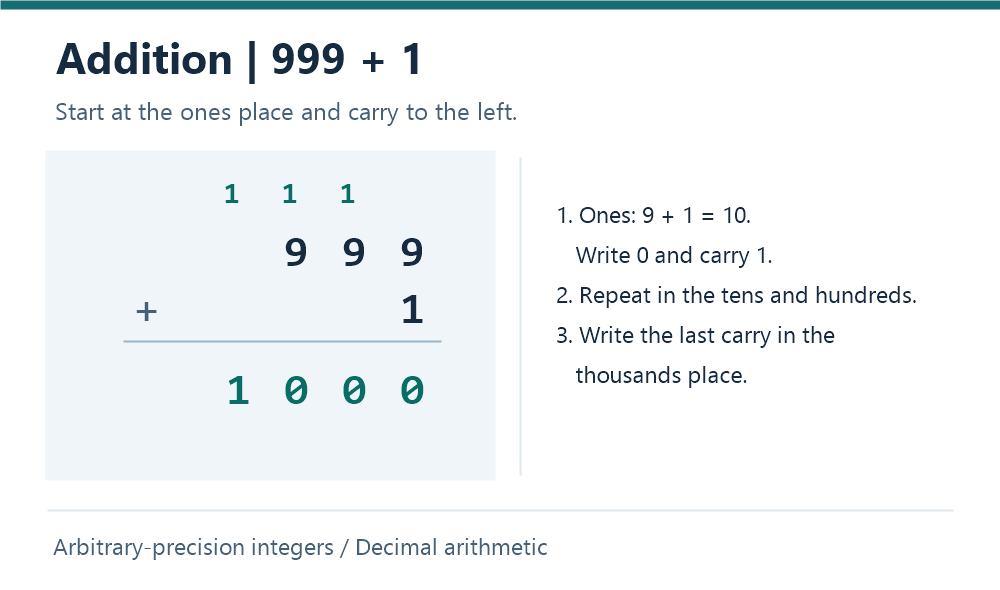
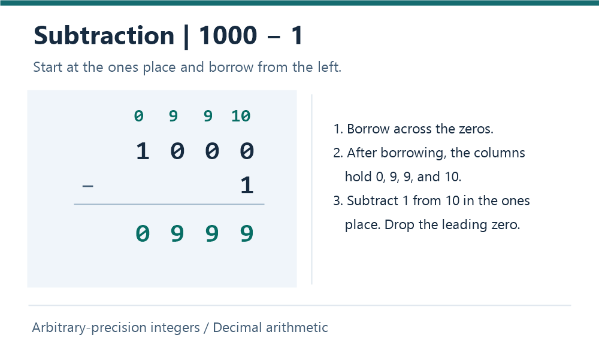
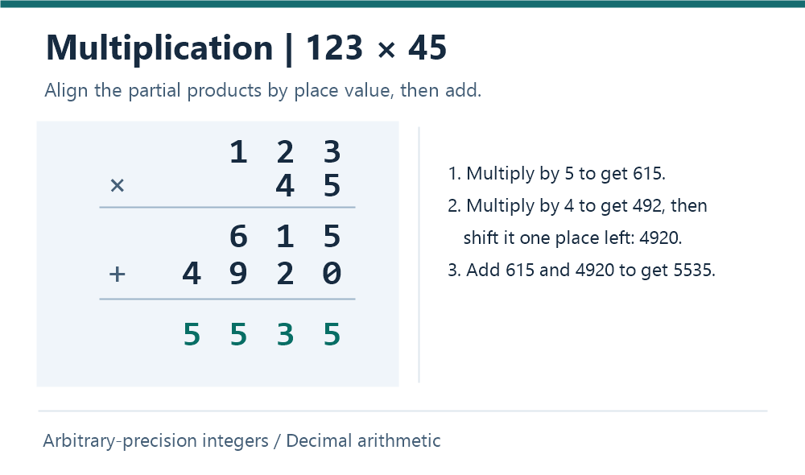
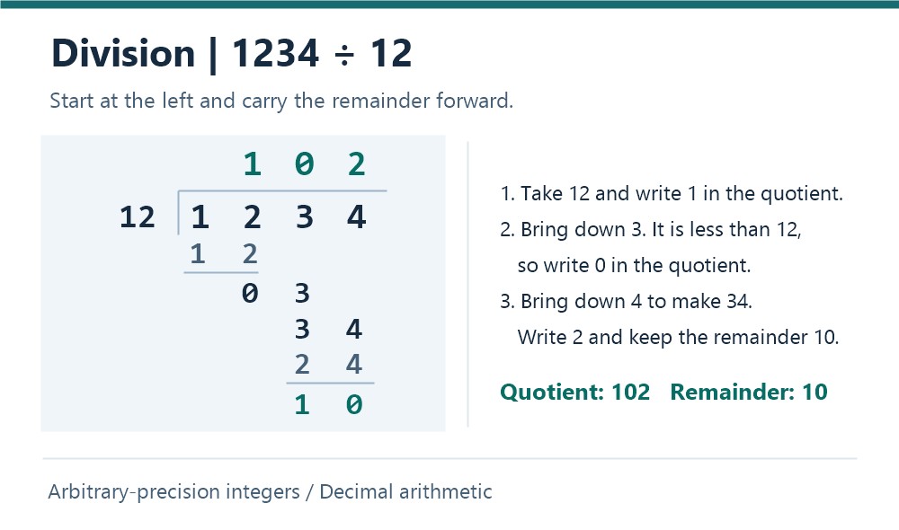

# When Integers Outgrow Their Types

## Why do we need arbitrary precision?

In the Amphoreus storyline of *Honkai: Star Rail*, Phainon's Flame-Chase Journey reaches its 33,550,336th cycle. Over 33 million sounds like a lot. Can a C++ `int` hold that cycle number?

On common C++ implementations, a signed 32-bit `int` holds up to 2,147,483,647, about 2.15 billion. A signed 64-bit `long long` holds up to 9,223,372,036,854,775,807, about 9.22 quintillion. The cycle number fits in either type. Suppose we add 64 copies of that count. The total, 2,147,221,504, still fits in an `int`. Add a 65th copy and the total rises to 2,180,771,840, so it needs a wider type such as `long long`.

Now see which types can hold the square and the cube of that cycle number.

- **Square it.** The result is 1,125,625,045,712,896. It exceeds the 32-bit `int` limit and fits in a 64-bit `long long`.
- **Cube it.** The result is 37,765,098,493,683,020,333,056. This is the first positive integer power that exceeds the 64-bit `long long` limit. Arbitrary-precision arithmetic can compute every digit exactly.

Python’s built-in `int` supports arbitrary precision. You can enter `33_550_336 ** 3` directly and get the exact value above. Python handles the extra digits for you.

A wider fixed-width type buys more room. If the input consists of two hundred-digit integers, we can store their digits in sequences and do the arithmetic one column at a time, just as we would on paper.

## How to store a large integer

Use an `int` array to store the digits. `a[0]` holds the digit count. Starting at `a[1]`, store the ones, tens, hundreds, and so on. For `2026`, `a[0]` is `4` and `a[1]` through `a[4]` are `6, 2, 0, 2`. Read the string backward and subtract `'0'` from each character. Print from the highest digit down, skipping leading zeros and printing one `0` for zero.

Why store the least significant digit first? Column addition and subtraction start at the ones place, and carries and borrows move to the next higher place. With this layout, the loop can start at index `1` and move forward. `a[i]` and `b[i]` refer to the same place value even if the numbers have different lengths. In `999 + 1`, the extra thousands digit simply goes in the next free slot.

Put the three C++ blocks in one file, in order. Enter `999 1` to get `1000`.

```cpp
#include <iostream>
#include <string>
using namespace std;

const int MAX_DIGITS = 1000;
// Reserve index 0 for the length and ten extra slots for multiplication.
const int CAPACITY = MAX_DIGITS + 11;
int a[CAPACITY], b[CAPACITY], c[CAPACITY];

void read_digits(const string& s, int a[]) {
    // Read from right to left, starting with the ones digit at index 1.
    a[0] = int(s.size());
    for (int i = 1; i <= a[0]; i++) {
        a[i] = s[a[0] - i] - '0'; // Store the ones digit at a[1]
    }
}

void print_digits(const int a[]) {
    // Start at the highest digit and keep at least one digit.
    int i = a[0];
    while (i > 1 && a[i] == 0) i--; // Skip leading zeros
    for (; i >= 1; i--) cout << a[i];
}
```

## Addition and subtraction

In `999 + 1`, the first column gives 10. Write down 0 and carry 1 into the next column. The carry reaches the hundreds column and then adds a new digit, giving `1000`. In each column, the remainder modulo 10 is the output digit and integer division by 10 gives the carry. A missing digit in the shorter operand counts as zero.



*Illustration generated by AI.*

For subtraction, ignore leading zeros and compare the lengths first. If the lengths match, compare the digits starting with the most significant one. In `1000 - 1`, the ones column gives −1. Add 10 to get 9 and borrow 1 from the tens column. The borrow travels all the way to the thousands column. Strip the leading zero from `0999` to get `999`. The code requires the first operand to be at least as large as the second.



*Illustration generated by AI.*

```cpp
void add(const int a[], const int b[], int c[]) {
    // carry holds the carry from the previous column.
    int carry = 0;
    c[0] = a[0] > b[0] ? a[0] : b[0];
    for (int i = 1; i <= c[0]; i++) {
        // Treat missing digits in the shorter operand as zero.
        int sum = carry;
        if (i <= a[0]) sum += a[i];
        if (i <= b[0]) sum += b[i];
        c[i] = sum % 10;
        carry = sum / 10;
    }
    // Append a new digit if there is a final carry.
    if (carry > 0) c[++c[0]] = carry;
}

// Requires a >= b
void subtract(const int a[], const int b[], int c[]) {
    int borrow = 0;
    c[0] = a[0];
    for (int i = 1; i <= c[0]; i++) {
        // Subtract the borrow from the preceding column first.
        int diff = a[i] - borrow;
        if (i <= b[0]) diff -= b[i];
        borrow = 0;
        if (diff < 0) {
            // Borrowing from the next column adds 10 to this column.
            diff += 10;
            borrow = 1;
        }
        c[i] = diff;
    }
}
```

## Multiplication and division

To multiply a large integer by an ordinary integer, multiply each digit by the factor and add the carry from the previous column. For `123 × 45`, the successive column totals are `135`, `103`, and `55`. The first three output digits are 5, 3, and 5, starting from the ones digit. The final carry of 5 gives `5535`.

Multiplying two large integers follows the same long multiplication method. For digit `j` of the second operand, compute a partial product and shift it left by `j` decimal places before adding it to the result. For instance, `123 × 45` becomes `123 × 5 + (123 × 4) × 10`. An implementation can also accumulate each pairwise product in its output column and propagate the carries in a separate pass.



*Illustration generated by AI.*

Division starts at the most significant digit. At each step, multiply the previous remainder by 10 and add the next digit. Dividing that value gives the next quotient digit. Carry the new remainder forward. For `1234 ÷ 12`, the quotient digits are 0, 1, 0, and 2 in that order. Discard the leading zero and keep the middle zero. The quotient is `102` and the remainder is `10`.



*Illustration generated by AI.*

```cpp
void multiply_small(const int a[], long long factor, int c[]) {
    long long carry = 0;
    c[0] = a[0];
    for (int i = 1; i <= a[0]; i++) {
        long long value = a[i] * factor + carry;
        c[i] = int(value % 10);
        carry = value / 10;
    }
    // A multi-digit factor can leave a multi-digit carry.
    while (carry > 0) {
        c[++c[0]] = int(carry % 10);
        carry /= 10;
    }
}

long long divide_small(const int a[], long long divisor, int c[]) {
    long long remainder = 0;
    c[0] = a[0];
    for (int i = a[0]; i >= 1; i--) {
        // Multiply the old remainder by 10 and bring down the next digit.
        long long value = remainder * 10 + a[i];
        // Integer division gives the quotient digit. Carry the remainder forward.
        c[i] = int(value / divisor);
        remainder = value % divisor;
    }
    return remainder;
}

int main() {
    string s, ss;
    if (!(cin >> s >> ss)) return 0;
    if (s.size() > MAX_DIGITS || ss.size() > MAX_DIGITS) return 0;

    // Convert both strings to digit arrays before adding.
    read_digits(s, a);
    read_digits(ss, b);
    add(a, b, c);
    print_digits(c);
    cout << '\n';
    return 0;
}
```

## C++ details and edge cases

Start with `0000 + 0`, `1000 - 1000`, `7 ÷ 12`, and `123 × 0`. They exercise leading zeros in the input, a zero difference, a zero quotient, and multiplication by zero. The examples assume validated input. Inputs must contain between 1 and 1,000 decimal digits, and subtraction requires the first operand to be at least as large as the second. The factor can be zero and the divisor must be positive. Both are capped at one billion. Each column's intermediate value uses `long long`.

The array stores a nonnegative integer. To support signed integers, store the sign separately from the magnitude. Adding two numbers with the same sign means adding their magnitudes. For different signs, subtract the smaller magnitude from the larger one and keep the sign of the number with the larger magnitude. Normalize a zero result to `0`.

For operands with `n` and `m` digits, addition and subtraction each take `O(max(n, m))` time. Long multiplication processes every pair of digits in `O(nm)` time. With a fixed-width factor or divisor, the multiplication and division examples above take `O(n)` time.

## Where these algorithms are used

Programming contests sometimes ask for the full value of `100!`, a large binomial coefficient, or a large Fibonacci number. To compute `100!`, start at 1 and multiply by each integer from 2 through 100. To compute a Fibonacci number, keep the last two terms and repeatedly add them. Binomial coefficients can be computed by adding neighboring entries in the previous row of Pascal's triangle.

Before choosing a representation, estimate the size of both the intermediate values and the final result, then check what the problem asks you to print. If all values fit in a built-in integer type, use it. If the problem asks for a residue and the recurrence lets you reduce after each step, the values can stay small. When you need the exact integer and it exceeds the available types, the same column arithmetic you do on paper works in a program.

### Try it yourself

Start with the addition example for the first problem. Then adapt `main` to call the division function for the second. Run the samples and try submitting your code on Luogu.

- **P1601 Arbitrary-precision addition**
  Add two nonnegative integers. Try `0 + 0` and `999 + 1`.
  https://www.luogu.com.cn/problem/P1601
- **P1480 A/B Problem (Arbitrary-precision division I)**
  Print the integer quotient only. The dividend can have up to 5,001 digits,
  so set `MAX_DIGITS` to at least 5001.
  https://www.luogu.com.cn/problem/P1480
