# DFS 树及其在图连通性中的应用

## 一、DFS 树

在介绍 DFS 树之前，我们先从 DFS 说起，看看它怎样沿着图中的边逐步探索。

深度优先搜索（DFS）是一种遍历图的方法，具体来说，从一个顶点出发，选择尚未访问的相邻顶点继续深入；当没有未访问的相邻顶点时，就回退到上一个顶点，继续探索其他分支，直到本次搜索能够到达的顶点都被访问。

我们先看一个具体例子：

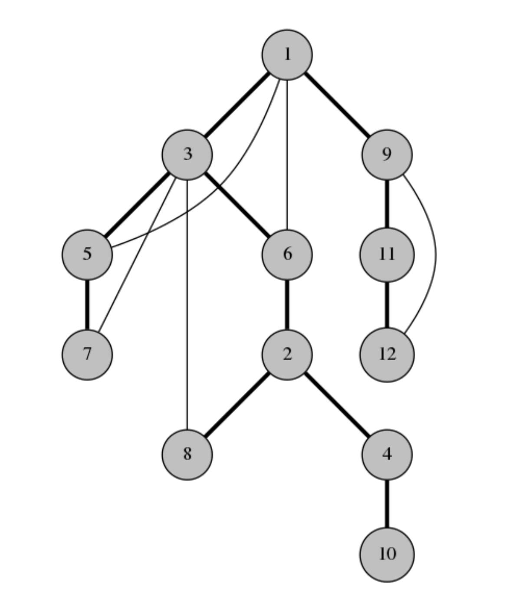

从节点 1 开始，依次访问节点 3、5、7。节点 7 的相邻节点都已访问，因此依次回退到节点 5、3，再访问节点 6。以此类推，直到遍历完所有节点。本次遍历的顺序为：1-3-5-7-6-2-8-4-10-9-11-12。

### 无向图的 DFS 树

当我们把 DFS 时首次访问新节点的边加粗记录下来，可以得到这张图：

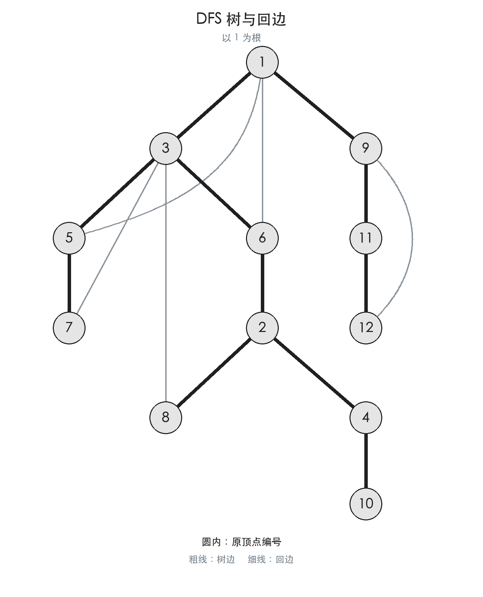

这就是标题中的 DFS 树。

#### 树边和回边

我们先看一下无向图的 DFS 树的边的分类。

树边：构成 DFS 树的边，即图中的粗线。

回边：其他不参与 DFS 树构建的边，即图中的细线。

无向图的回边只会连接祖先和后代，不会横跨两棵互不包含的 DFS 子树：否则，搜索其中一棵时就会沿边发现另一棵。

### 有向图的 DFS 树

有向图的 DFS 树的构造方式与无向图类似，但从一个节点出发不一定能访问所有节点。例如，图中从 1 出发只能访问 1、2、3。此时需要从尚未访问的顶点 4 继续搜索，两次搜索形成的 DFS 树共同组成一片 DFS 森林。

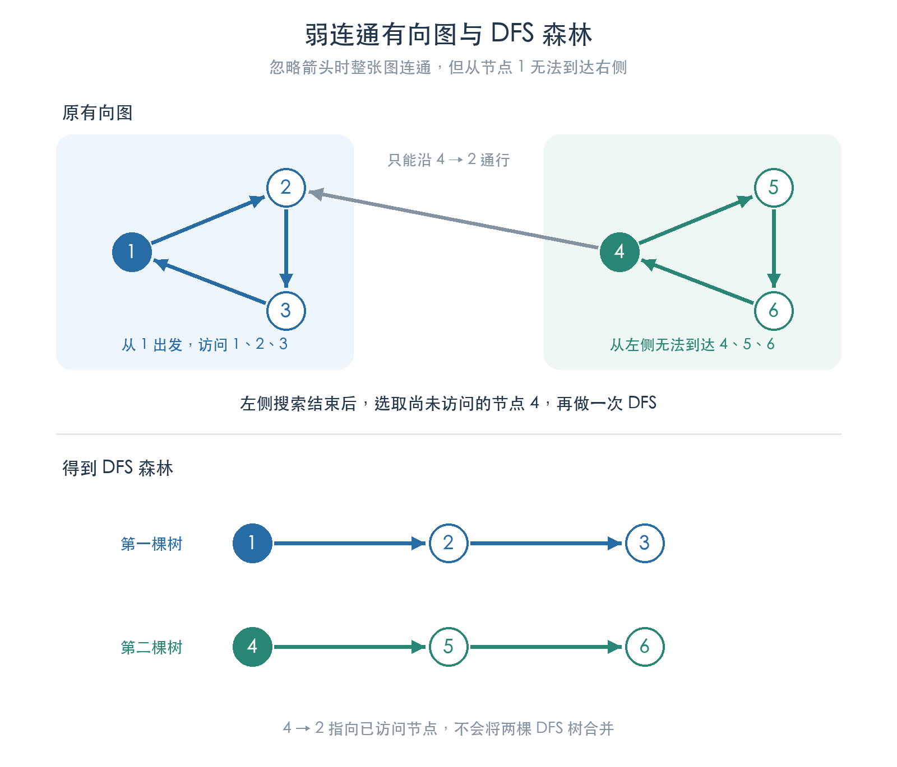

#### 前向边、后向边（返祖边）和横叉边

下面用另一张有向图展示 DFS 树和各类非树边：

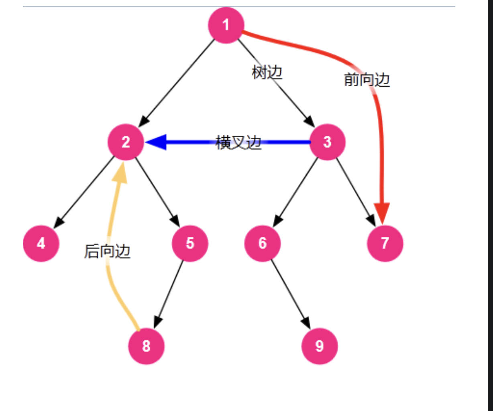

* 从祖先指向后代的非树边，称为 **前向边** 。

* 从后代指向祖先的非树边，称为 **后向边（返祖边）** 。

* 两端无祖先后代关系的非树边，称为 **横叉边** 。

### DFN

DFN（Depth-First Number）是深度优先搜索（DFS）中，顶点首次被访问时的编号，也称为 DFS 序或发现时间。
每当首次访问一个顶点时，就将计数器加一，并记录该顶点的编号。

以上面的无向图 DFS 树为例，可以求出每个节点对应的 dfn 值：

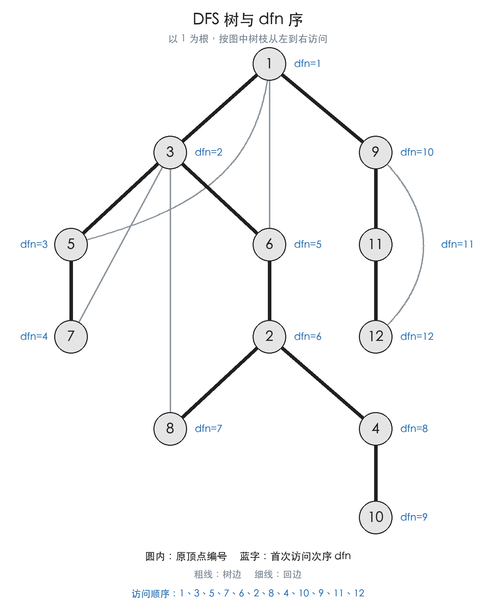

## 二、无向图的连通性

有了 DFS 树，接下来看看它怎样帮助我们判断图的连通性。

### 割点

定义：在无向图中，删去后使得连通分量数增加的点称为 **割点** 。

定义中的连通分量是指极大连通子图。

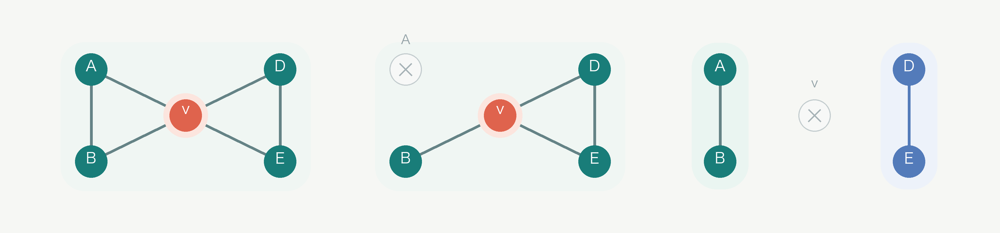

图中的 V 就是一个割点。去除节点 V 后，原来的一个连通分量分成了两个连通分量。

如何利用 DFS 树快速求出一张图的割点呢？

有一个强大的算法： **Tarjan** 。

#### Tarjan 求割点

下面先讨论不含重边的无向图。设 $T(x)$ 为以 $x$ 为根的 DFS 子树，$T'(x)$ 为 $x$ 所在连通分量中除去 $T(x)$ 后剩余的部分。

设 $x$ 不为 DFS 树的根，则 $T'(x)$ 不为空。

删除 $x$ 后，它的各棵子树内部仍然连通，$T'(x)$ 也仍然连通。由于无向图的 DFS 树中不存在横跨两棵互不包含的子树的边，$x$ 是割点当且仅当存在一个子节点 $y$，使得 $T(y)$ 无法绕过 $x$ 与 $T'(x)$ 连通。

以下图为例，$y$ 是 $x$ 的一个子节点，$u\in T(y)$，$v\in T'(x)$。如果 $T(y)$ 能绕过 $x$ 到达 $T'(x)$，就必然存在一条跨越这两部分的回边 $(u,v)$。根据无向图回边的性质，$v$ 一定是 $x$ 的严格祖先，也就是不包括 $x$ 自身的祖先。


因此，只要存在一棵子树 $T(y)$，其中没有节点通过回边连接到 $x$ 的严格祖先，$x$ 就是割点。其他子树是否能连接到 $x$ 的严格祖先，并不影响这个结论。

为了快速判断这一条件，定义 $low_x$：从 $x$ 出发，沿零条或多条树边向下，再经过至多一条回边所能到达的节点的最小 $dfn$ 值。这里的回边不包括进入当前节点的那条树边。

它可以通过以下递推式计算：

$$
low_x=\min\left(
\{dfn_x\}
\cup\{dfn_a\mid (x,a)\text{ 是指向祖先的回边}\}
\cup\{low_y\mid y\text{ 是 }x\text{ 的 DFS 子节点}\}
\right)
$$

首次访问 $x$ 时，令 $low_x=dfn_x$；遇到指向祖先 $a$ 的回边时，用 $dfn_a$ 更新 $low_x$；递归搜索子节点 $y$ 返回后，用 $low_y$ 更新 $low_x$。即使不存在回边，最小值也有定义，因为它始终包含 $dfn_x$。

对于 $x$ 的一个子节点 $y$，$low_y<dfn_x$ 表示 $T(y)$ 能通过回边连接到 $x$ 的严格祖先；$low_y\ge dfn_x$ 则表示它无法绕过 $x$ 与 $T'(x)$ 连通。

最终得到非根节点的割点判定法则：

> 非根节点 $x$ 是割点，当且仅当存在一个 DFS 子节点 $y$，满足 $low_y\ge dfn_x$。

对于根节点，它是割点当且仅当它在 DFS 树中的子节点数至少为二，即 $son_x\ge 2$。此时删除根节点后，各棵子树之间不再连通。

#### 代码实现

时间复杂度：$O(n+m)$

```cpp
#include<bits/stdc++.h>
using namespace std;
const int N=1e5+10;
vector<int>e[N];
int n,m;
int dfn[N],low[N],buc[N],tim;
// buc[i] 代表是否是割点
void tarjan(int u,int fa)
{
    // 首次访问 u：dfn 记录访问顺序，low 初始只能到达自己。
    dfn[u]=low[u]=++tim;
    // son 只统计 DFS 树中的子节点，用于单独判断根节点。
    int son=0;
    for(auto v : e[u])
    {
        // 当前示例不含重边，跳过通向父节点的树边。
        if(v==fa)   continue;
        if(!dfn[v])
        {
            son++;
            tarjan(v,u);
            low[u]=min(low[u],low[v]);
            // 子树无法绕过 u 到达其严格祖先时，非根节点 u 是割点。
            if(low[v]>=dfn[u]&&fa!=0)
                buc[u]=1;
        }
        // 遇到通向祖先的回边，用祖先的 dfn 更新 low。
        else low[u]=min(low[u],dfn[v]);
    }
    // 根节点有至少两棵 DFS 子树时才是割点。
    if(son>=2&&fa==0)
        buc[u]=1;
}
int main()
{
    scanf("%d%d",&n,&m);
    for(int i=1;i<=m;i++)
    {
        int u,v;
        scanf("%d%d",&u,&v);
        e[u].push_back(v);
        e[v].push_back(u);
    }
    for(int i=1;i<=n;i++)
    {
        // 可能不是连通图
        if(!dfn[i])
            tarjan(i,0);
    }
    int ans=0;
    for(int i=1;i<=n;i++)
        ans+=buc[i];
    printf("%d\n",ans);//输出割点个数
    for(int i=1;i<=n;i++)
        if(buc[i])  printf("%d ",i);
    //分别输出割点
    return 0;
}
```

### 割边

定义：在无向图中，删去后使连通分量数增加的边称为 **割边** ，也称为 **桥** 。


如上图所示，去除 C-D 这条边后，原图分成两个连通分量。

那我们如何求解割边呢？

仍然是 Tarjan 算法。

#### Tarjan 求割边

求割边的思路与求割点相似 ~~（不然为什么也叫 Tarjan）~~。

首先，有一个比较显然的事实：如果一条边 $e$ 是割边，那么它一定是树边。除去一条非树边，仍然可以通过树边保持原有的连通性。

了解割点的求法后，可以得出割边的判定法则：

> 对于树边 $e(u,v)$，假设 $v$ 是 $u$ 的子节点，则 $e(u,v)$ 是割边当且仅当 $dfn_u < low_v$。

这里没有等号，是因为删去的是边而非节点：只要 $v$ 可以绕过边 $e$ 到达 $u$，$e$ 就不是割边。

下面是代码实现：

时间复杂度： $O(N+M)$

```cpp
#include<bits/stdc++.h>
using namespace std;
const int N=1e5+10;
vector<int>e[N];
int n,m,ans;
int dfn[N],low[N],tim;
void tarjan(int u,int fa)
{
    // low[u] 是 u 的子树经至多一条回边能到达的最小 dfn。
    dfn[u]=low[u]=++tim;
    int son=0;
    for(auto v : e[u])
    {
        // 此版本假设没有重边，因此可按父节点跳过来时的边。
        if(v==fa)   continue;
        if(!dfn[v])
        {
            son++;
            tarjan(v,u);
            low[u]=min(low[u],low[v]);
            // 子树无法经回边到达 u 或其祖先，这条树边就是桥。
            if(low[v]>dfn[u])
                ans++;
        }
        // 已访问的祖先提供一条绕开树边的回边。
        else low[u]=min(low[u],dfn[v]);
    }
}
int main()
{
    scanf("%d%d",&n,&m);
    for(int i=1;i<=m;i++)
    {
        int u,v;
        scanf("%d%d",&u,&v);
        e[u].push_back(v);
        e[v].push_back(u);
    }
    for(int i=1;i<=n;i++)
    {
        if(!dfn[i])
            tarjan(i,0);
    }
    printf("%d\n",ans);
    return 0;
}
```

#### 处理重边

当这张图出现重边时，这些重边一定不是割边。但此时代码并没有考虑到这件事情。

解决方法：记录边的编号。建图时，在 vector 中存入边的编号。这样把 **不用父节点更新** 改为 **不用来时的边更新** 。

修改后的代码：

```cpp
#include<bits/stdc++.h>
using namespace std;
const int N=1e5+10;
struct Edge
{
    int v,id;
};
vector<Edge>e[N];
int n,m,ans;
int dfn[N],low[N],tim;
void tarjan(int u,int in_edge)
{
    dfn[u]=low[u]=++tim;
    for(auto edge : e[u])
    {
        int v=edge.v;
        int id=edge.id;
        // 只跳过进入 u 的那条边，不跳过其他连接父节点的边
        if(id==in_edge)
            continue;
        if(!dfn[v])
        {
            tarjan(v,id);
            low[u]=min(low[u],low[v]);
            // 只有严格大于 dfn[u]，这条编号为 id 的树边才是桥。
            if(low[v]>dfn[u])
                ans++;
        }
        else
        {
            // 其他平行边仍可作为回边，降低 low[u]。
            low[u]=min(low[u],dfn[v]);
        }
    }
}
int main()
{
    scanf("%d%d",&n,&m);
    for(int i=1;i<=m;i++)
    {
        int u,v;
        scanf("%d%d",&u,&v);
        // 同一条无向边的两个方向使用相同编号
        e[u].push_back({v,i});
        e[v].push_back({u,i});
    }
    for(int i=1;i<=n;i++)
    {
        if(!dfn[i])
            tarjan(i,0);
    }
    printf("%d\n",ans);
    return 0;
}
```

### 深入拓展：树上差分求割边

由于篇幅有限，无法再详细讲解树上差分的内容，本节作为拓展内容，仅简要介绍这种做法。

> 结论：当且仅当树边 $(u,v)$ 不存在连接其祖先和子孙节点的回边时，它是割边。也就是说，树边 $(u,v)$ 是桥当且仅当此时没有回边跨越它。

所以求割边的方法为：

1. 建立这张图的 DFS 树。

2. 对每一条树边 $(u,v)$，寻找是否有一条回边跨越 $(u,v)$，如果没有，它就是割边。

对于第二步，对每条从后代 $x$ 连向祖先 $y$ 的回边，令 $d[x]$ 加一，令 $d[y]$ 减一，再自底向上累加子树内的 $d$ 值。非根节点 $v$ 的子树和，就是连接它与父节点的树边被跨越的次数；若为零，则该树边是桥。

时间复杂度： $O(N+M)$

## 三、有向图的连通性

无向图常用于描述双向通道等关系，而有向图可以描述单向通道、任务的先后顺序等关系。

引入方向后，“连通”可以分为三个层次：有的图任意两点都能互相到达，有的图只能保证“总有一个方向能走”，还有的图必须先把箭头全擦掉才连得上。

按要求从弱到强，这三个层次分别称为弱连通、单向连通和强连通。

1. 弱连通：把所有有向边当成无向边之后，图是连通的。方向信息全部抛弃，只探究“有没有路”。

   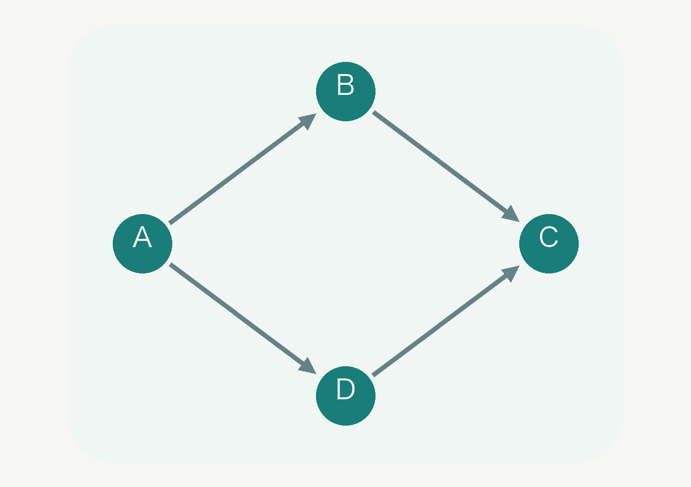

2. 单向连通：任意两点 $u,v$，至少有一个方向可达（$u \to v$ 或 $v \to u$）。比第一层多要了一样东西：不光要有路，还得顺着箭头走得到。所以它是弱连通的加强：弱连通的图未必单向连通。

   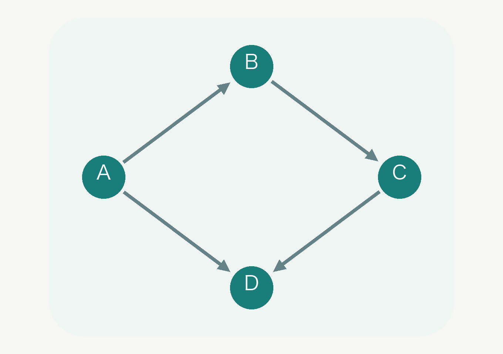

3. 强连通：任意两点 $u,v$，都有 $u \to v$ 且 $v \to u$。到这一层，要求变成双向的：任意两点之间必须能“来回走通”。

   

当研究一张图时，希望尽可能简化信息，而强连通节点之间相互可达的性质，正好可以用来压缩信息。所以接下来我们重点关注强连通相关的性质。

### 强连通分量

强连通图：满足任意两点强连通的有向图称为 **强连通图** 。它等价于图中任意一个节点都能到达其他所有节点。

强连通分量：有向图的极大强连通子图称为 **强连通分量** （Strongly Connected Component，SCC）。

一个强连通分量中的任意两点可以相互到达，构成一个整体。本节先介绍如何找到一张有向图中的所有 SCC，随后再介绍缩点。

#### Tarjan 求 SCC

我们回到刚才的有向图，看看不同类型的边会怎样影响 SCC 的识别。

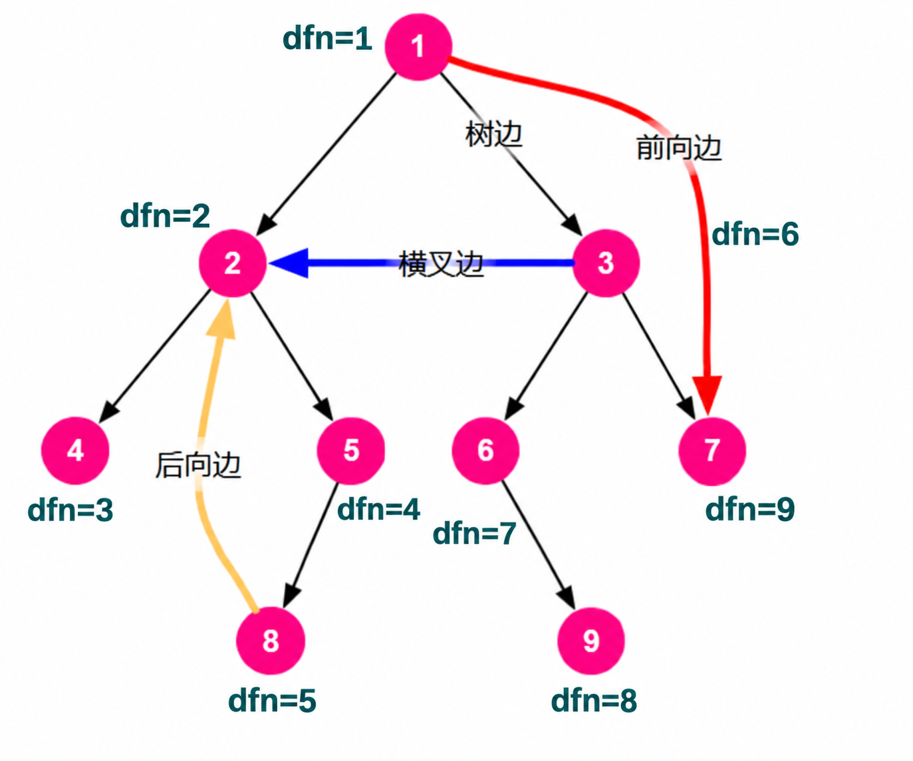

分别讨论一条边 $e(u \to v)$ 在不同情况下的作用。

树边负责首次访问新节点，并为它分配更大的时间戳。节点的 $dfn$ 一经确定就不再改变；后向边和指向栈中节点的横叉边可能更新的是下面要介绍的 $low$ 值。

* 前向边不影响强连通性。所以可以忽略前向边。

* 后向边 $u\to v$ 与 DFS 树上从祖先 $v$ 到后代 $u$ 的路径构成一个有向环，因此这条树路径上的所有节点都属于同一个 SCC，但这个 SCC 还可能包含其他节点。在本图中，节点 2、5、8 恰好构成一个完整的 SCC。
* 横叉边使 $u$ 可达 $v$，如果 $v$ 可达 $u$，那么此横叉边是有用的横叉边。

一个 SCC 在 DFS 树上一定存在一个深度最小的节点。找出这个节点，就可以进一步确定对应的 SCC。

与无向图求割点时不同，这里需要用一个栈保存已经访问、但尚未归入某个 SCC 的节点。首次访问节点 $u$ 时，令 $low_u=dfn_u$，并将 $u$ 入栈。

对于一条边 $u \to v$，按以下规则维护 $low$：

* 如果 $v$ 尚未访问，先递归搜索 $v$，返回后令 $low_u=\min(low_u,low_v)$。
* 如果 $v$ 已经访问且仍在栈中，令 $low_u=\min(low_u,dfn_v)$。
* 如果 $v$ 已经出栈，说明它所属的 SCC 已经确定，这条边不参与 $low_u$ 的更新。

遍历完 $u$ 的所有出边后，如果 $low_u=dfn_u$，就找到了一个 SCC 在 DFS 树上最浅的节点。从栈顶依次弹出节点，直到弹出 $u$，这些节点共同组成一个 SCC。

下面用一个简单的例子来模拟一下过程。

例图包含两个环：$A \to B \to C \to A$ 和 $D \to E \to D$，另外有一条边 $B \to D$。从 $A$ 开始搜索，在 $B$ 处先访问 $C$，再访问 $D$，因此首次访问顺序是 $A,B,C,D,E$。

图中橙色突出正在处理或更新的位置，浅色节点尚未访问，背景色块标出已经确定的 SCC。下文写出的栈均从左到右表示栈底到栈顶；这是 Tarjan 维护的节点栈，不是递归调用栈。

##### 1. 访问 A、B、C，初始化 low

沿树边依次访问 $A,B,C$，首次访问每个节点时，都令它的 $low$ 等于自己的 $dfn$：

$$
(dfn_A,dfn_B,dfn_C)=(1,2,3),\qquad
(low_A,low_B,low_C)=(1,2,3)
$$

此时刚进入 $C$，尚未检查它指向 $A$ 的边，栈为 $[A,B,C]$。

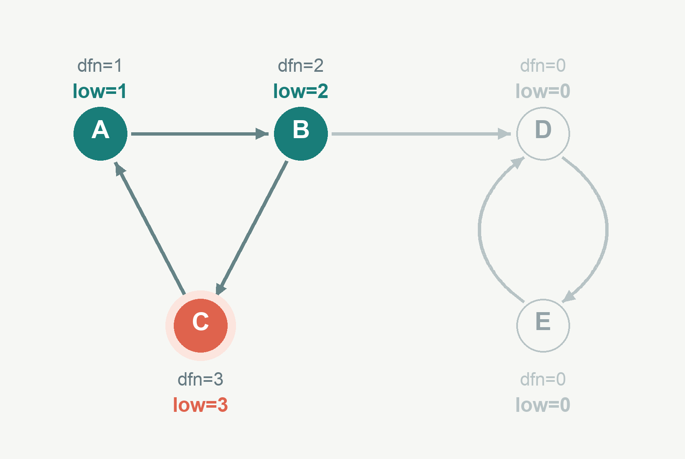

##### 2. 检查 C → A，更新 C 的 low

$A$ 已经访问，并且仍在栈中，因此用 $dfn_A$ 更新 $low_C$：

$$
low_C=\min(low_C,dfn_A)=\min(3,1)=1
$$

这说明 $C$ 可以沿这条边回到更早访问的 $A$。此刻尚未回溯到 $B$，所以 $low_B$ 仍然为 $2$，栈仍为 $[A,B,C]$。

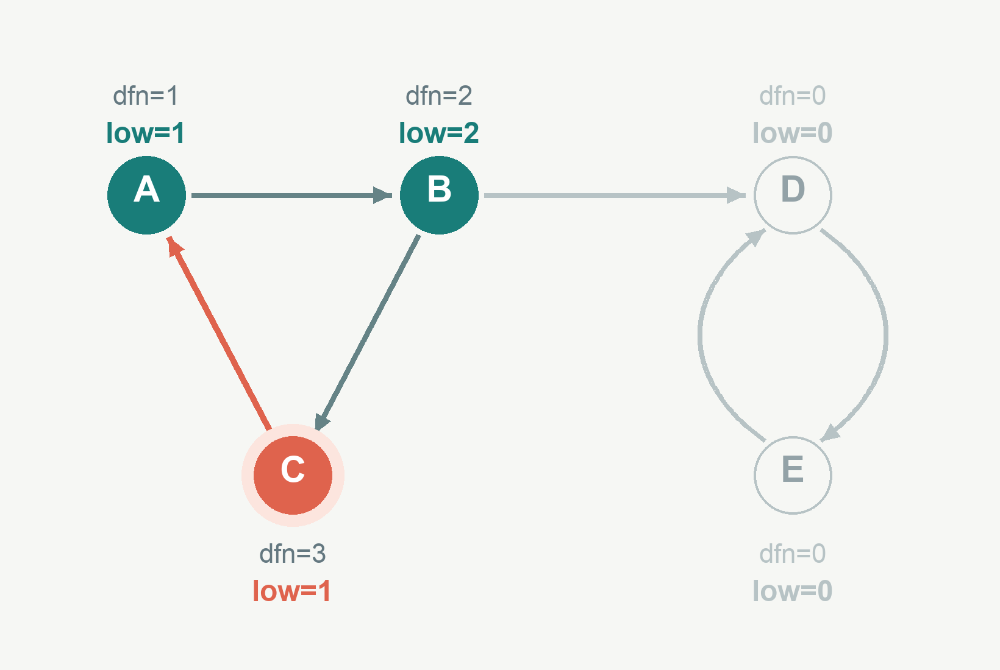

##### 3. 返回 B，再访问 D、E

$C$ 的出边已经检查完毕。因为 $low_C=1\ne dfn_C=3$，不能在 $C$ 处弹出一个 SCC，$C$ 继续留在节点栈中。

递归返回 $B$ 后，用子节点的 $low$ 更新父节点：

$$
low_B=\min(low_B,low_C)=\min(2,1)=1
$$

接着沿 $B \to D \to E$ 继续搜索，初始化 $dfn_D=low_D=4$、$dfn_E=low_E=5$。栈变为 $[A,B,C,D,E]$。

这里可以看到，虽然 $C$ 的递归调用已经结束，但它仍在 Tarjan 的节点栈中，等待所属的 SCC 被确定。


##### 4. 检查 E → D，更新 E 的 low

$D$ 已经访问，并且仍在栈中，因此：

$$
low_E=\min(low_E,dfn_D)=\min(5,4)=4
$$

此时 $low_E=4\ne dfn_E=5$，所以 $E$ 还不能作为一个 SCC 的最浅节点。栈仍为 $[A,B,C,D,E]$。

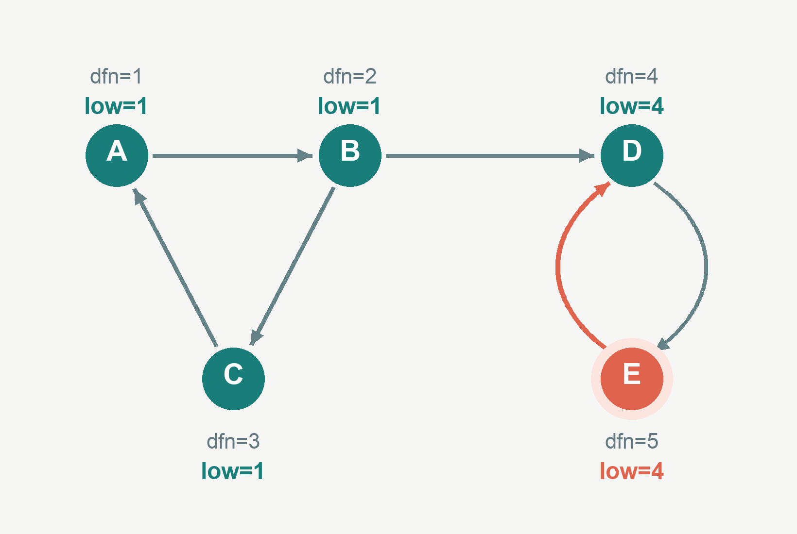

##### 5. 返回 D，弹出第一个 SCC

$E$ 返回 $D$，更新：

$$
low_D=\min(low_D,low_E)=\min(4,4)=4
$$

$D$ 的所有出边已经处理完毕，并且 $low_D=dfn_D=4$，因此从栈顶依次弹出 $E,D$，得到第一个 SCC：$\{D,E\}$。

接着返回 $B$，更新 $low_B=\min(1,4)=1$，数值保持不变。$B$ 能到达 $D$，但 $D,E$ 无法返回 $A,B,C$，所以两个环不会合并为同一个 SCC。此时栈中只剩下 $[A,B,C]$。


##### 6. 返回 A，弹出第二个 SCC

$B$ 的搜索结束，因为 $low_B=1\ne dfn_B=2$，它继续留在栈中。返回 $A$ 后：

$$
low_A=\min(low_A,low_B)=\min(1,1)=1
$$

$A$ 的所有出边已经处理完毕，并且 $low_A=dfn_A=1$。从栈顶依次弹出 $C,B,A$，得到第二个 SCC：$\{A,B,C\}$。此时栈为空，本次搜索结束。


整个过程中，$dfn$ 始终不变，发生变化的是 $low$。两种更新方式也要区分：递归搜索子节点后，使用子节点的 $low$；遇到已访问且仍在栈中的节点，使用该节点的 $dfn$。只有处理完当前节点的所有出边，才检查 $low_u=dfn_u$ 是否成立，并决定是否弹出一个 SCC。

至此，我们已经学会如何求出每一个 SCC 了。当我们把一个 SCC 缩成一个点后，如何保留原图中重要的连通性信息呢？

#### 缩点

缩点时，将每一个 SCC 替换为一个新的点，同一个 SCC 中的边全部删除，保留原来两端在不同 SCC 的边，这样就得到缩点图。

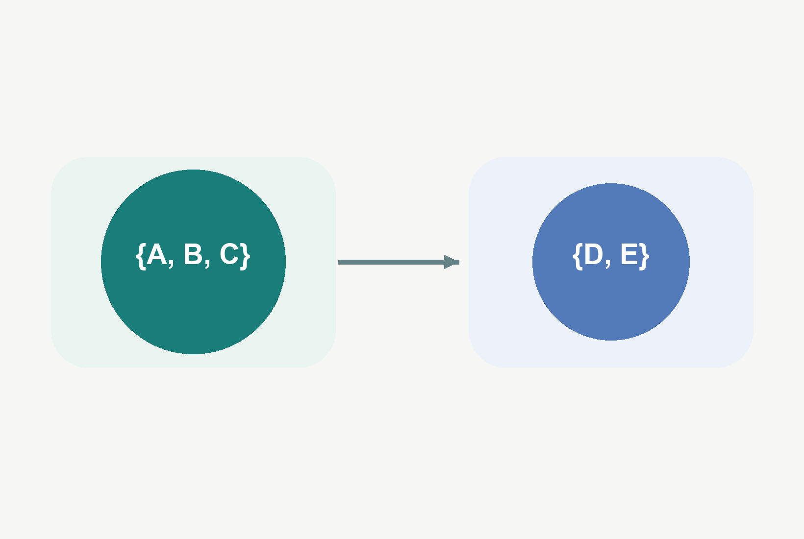

缩点图有一个重要的性质：它一定是 **有向无环图** （DAG）。

更通俗来说，DAG 是“只能顺着箭头走，而且怎么走都绕不回原点”的图。

可以把它想成任务之间的先后关系，这件事完成后，才能做下一件事，但一定不会出现两件事情相互依赖的情况。

这样的图逻辑清晰，可以和拓扑排序、动态规划等算法相结合，有很多的应用方向。

以下是求 SCC 并缩点的代码。

Tarjan 求 SCC 的时间复杂度为 $O(N+M)$，构建未去重的缩点图也需要 $O(N+M)$。下面的代码还会对各节点的出边排序去重，因此整体最坏时间复杂度为 $O(N+M\log M)$，空间复杂度为 $O(N+M)$。其中 $N$ 为原图的节点数，$M$ 为原图的边数。

```cpp
#include<bits/stdc++.h>
using namespace std;
vector<int>stk;
int top=0;
vector<vector<int>>graph;
vector<int>dfn,low,belong;
vector<bool>inStack;
int timer=0;
int sccCount=0;
void tarjan(int u)
{
    // 首次访问 u：分配发现时间，并把它压入待确定 SCC 的节点栈。
    dfn[u]=low[u]=++timer;
    stk[top++]=u;
    inStack[u]=true;
    for(int v : graph[u])
    {
        if(dfn[v]==0)
        {
            // 树边：先搜索子节点，再用子节点的 low 更新 u。
            tarjan(v);
            low[u]=min(low[u],low[v]);
        }
        else if(inStack[v])
        {
            // 指向栈中节点的边：只能用该节点的 dfn 更新。
            low[u]=min(low[u],dfn[v]);
        }
    }
    // low[u] == dfn[u] 表示 u 是一个 SCC 在 DFS 树中的最浅节点。
    if(low[u]==dfn[u])
    {
        ++sccCount;
        // 从栈顶弹到 u 为止，弹出的节点属于同一个 SCC。
        while(true)
        {
            int v=stk[--top];
            inStack[v]=false;
            belong[v]=sccCount;
            if(v==u)
                break;
        }
    }
}
int main()
{
    int n,m;
    cin>>n>>m;
    graph.resize(n+1);
    dfn.assign(n+1,0);
    low.assign(n+1,0);
    belong.assign(n+1,0);
    inStack.assign(n+1,false);
    stk.resize(n+1);
    for(int i=0;i<m;i++)
    {
        int u,v;
        cin>>u>>v;
        graph[u].push_back(v);
    }
    // 求所有强连通分量。
    for(int u=1;u<=n;u++)
    {
        if(dfn[u]==0)
            tarjan(u);
    }
    // 构建缩点图。
    vector<vector<int>>dag(sccCount+1);
    vector<int>sccSize(sccCount+1,0);
    vector<int>indegree(sccCount+1,0);
    for(int u=1;u<=n;u++)
    {
        int a=belong[u];
        ++sccSize[a];
        for(int v : graph[u])
        {
            int b=belong[v];
            // 分量内部的边被压缩；不同分量之间保留有向边。
            if(a!=b)
                dag[a].push_back(b);
        }
    }
    // 去除重边，然后统计入度。
    int edgeCount=0;
    for(int a=1;a<=sccCount;a++)
    {
        auto&edges=dag[a];
        // 平行边只保留一条，随后统计缩点图中的入度。
        sort(edges.begin(),edges.end());
        edges.erase(unique(edges.begin(),edges.end()),edges.end());
        edgeCount+=static_cast<int>(edges.size());
        for(int b : edges)
            ++indegree[b];
    }
    // 输出 SCC 数量。
    cout<<sccCount<<'\n';
    // 输出原图每个节点所属的 SCC。
    for(int u=1;u<=n;u++)
        cout<<belong[u]<<(u==n ? '\n' : ' ');
    // 输出缩点图的边数及所有边。
    cout<<edgeCount<<'\n';
    for(int a=1;a<=sccCount;a++)
    {
        for(int b : dag[a])
            cout<<a<<' '<<b<<'\n';
    }
    return 0;
}
```

## 参考资料

1. CP-Algorithms：Finding bridges in a graph in O(N+M)
   https://cp-algorithms.com/graph/bridge-searching.html
2. CP-Algorithms：Finding articulation points in a graph in O(N+M)
   https://cp-algorithms.com/graph/cutpoints.html
3. OI Wiki：强连通分量
   https://oi-wiki.org/graph/scc/
4. CP-Algorithms：Strong Orientation
   https://cp-algorithms.com/graph/strong-orientation.html
5. Alex_Wei 图论I
   https://www.cnblogs.com/alex-wei/p/basic_graph_theory.html
6. malanIIIII DFS 树
   https://blog.csdn.net/weixin_43848437/article/details/105133155
