# DFS Trees and Their Applications to Graph Connectivity

## 1. DFS Trees

Before introducing DFS trees, let us start with DFS and see how it explores a graph one edge at a time.

Depth-first search (DFS) is a graph traversal method. Starting from a vertex, it selects an unvisited adjacent vertex and continues exploring deeper. When no unvisited adjacent vertices remain, it backtracks to the previous vertex and explores other branches. This continues until every vertex reachable from the starting vertex has been visited.

Let us look at a concrete example:


Starting from vertex 1, we visit vertices 3, 5, and 7 in order. All neighbors of vertex 7 have already been visited, so we backtrack through vertex 5 to vertex 3, then visit vertex 6. We continue in this way until all vertices have been visited. The traversal order in this example is 1-3-5-7-6-2-8-4-10-9-11-12.

### DFS Trees in Undirected Graphs

If we highlight each edge used to visit a new vertex for the first time during DFS, we obtain the following graph:

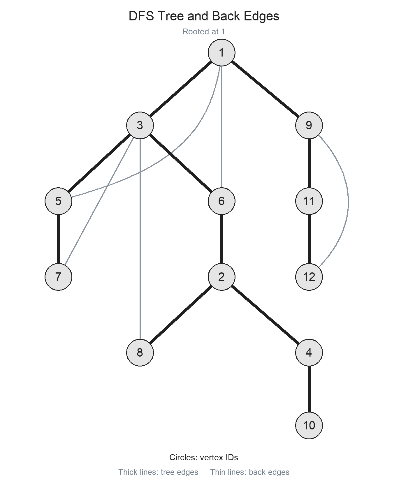

This is the DFS tree mentioned in the title.

#### Tree Edges and Back Edges

Let us first classify the edges in an undirected DFS tree.

Tree edges are the edges that form the DFS tree, shown as thick lines.

Back edges are the remaining edges, which are not part of the DFS tree, shown as thin lines.

In an undirected graph, a back edge always connects an ancestor and a descendant. It cannot connect two DFS subtrees when neither contains the other: otherwise, DFS would discover one subtree while exploring the other.

### DFS Trees in Directed Graphs

DFS trees in directed graphs are constructed similarly to those in undirected graphs, but a search starting from a single vertex may not reach every vertex. For example, in the following graph, starting from vertex 1 reaches only vertices 1, 2, and 3. We then start another search from the unvisited vertex 4. The trees produced by these two searches together form a DFS forest.

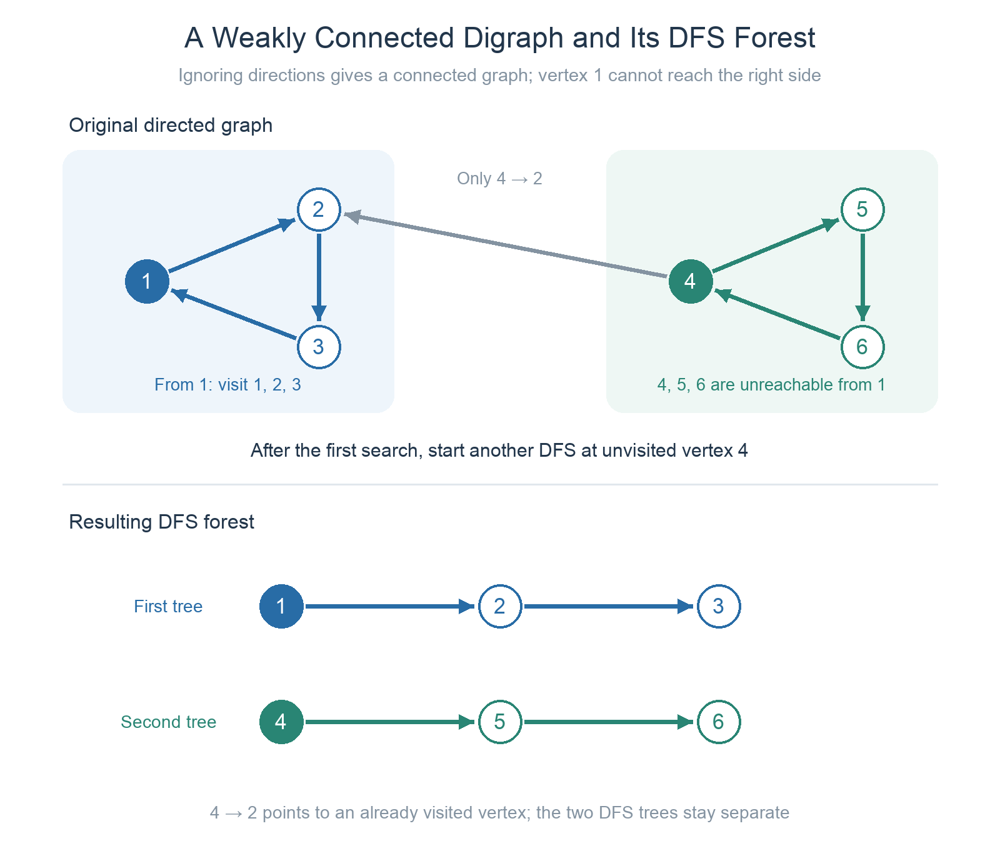

#### Forward Edges, Back Edges, and Cross Edges

The following directed graph illustrates a DFS tree and the different types of non-tree edges:

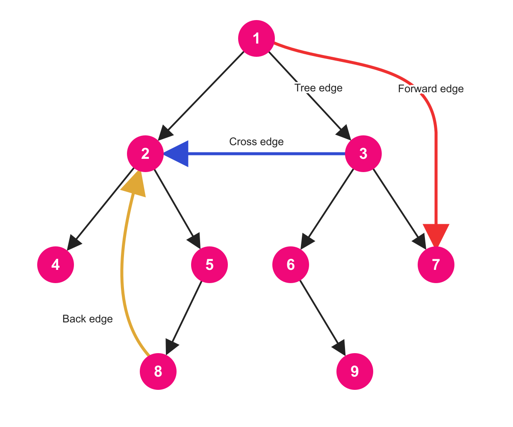

* A non-tree edge directed from an ancestor to a descendant is called a **forward edge**.

* A non-tree edge directed from a descendant to an ancestor is called a **back edge**.

* A non-tree edge whose endpoints have no ancestor-descendant relationship is called a **cross edge**.

### DFN

DFN (depth-first number) is the number assigned to a vertex when it is first visited during DFS. It is also called its DFS discovery order or discovery time.
Whenever we visit a vertex for the first time, we increment a counter and record its value for that vertex.

For the undirected DFS tree above, each vertex receives the following dfn value:

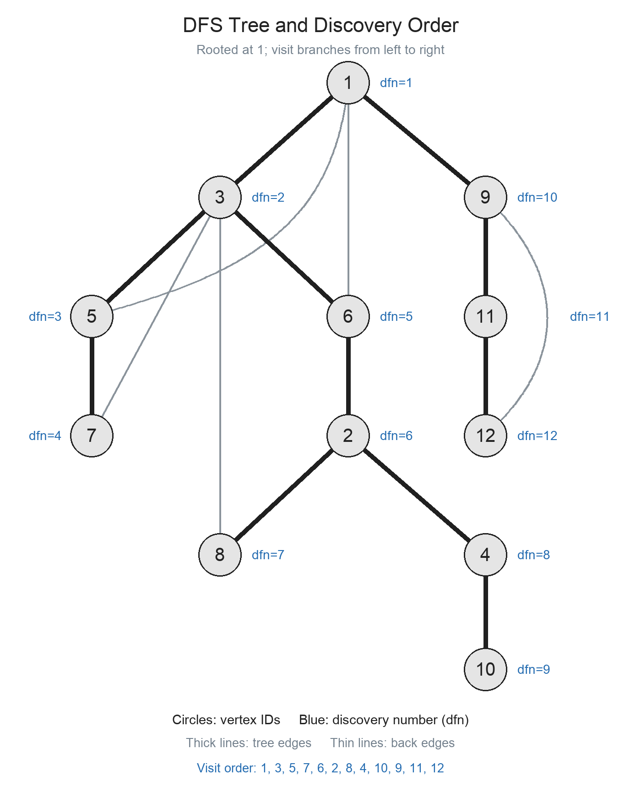

## 2. Connectivity in Undirected Graphs

Now that we have a DFS tree, let us see how it helps us analyze graph connectivity.

### Articulation Points

Definition: In an undirected graph, a vertex whose removal increases the number of connected components is called an **articulation point**, or a **cut vertex**.

A connected component is a maximal connected subgraph.


Vertex V in the diagram is an articulation point. Removing it splits the original connected component into two connected components.

How can a DFS tree help us find articulation points efficiently?

We can use **Tarjan's algorithm**.

#### Finding Articulation Points with Tarjan's Algorithm

First, consider an undirected graph without parallel edges. Let $T(x)$ denote the DFS subtree rooted at $x$, and let $T'(x)$ denote the part of the connected component containing $x$ that remains after removing $T(x)$.

Assume that $x$ is not the root of its DFS tree, so $T'(x)$ is nonempty.

After removing $x$, each of its child subtrees remains internally connected, and $T'(x)$ also remains connected. In an undirected DFS tree, no edge connects two subtrees when neither contains the other. Therefore, $x$ is an articulation point if and only if it has a child $y$ such that $T(y)$ cannot connect to $T'(x)$ without passing through $x$.

In the diagram below, $y$ is a child of $x$, $u\in T(y)$, and $v\in T'(x)$. If $T(y)$ can reach $T'(x)$ without passing through $x$, there must be a back edge $(u,v)$ connecting these two parts. By the properties of back edges in undirected graphs, $v$ must be a strict ancestor of $x$, meaning an ancestor other than $x$ itself.

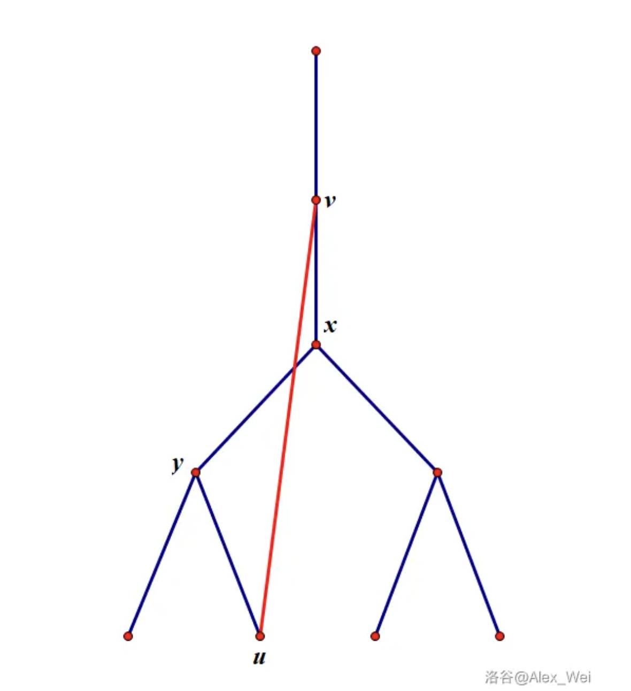

Thus, $x$ is an articulation point whenever there is a child subtree $T(y)$ with no back edge from any of its vertices to a strict ancestor of $x$. Whether other child subtrees can connect to strict ancestors of $x$ does not affect this conclusion.

To check this condition efficiently, define $low_x$ as the smallest dfn value of a vertex reachable from $x$ by following zero or more tree edges downward and then at most one back edge. The tree edge used to enter the current vertex does not count as a back edge.

We can compute this value using the following recurrence:

$$
low_x=\min\left(
\{dfn_x\}
\cup\{dfn_a\mid (x,a)\text{ is a back edge to an ancestor}\}
\cup\{low_y\mid y\text{ is a DFS child of }x\}
\right)
$$

When $x$ is first visited, set $low_x=dfn_x$. When a back edge to an ancestor $a$ is encountered, update $low_x$ using $dfn_a$. After a recursive call on a child $y$ returns, update $low_x$ using $low_y$. The minimum is well-defined even when no back edges exist, because its candidate values always include $dfn_x$.

For a child $y$ of $x$, the condition $low_y<dfn_x$ means that $T(y)$ has a back edge to a strict ancestor of $x$. Conversely, $low_y\ge dfn_x$ means that it cannot connect to $T'(x)$ without passing through $x$.

This gives the articulation point criterion for a non-root vertex:

> A non-root vertex $x$ is an articulation point if and only if it has a DFS child $y$ such that $low_y\ge dfn_x$.

The root is an articulation point if and only if it has at least two children in the DFS tree, that is, $son_x\ge 2$. Removing the root then disconnects its child subtrees from one another.

#### Implementation

Time complexity: $O(n+m)$

```cpp
#include<bits/stdc++.h>
using namespace std;
const int N=1e5+10;
vector<int>e[N];
int n,m;
int dfn[N],low[N],buc[N],tim;
// buc[i] indicates whether vertex i is an articulation point.
void tarjan(int u,int fa)
{
    // On first visit, dfn records discovery order; low initially reaches only u.
    dfn[u]=low[u]=++tim;
    // Count DFS children separately to handle the root criterion.
    int son=0;
    for(auto v : e[u])
    {
        // This example has no parallel edges, so skip the parent tree edge.
        if(v==fa)   continue;
        if(!dfn[v])
        {
            son++;
            tarjan(v,u);
            low[u]=min(low[u],low[v]);
            // A child subtree cannot bypass u to reach a strict ancestor.
            if(low[v]>=dfn[u]&&fa!=0)
                buc[u]=1;
        }
        // A back edge to an ancestor can lower low[u].
        else low[u]=min(low[u],dfn[v]);
    }
    // The root is an articulation point only with at least two DFS children.
    if(son>=2&&fa==0)
        buc[u]=1;
}
int main()
{
    scanf("%d%d",&n,&m);
    for(int i=1;i<=m;i++)
    {
        int u,v;
        scanf("%d%d",&u,&v);
        e[u].push_back(v);
        e[v].push_back(u);
    }
    for(int i=1;i<=n;i++)
    {
        // The graph may be disconnected.
        if(!dfn[i])
            tarjan(i,0);
    }
    int ans=0;
    for(int i=1;i<=n;i++)
        ans+=buc[i];
    printf("%d\n",ans);// Print the number of articulation points.
    for(int i=1;i<=n;i++)
        if(buc[i])  printf("%d ",i);
    // Print each articulation point.
    return 0;
}
```

### Bridges

Definition: In an undirected graph, an edge whose removal increases the number of connected components is called a **bridge**, or a **cut edge**.

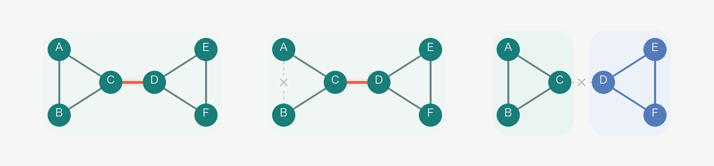

As shown above, removing edge C-D splits the original graph into two connected components.

How can we find bridges?

Once again, we use Tarjan's algorithm.

#### Finding Bridges with Tarjan's Algorithm

The idea is similar to finding articulation points ~~(which explains why Tarjan gets another mention)~~.

First, observe that if an edge $e$ is a bridge, it must be a tree edge. Removing a non-tree edge preserves the original connectivity, because the tree edges still provide paths between the vertices.

The articulation point method leads to the following bridge criterion:

> For a tree edge $e(u,v)$, where $v$ is a child of $u$, the edge is a bridge if and only if $dfn_u < low_v$.

The inequality is strict because we are removing an edge rather than a vertex. If $v$ can reach $u$ without using edge $e$, then $e$ is not a bridge.

Here is the implementation:

Time complexity: $O(N+M)$

```cpp
#include<bits/stdc++.h>
using namespace std;
const int N=1e5+10;
vector<int>e[N];
int n,m,ans;
int dfn[N],low[N],tim;
void tarjan(int u,int fa)
{
    // low[u] is the earliest dfn reachable from u's subtree via a back edge.
    dfn[u]=low[u]=++tim;
    int son=0;
    for(auto v : e[u])
    {
        // Skipping the parent by vertex works only without parallel edges.
        if(v==fa)   continue;
        if(!dfn[v])
        {
            son++;
            tarjan(v,u);
            low[u]=min(low[u],low[v]);
            // The child subtree cannot reach u or any ancestor: this edge is a bridge.
            if(low[v]>dfn[u])
                ans++;
        }
        // An edge to an ancestor offers a route around the tree edge.
        else low[u]=min(low[u],dfn[v]);
    }
}
int main()
{
    scanf("%d%d",&n,&m);
    for(int i=1;i<=m;i++)
    {
        int u,v;
        scanf("%d%d",&u,&v);
        e[u].push_back(v);
        e[v].push_back(u);
    }
    for(int i=1;i<=n;i++)
    {
        if(!dfn[i])
            tarjan(i,0);
    }
    printf("%d\n",ans);
    return 0;
}
```

#### Handling Parallel Edges

If the graph contains parallel edges, none of those parallel edges is a bridge. The implementation above does not yet account for this case.

The solution is to assign an ID to each edge and store it in the adjacency vector when building the graph. Instead of **skipping every edge to the parent vertex**, we **skip only the edge used to enter the current vertex**.

The revised implementation is:

```cpp
#include<bits/stdc++.h>
using namespace std;
const int N=1e5+10;
struct Edge
{
    int v,id;
};
vector<Edge>e[N];
int n,m,ans;
int dfn[N],low[N],tim;
void tarjan(int u,int in_edge)
{
    dfn[u]=low[u]=++tim;
    for(auto edge : e[u])
    {
        int v=edge.v;
        int id=edge.id;
        // Skip only the incoming edge, not other edges to the parent.
        if(id==in_edge)
            continue;
        if(!dfn[v])
        {
            tarjan(v,id);
            low[u]=min(low[u],low[v]);
            // Strict inequality means the tree edge with this ID is a bridge.
            if(low[v]>dfn[u])
                ans++;
        }
        else
        {
            // A parallel edge may still act as a back edge and lower low[u].
            low[u]=min(low[u],dfn[v]);
        }
    }
}
int main()
{
    scanf("%d%d",&n,&m);
    for(int i=1;i<=m;i++)
    {
        int u,v;
        scanf("%d%d",&u,&v);
        // Both directions of an undirected edge share the same ID.
        e[u].push_back({v,i});
        e[v].push_back({u,i});
    }
    for(int i=1;i<=n;i++)
    {
        if(!dfn[i])
            tarjan(i,0);
    }
    printf("%d\n",ans);
    return 0;
}
```

### Further Exploration: Finding Bridges with Tree Difference Updates

A detailed explanation of tree difference updates is beyond the scope of this article, so this section gives only a brief overview of the method.

> A tree edge $(u,v)$ is a bridge if and only if no back edge crosses it: no back edge connects the descendant side of the tree edge to its ancestor side.

The method for finding bridges is therefore:

1. Build a DFS tree of the graph.

2. For each tree edge $(u,v)$, check whether any back edge crosses it. If no back edge does, it is a bridge.

For the second step, process each back edge from a descendant $x$ to an ancestor $y$ by incrementing $d[x]$ and decrementing $d[y]$. Then accumulate the $d$ values within each subtree from the bottom up. For a non-root vertex $v$, its subtree sum is the number of back edges crossing the tree edge between $v$ and its parent. If the sum is zero, that tree edge is a bridge.

Time complexity: $O(N+M)$

## 3. Connectivity in Directed Graphs

Undirected graphs often describe relationships such as two-way passages, while directed graphs can describe one-way passages or precedence constraints between tasks.

Introducing edge directions gives us three levels of connectivity. In some graphs, any two vertices can reach each other. In others, at least one direction of reachability is guaranteed. Still others become connected only after all edge directions are ignored.

From weakest to strongest, these levels are called weak connectivity, unilateral connectivity, and strong connectivity.

1. Weak connectivity: The graph is connected when every directed edge is treated as undirected. Direction is ignored; we ask only whether a path exists.

   

2. Unilateral connectivity: For any two vertices $u,v$, at least one direction is reachable ($u \to v$ or $v \to u$). This adds a requirement beyond weak connectivity: the path must follow the edge directions. A weakly connected graph is not necessarily unilaterally connected.

   

3. Strong connectivity: For any two vertices $u,v$, both $u \to v$ and $v \to u$ hold. In other words, every pair of vertices must be mutually reachable.

   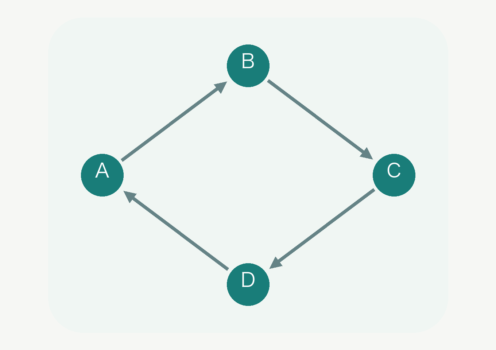

When studying a graph, it is useful to simplify its structure. Mutual reachability among strongly connected vertices allows us to compress this information. We will therefore focus on strong connectivity next.

### Strongly Connected Components

A **strongly connected graph** is a directed graph in which every pair of vertices is mutually reachable. Equivalently, every vertex can reach every other vertex.

A **strongly connected component** (SCC) is a maximal strongly connected subgraph of a directed graph.

Any two vertices in an SCC can reach each other, so the component can be treated as a single unit. We will first find all SCCs in a directed graph, then introduce graph condensation.

#### Finding SCCs with Tarjan's Algorithm

Consider this graph again:

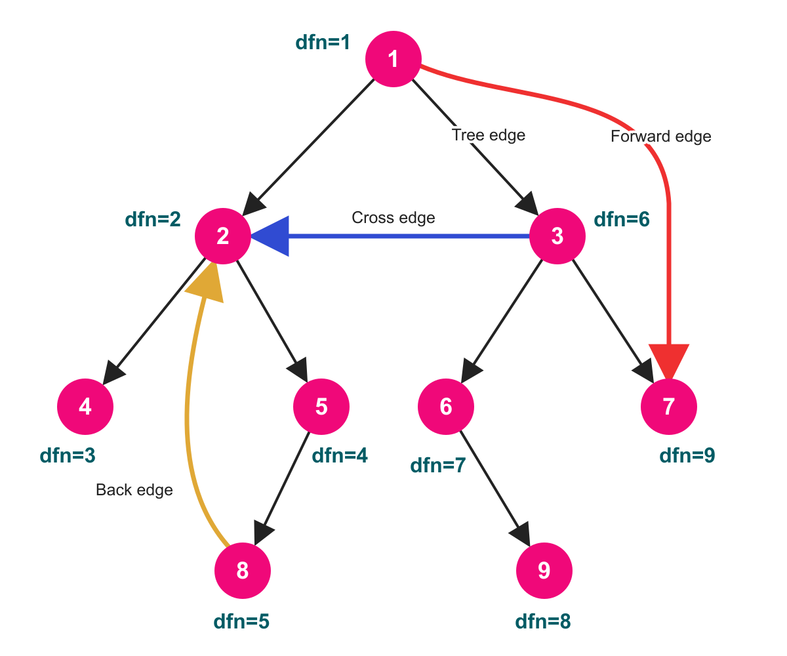

Let us examine the role of an edge $e(u \to v)$ in each case.

Tree edges discover new vertices and assign them larger discovery timestamps. Once a vertex's dfn has been assigned, it never changes. Back edges and cross edges pointing to vertices still on the stack may instead update the low values introduced below.

* Forward edges do not affect strong connectivity and can therefore be ignored.

* A back edge $u\to v$, together with the DFS tree path from ancestor $v$ to descendant $u$, forms a directed cycle. All vertices on that tree path therefore belong to the same SCC, but the SCC may also contain other vertices. In this particular graph, vertices 2, 5, and 8 form a complete SCC.
* A cross edge makes $v$ reachable from $u$. If $v$ can also reach $u$, the cross edge contributes to strong connectivity.

Every SCC has a vertex of minimum depth in the DFS tree. Identifying that vertex allows us to determine the corresponding SCC.

Unlike the articulation point algorithm for undirected graphs, this algorithm uses a stack to store vertices that have been visited but have not yet been assigned to an SCC. When a vertex $u$ is first visited, set $low_u=dfn_u$ and push $u$ onto the stack.

For an edge $u \to v$, maintain low as follows:

* If $v$ has not been visited, recursively search $v$, then set $low_u=\min(low_u,low_v)$ after the recursive call returns.
* If $v$ has already been visited and is still on the stack, set $low_u=\min(low_u,dfn_v)$.
* If $v$ has already been popped from the stack, its SCC has been determined, so this edge does not update $low_u$.

After all outgoing edges of $u$ have been processed, if $low_u=dfn_u$, then $u$ is the vertex of minimum depth in an SCC. Pop vertices from the top of the stack until $u$ is popped. These vertices together form one SCC.

Let us walk through a simple example.

The example graph contains two cycles, $A \to B \to C \to A$ and $D \to E \to D$, together with an edge $B \to D$. Start the search at $A$, and at $B$, visit $C$ before $D$. The discovery order is therefore $A,B,C,D,E$.

Orange highlights the vertex or edge currently being processed or updated. Pale vertices have not yet been visited, and colored background regions indicate SCCs that have already been identified. In the stack notation below, the bottom is on the left and the top is on the right. This is Tarjan's vertex stack, not the recursive call stack.

##### 1. Visit A, B, and C, initializing low

Follow the tree edges to visit $A,B,C$ in order. When each vertex is first visited, initialize its low value to its own dfn:

$$
(dfn_A,dfn_B,dfn_C)=(1,2,3),\qquad
(low_A,low_B,low_C)=(1,2,3)
$$

At this point, we have just entered $C$ and have not yet examined its edge to $A$. The stack is $[A,B,C]$.


##### 2. Examine C → A and update C's low

$A$ has already been visited and is still on the stack, so use $dfn_A$ to update $low_C$:

$$
low_C=\min(low_C,dfn_A)=\min(3,1)=1
$$

This means that $C$ can follow this edge back to the earlier-discovered vertex $A$. We have not yet returned to $B$, so $low_B$ is still $2$. The stack remains $[A,B,C]$.


##### 3. Return to B, then visit D and E

All outgoing edges of $C$ have been examined. Since $low_C=1\ne dfn_C=3$, we cannot pop an SCC at $C$, so $C$ stays on the vertex stack.

After the recursive call returns to $B$, update the parent's low using the child's low:

$$
low_B=\min(low_B,low_C)=\min(2,1)=1
$$

Then continue along $B \to D \to E$, initializing $dfn_D=low_D=4$ and $dfn_E=low_E=5$. The stack becomes $[A,B,C,D,E]$.

Notice that although the recursive call for $C$ has finished, $C$ remains on Tarjan's vertex stack, waiting for its SCC to be determined.

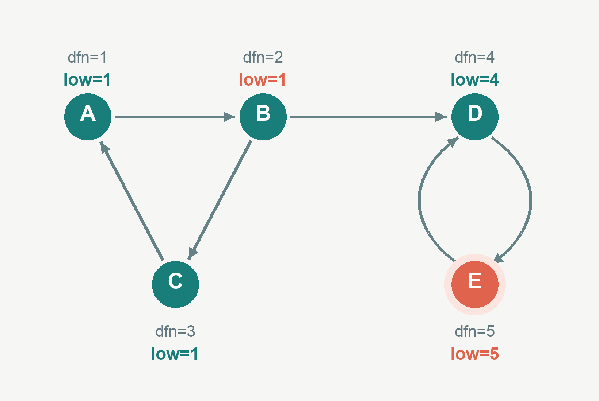

##### 4. Examine E → D and update E's low

$D$ has already been visited and is still on the stack, so:

$$
low_E=\min(low_E,dfn_D)=\min(5,4)=4
$$

Since $low_E=4\ne dfn_E=5$, $E$ is not the vertex of minimum depth in an SCC. The stack remains $[A,B,C,D,E]$.


##### 5. Return to D and pop the first SCC

When the recursive call for $E$ returns to $D$, update:

$$
low_D=\min(low_D,low_E)=\min(4,4)=4
$$

All outgoing edges of $D$ have been processed, and $low_D=dfn_D=4$. Pop $E$ and then $D$ from the stack to obtain the first SCC: $\{D,E\}$.

Next, return to $B$ and update $low_B=\min(1,4)=1$, which leaves the value unchanged. $B$ can reach $D$, but $D,E$ cannot reach $A,B,C$, so the two cycles do not merge into a single SCC. Only $[A,B,C]$ remains on the stack.

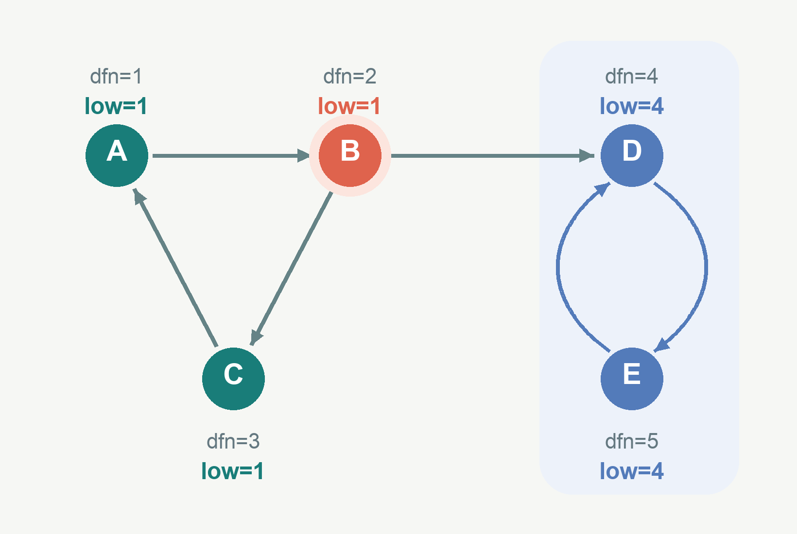

##### 6. Return to A and pop the second SCC

The search from $B$ finishes. Since $low_B=1\ne dfn_B=2$, $B$ stays on the stack. After returning to $A$:

$$
low_A=\min(low_A,low_B)=\min(1,1)=1
$$

All outgoing edges of $A$ have been processed, and $low_A=dfn_A=1$. Pop $C,B,A$ in order to obtain the second SCC: $\{A,B,C\}$. The stack is now empty, and this search is complete.

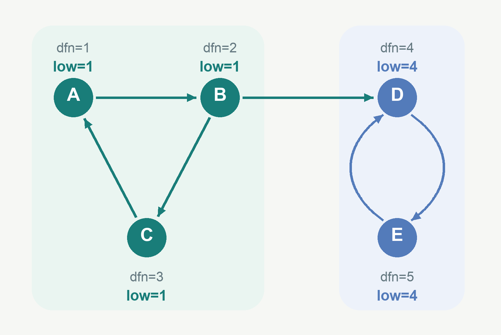

Throughout this process, dfn values never change; only low values are updated. The two update rules must be kept distinct: after recursively searching a child, use that child's low; when encountering an already-visited vertex that is still on the stack, use its dfn. Only after processing all outgoing edges of the current vertex do we check whether $low_u=dfn_u$ and decide whether to pop an SCC.

We now know how to find every SCC. When we compress an SCC into a single vertex, how can we preserve the important reachability information in the original graph?

#### Graph Condensation

Replace each SCC with a new vertex, discard all edges whose endpoints belong to the same SCC, and retain the edges between different SCCs. The resulting graph is called the condensation graph.


The condensation graph has an important property: it is always a **directed acyclic graph** (DAG).

Informally, a DAG is a graph in which following the arrows can never lead you back to your starting vertex.

You can think of it as a set of precedence constraints between tasks: one task must be completed before another can begin, but the dependencies never form a cycle.

Such graphs can be combined with algorithms such as topological sorting and dynamic programming and have many applications.

The following code finds SCCs and builds the condensation graph.

Tarjan's SCC algorithm runs in $O(N+M)$ time, and building the condensation graph before removing duplicate edges also takes $O(N+M)$ time. The implementation below additionally sorts each vertex's outgoing edges to remove duplicates, so its overall worst-case time complexity is $O(N+M\log M)$. Its space complexity is $O(N+M)$. Here, $N$ and $M$ are the numbers of vertices and edges in the original graph.

```cpp
#include<bits/stdc++.h>
using namespace std;
vector<int>stk;
int top=0;
vector<vector<int>>graph;
vector<int>dfn,low,belong;
vector<bool>inStack;
int timer=0;
int sccCount=0;
void tarjan(int u)
{
    // Assign a discovery number and push u onto the unresolved-vertex stack.
    dfn[u]=low[u]=++timer;
    stk[top++]=u;
    inStack[u]=true;
    for(int v : graph[u])
    {
        if(dfn[v]==0)
        {
            // Tree edge: recurse first, then propagate the child's low value.
            tarjan(v);
            low[u]=min(low[u],low[v]);
        }
        else if(inStack[v])
        {
            // Edge to a vertex still on the stack: use its dfn, not its low.
            low[u]=min(low[u],dfn[v]);
        }
    }
    // This equality identifies the shallowest DFS-tree vertex of an SCC.
    if(low[u]==dfn[u])
    {
        ++sccCount;
        // Pop through u; every popped vertex belongs to this SCC.
        while(true)
        {
            int v=stk[--top];
            inStack[v]=false;
            belong[v]=sccCount;
            if(v==u)
                break;
        }
    }
}
int main()
{
    int n,m;
    cin>>n>>m;
    graph.resize(n+1);
    dfn.assign(n+1,0);
    low.assign(n+1,0);
    belong.assign(n+1,0);
    inStack.assign(n+1,false);
    stk.resize(n+1);
    for(int i=0;i<m;i++)
    {
        int u,v;
        cin>>u>>v;
        graph[u].push_back(v);
    }
    // Find all strongly connected components.
    for(int u=1;u<=n;u++)
    {
        if(dfn[u]==0)
            tarjan(u);
    }
    // Build the condensation graph.
    vector<vector<int>>dag(sccCount+1);
    vector<int>sccSize(sccCount+1,0);
    vector<int>indegree(sccCount+1,0);
    for(int u=1;u<=n;u++)
    {
        int a=belong[u];
        ++sccSize[a];
        for(int v : graph[u])
        {
            int b=belong[v];
            // Internal edges disappear; edges between SCCs keep their direction.
            if(a!=b)
                dag[a].push_back(b);
        }
    }
    // Remove duplicate edges, then compute indegrees.
    int edgeCount=0;
    for(int a=1;a<=sccCount;a++)
    {
        auto&edges=dag[a];
        // Keep each outgoing SCC edge once before computing indegrees.
        sort(edges.begin(),edges.end());
        edges.erase(unique(edges.begin(),edges.end()),edges.end());
        edgeCount+=static_cast<int>(edges.size());
        for(int b : edges)
            ++indegree[b];
    }
    // Print the number of SCCs.
    cout<<sccCount<<'\n';
    // Print the SCC ID of each vertex in the original graph.
    for(int u=1;u<=n;u++)
        cout<<belong[u]<<(u==n ? '\n' : ' ');
    // Print the edge count and all edges of the condensation graph.
    cout<<edgeCount<<'\n';
    for(int a=1;a<=sccCount;a++)
    {
        for(int b : dag[a])
            cout<<a<<' '<<b<<'\n';
    }
    return 0;
}
```

## References

1. CP-Algorithms: Finding bridges in a graph in O(N+M)
   https://cp-algorithms.com/graph/bridge-searching.html
2. CP-Algorithms: Finding articulation points in a graph in O(N+M)
   https://cp-algorithms.com/graph/cutpoints.html
3. OI Wiki: Strongly Connected Components
   https://oi-wiki.org/graph/scc/
4. CP-Algorithms: Strong Orientation
   https://cp-algorithms.com/graph/strong-orientation.html
5. Alex_Wei: Graph Theory I
   https://www.cnblogs.com/alex-wei/p/basic_graph_theory.html
6. malanIIIII: DFS Trees
   https://blog.csdn.net/weixin_43848437/article/details/105133155
