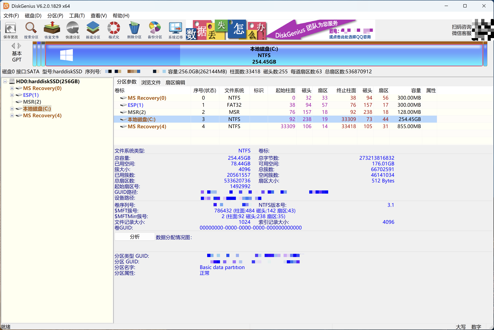
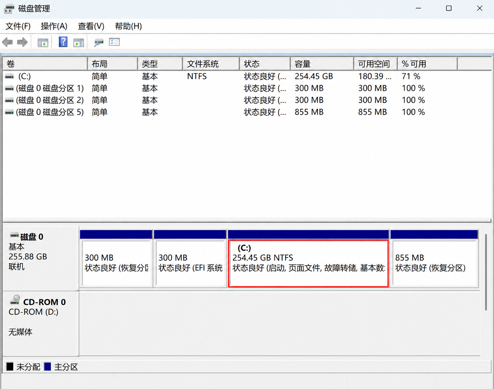
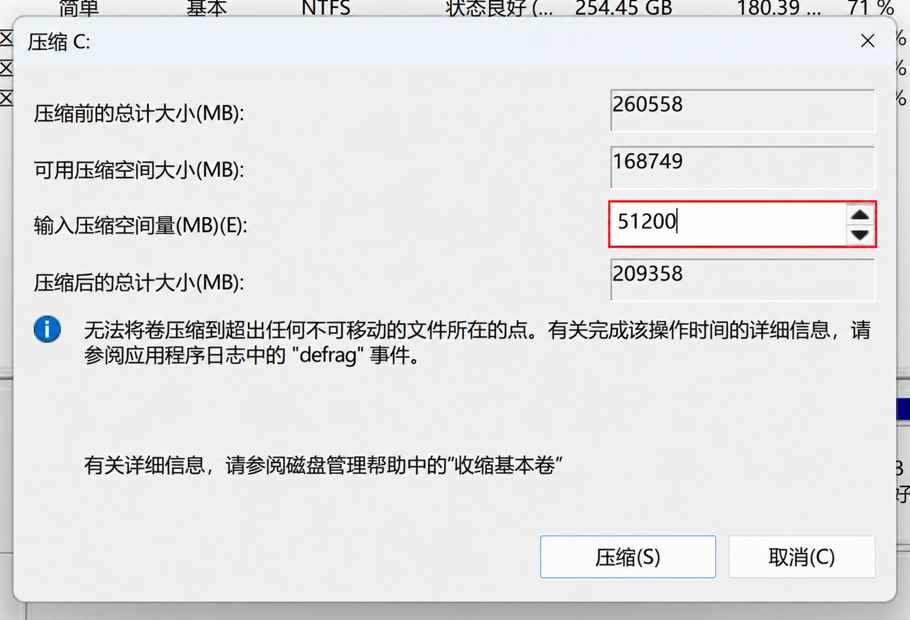
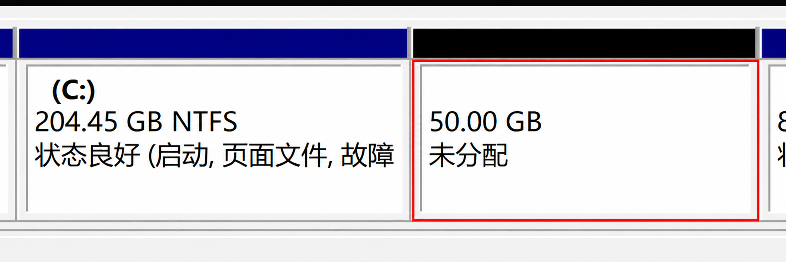
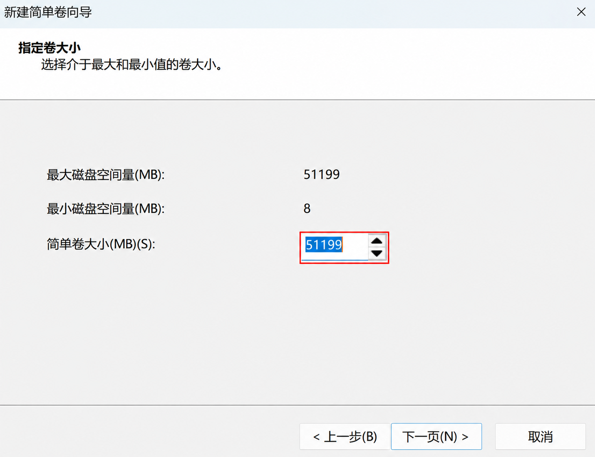
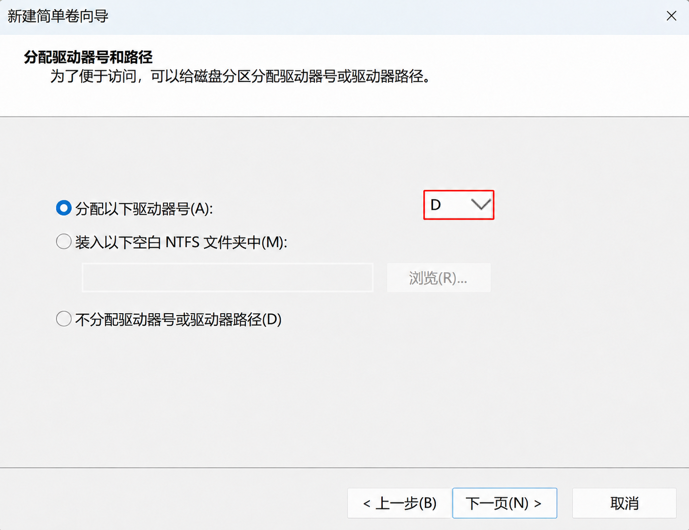
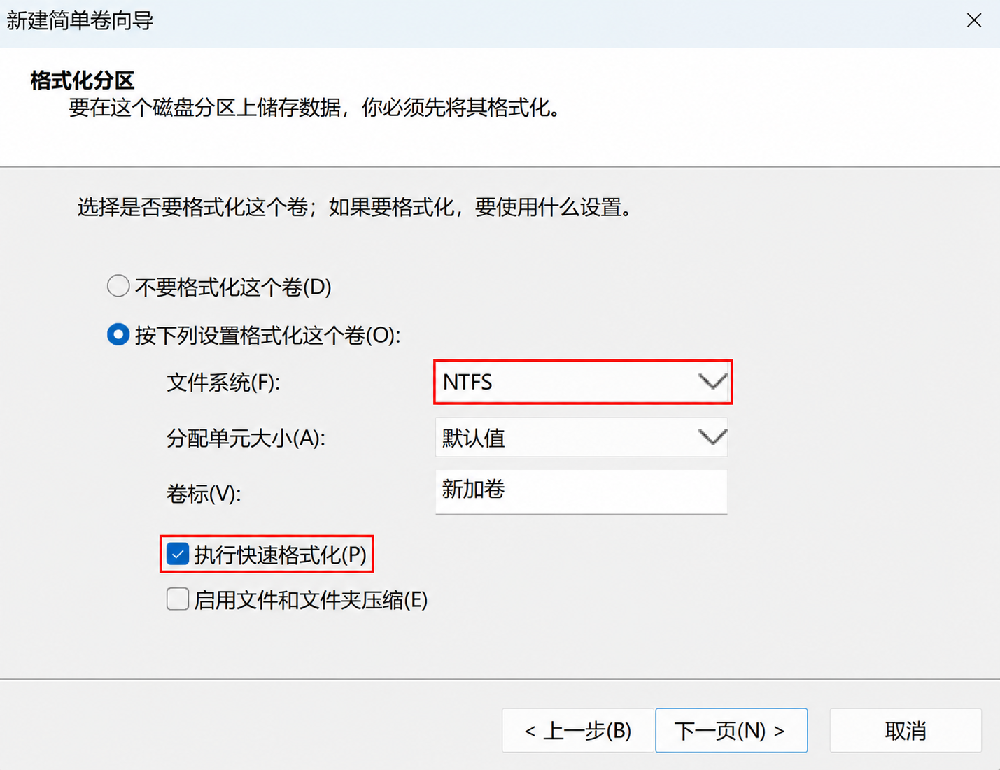
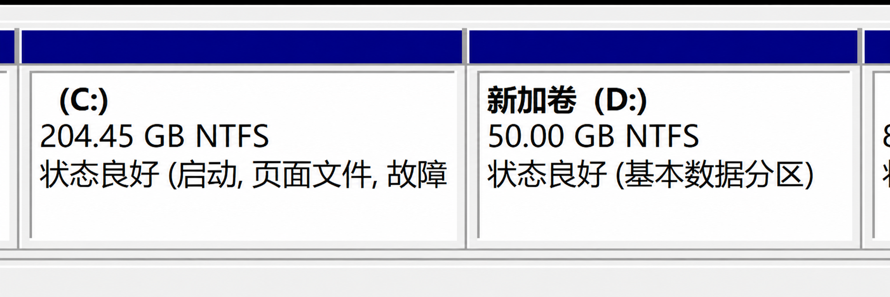
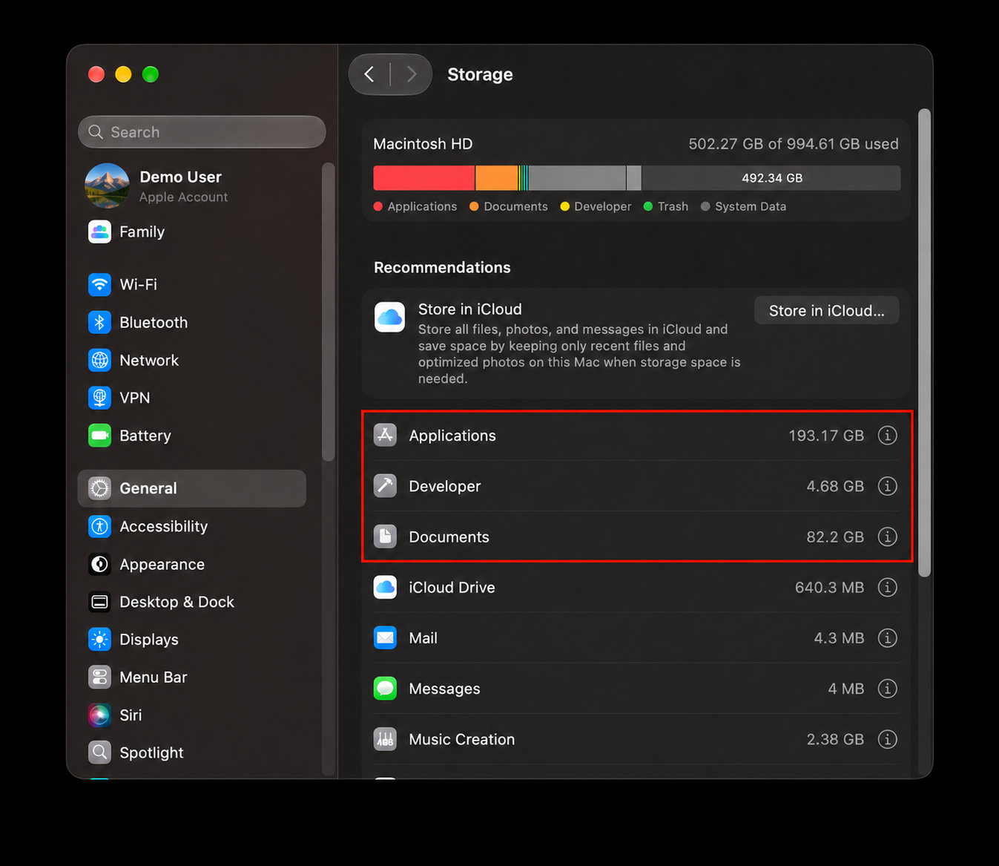

# 电脑只有一个 C 盘？带你认识磁盘分区

当你打开“此电脑”时，有没有发现里面只有一个 C 盘？照片、作业、游戏和软件都放在一起，用久了就像在一个大柜子里找东西。要是能再分出一个盘来放文件，会不会顺手一点？

我们这次就用 Windows 11 来聊聊磁盘分区，再一起看看怎么从现有空间里分出一个新盘。

## 一个大柜子，分成几个抽屉

让我们把硬盘想成一个柜子，分区就像在柜子里隔出几个抽屉。C 盘、D 盘可以是同一块硬盘上的不同区域，你可以按自己的习惯整理文件，就好像不同的抽屉放不同的东西一样。

这里有一点要注意：**分区不会凭空增加硬盘容量**。如果 C 盘和 D 盘来自同一块硬盘，硬盘损坏时两个区域都可能受影响。因此，D 盘不是备份：重要文件还要另存到外置硬盘或其他独立位置。

## 格式化时，选哪种文件系统？

分区像抽屉，**文件系统**就像抽屉里的整理规则。用什么格式，关系到哪些设备能读写它：

- **NTFS**：Windows 硬盘常用；Mac 通常能读取，但不能直接写入。
- **exFAT**：移动硬盘在 Windows 和 Mac 间传文件时常用，也支持大文件。
- **FAT32**：比较老，兼容不少设备，但单个文件不能达到 4 GiB。
- **APFS**：Mac 常用；**ext4**：Linux 常用。换系统使用前，先确认能否读写。

给现有磁盘换格式前，记得备份：格式化会清除目标卷里的文件。

## 那些没有盘符的小分区是什么？

我们先打开 DiskGenius 看一眼。截图里的 Windows 跑在 Mac 的 Parallels 虚拟机中，不过读图的方法和普通 Windows 电脑一样：

先看左边的 `HD0`，它代表 Windows 看到的一整块虚拟磁盘。下面列着几个区域：`C:` 是我们平时存文件的地方；`ESP` 放着开机要用的文件；`MSR` 是 Windows 留给自己用的；`MS Recovery` 则和系统恢复有关。它们有的只有几百 MB，也不显示盘符，但都有用处，先别动它们。

再看右边的“文件系统”一列：ESP 写着 FAT32，C 盘写着 NTFS。同一块磁盘里的不同区域，也能按不同规则存文件。顺带一提，Windows 磁盘管理把 C 盘标为“启动”时，说的不是 ESP。

这里的 256 GB 是 Windows 看到的虚拟磁盘容量。它在 Mac 上实际占了多少空间，得看虚拟机的设置和已存入的内容。

左上角还有个 **GPT**（当然不是 ChatGPT）。你可以把它想成这块磁盘的“分区目录”，记着每个区域放在哪里。另一种目录叫 **MBR**，多见于老设备；GPT 通常能管理更大的磁盘和更多分区。NTFS、FAT32 管的是区域里面怎么存文件，和 GPT 管的事不同。

## 动手之前，先准备一下

1. **先备份重要文件。** 作业、照片这些珍贵的东西，可以先复制到外置硬盘或其他独立位置，再打开几份副本，确认能正常读取。
2. **看看空间够不够。** 新盘的空间是从原有分区里分出来的。记得给 C 盘留些余地，Windows 更新、软件和日常文件都还需要空间。
3. **认准要操作的区域。** 下面以 C 盘为例，你电脑上的布局可能和截图不一样。标着“恢复”“EFI”等不熟悉的小分区，先不要删除或格式化。

学校或公司的电脑，可以先问管理员；遇到陌生界面或磁盘异常，也可以找熟悉磁盘管理的人帮忙。

## 第一步：从 C 盘腾出空间

在 Windows 搜索框中输入 **磁盘管理**，选择搜索结果中的**创建和格式化硬盘分区**。等待窗口加载后，在下方找到标有 `C:` 的区域，右键点击它，选择**压缩卷**。

等 Windows 算出可压缩的空间，再填想分给新盘的大小。比如图中填的 `51200 MB`，大约是 `50 GB`，你可以按自己的空间来定。这里填的是**从 C 盘拿出多少**，不是 C 盘最后剩多少。看清数字后，点**压缩**。

这时会出现一块写着**未分配**的空间。先别急着去“此电脑”找：我们还没给它建新盘呢。

## 第二步：给新空间一个盘符

在刚出现的**未分配**空间上点击右键，选择**新建简单卷**，按照向导操作：

1. 确认新卷大小；如果希望全部使用刚腾出的空间，可以保留默认值。

   

2. 选择一个未被占用的盘符。D 盘已被使用也没关系，选其他字母即可。

   

3. 按向导默认设置格式化这个**新建的空卷**，检查摘要，确认无误后点击**完成**。

   

走到格式化这一步，花几秒确认一下：选中的是刚腾出的新空间。完成后再打开“此电脑”，新盘就出现了。

## 为什么没有腾出那么多空间？

如果你发现 C 盘明明还有不少空余，Windows 却不让你分出那么多，也不用太意外。部分系统文件无法自动移动，可能限制可压缩的大小。这时可以先按界面允许的范围操作，或者咨询了解磁盘管理的人；不要为了追求更大的数字随意删除系统文件。

新建分区后，原来的文件不会自动搬过去。你可以自己把需要整理的文件复制到新盘，确认能够打开后，再决定是否删除原文件。软件和系统文件则不要直接拖走。

## Mac 存储空间满了怎么办？

上面的操作适用于 Windows。Mac 通常不需要为了整理文件另行分区。常用的 APFS 格式允许同一容器中的多个宗卷共享空余空间；增加宗卷或分区也不会让硬盘变大。

如果 Mac 提示空间不足，可以先打开**苹果菜单 → 系统设置 → 通用 → 储存空间**，看看什么占用最多。再检查下载文件夹、卸载不用的应用，或者把不常用的大文件复制到外置硬盘；确认副本能打开后，再决定是否删除电脑里的原件。清空废纸篓前也先确认里面没有需要的文件。iCloud 储存空间优化是另一种选择，但需要留意云端容量和文件同步设置。

图中是英文界面，`General` 对应“通用”，`Storage` 对应“储存空间”。

分区说到底是为了让自己用得顺手。如果你现在靠文件夹就能整理得很好，继续这样用也完全可以。

如果“扩展卷”是灰色的，可以先看看未分配空间是不是紧挨着目标卷的右边。Windows 磁盘管理通常有这个要求；恢复分区别为了腾位置随手删。

想再多认识一点的话，DiskGenius 这类工具可以查看分区和磁盘健康信息，也提供搜索丢失分区等功能。数据丢失后不一定能恢复，涉及写入或修复的操作先别急着点，重要数据可以找专业人员帮忙。

## 参考资料

1. Microsoft Support, Disk Management in Windows: https://support.microsoft.com/en-gb/windows/experience/storage-filemanagement/disk-management-in-windows
2. Microsoft Learn, Shrink a Basic Volume: https://learn.microsoft.com/en-my/windows-server/storage/disk-management/shrink-a-basic-volume
3. Microsoft Support, Backup and restore with File History: https://support.microsoft.com/en-us/windows/experience/backup-recovery/backup-and-restore-with-file-history
4. Apple Support, Free up storage space on Mac: https://support.apple.com/en-gb/102624
5. Apple Support, Add, delete, or erase APFS volumes: https://support.apple.com/en-ie/guide/disk-utility/dskua9e6a110/mac
6. Microsoft Learn, File System Functionality Comparison: https://learn.microsoft.com/en-us/windows/win32/fileio/filesystem-functionality-comparison
7. Microsoft Learn, UEFI/GPT-based hard drive partitions: https://learn.microsoft.com/en-us/windows-hardware/manufacture/desktop/configure-uefigpt-based-hard-drive-partitions
8. Apple Support, File system formats available in Disk Utility: https://support.apple.com/guide/disk-utility/file-system-formats-dsku19ed921c/mac
9. Linux Kernel, ext4 General Information: https://www.kernel.org/doc/html/latest/admin-guide/ext4.html
10. DiskGenius, 硬盘操作: https://www.diskgenius.cn/help/disk.php
11. Microsoft Learn, Convert a disk to GPT or MBR: https://learn.microsoft.com/en-us/windows-server/storage/disk-management/change-disk-partition-scheme
12. Microsoft Learn, Extend a basic or dynamic volume: https://learn.microsoft.com/en-us/windows-server/storage/disk-management/extend-a-basic-volume
13. Parallels, What is an Expanding Disk?: https://kb.parallels.com/en/4706
