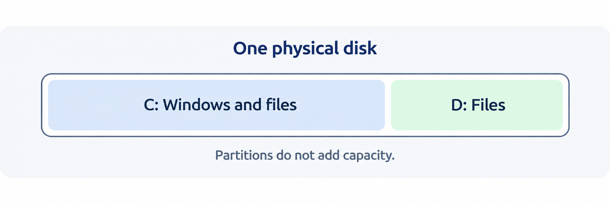
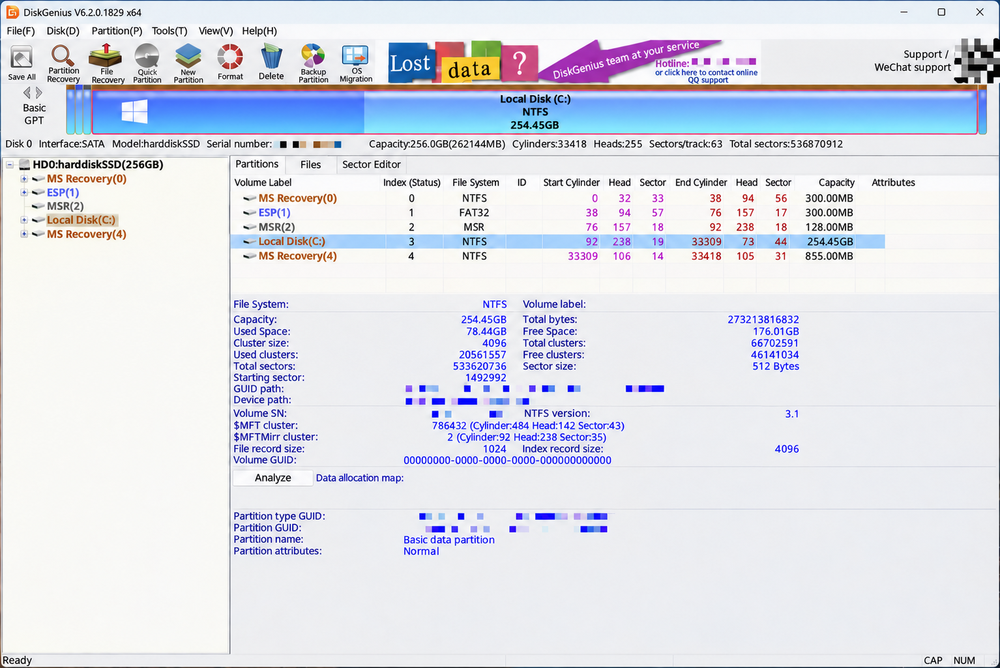
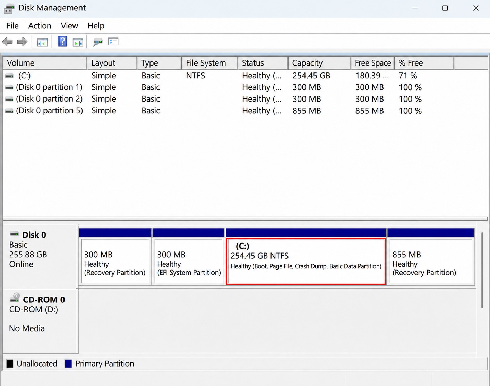
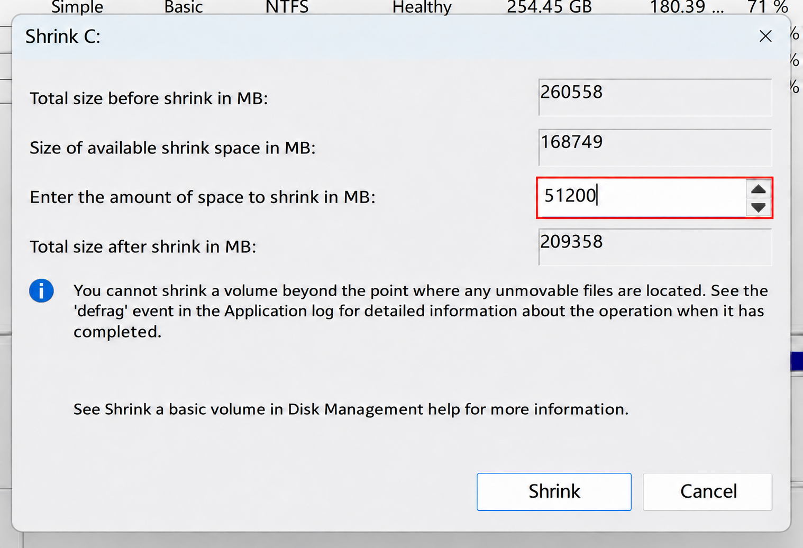
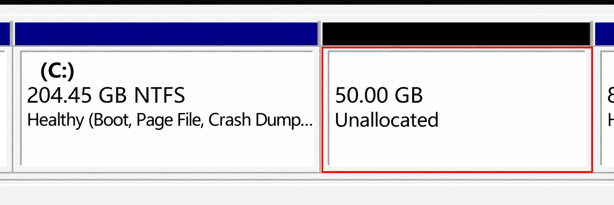
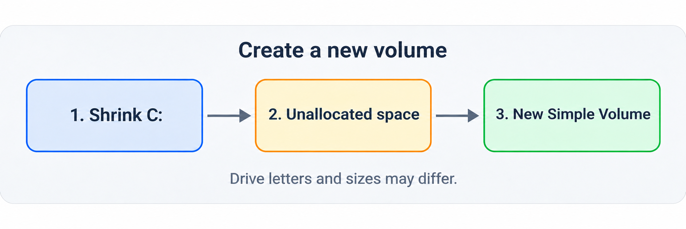
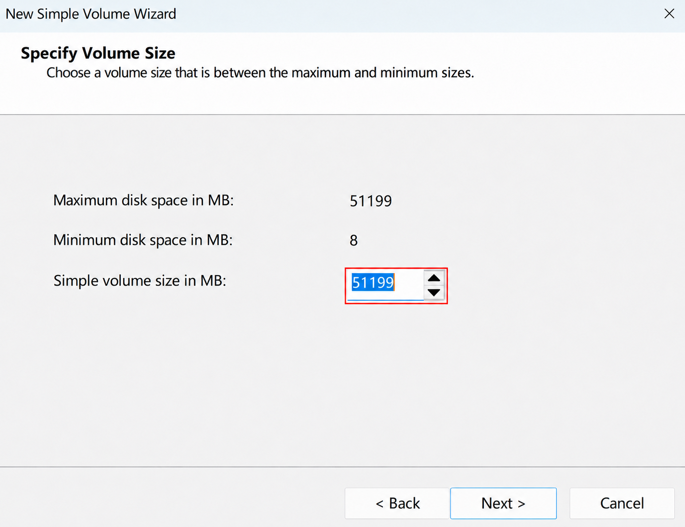
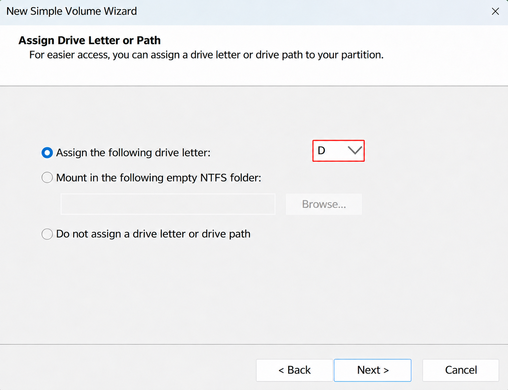
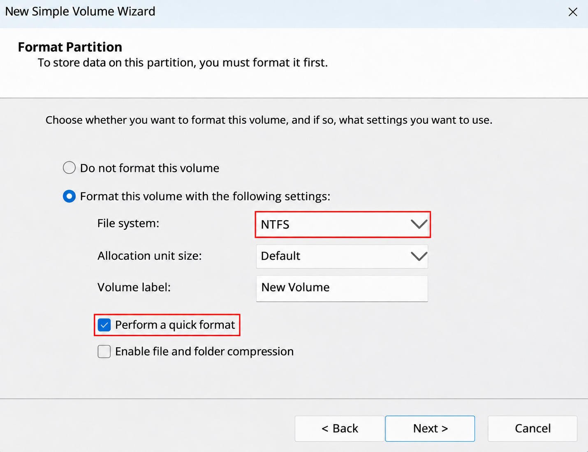
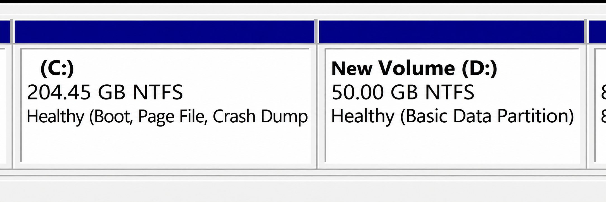

# Only a C: Drive? A Simple Guide to Disk Partitions

Have you ever opened “This PC” and found only a C: drive? Photos, coursework, games, and apps can all end up together. After a while, finding something can feel like rummaging through one big drawer. Perhaps a separate drive would make things a little easier to organize.

Let’s use Windows 11 to get to know partitions and see how to make a new drive from the space you already have.

The Windows UI text in the screenshots has been translated into English.

## One cabinet, several drawers

Think of a physical disk as a cabinet. A partition is like a separate drawer inside it. The C: and D: drives can be different areas on the same physical disk, giving you places to organize files in a way that suits you.

One thing to keep in mind: **partitioning does not create extra storage.** If C: and D: are on the same disk, both may be affected if that disk fails. A D: drive is therefore not a backup: keep important files on an external drive or in another independent location too.

## Which file system should I choose?

A partition is like a drawer, while a **file system** is the way things are organized inside it. The format also affects which devices can read and write your files:

- **NTFS** is common on Windows drives. A Mac can usually read it, but cannot write to it directly.
- **exFAT** is useful for moving files between modern Windows PCs and Macs, including large files.
- **FAT32** is older and works with many devices, but a single file cannot reach 4 GiB.
- **APFS** is common on Macs, while **ext4** is common on Linux. Check compatibility before moving a drive between systems.

Back up existing files before changing a drive's format: formatting erases files on the target volume.

## What are those small partitions without drive letters?

Let’s open DiskGenius and take a look. The Windows shown here runs in Parallels on a Mac, but you can read the layout in much the same way on a regular Windows PC:

On the left, `HD0` is the whole virtual disk as Windows sees it. The areas listed below each have a job. `C:` is where we keep everyday files; `ESP` holds files needed to start Windows; `MSR` is reserved for Windows; and `MS Recovery` helps with recovery. Some are only a few hundred megabytes and have no drive letter, but they still matter. Leave them as they are.

Now look at the “File System” column on the right. ESP says FAT32, while C: says NTFS. Different areas of one disk can use different rules for storing files. One confusing detail: when Windows Disk Management calls C: “Boot,” it is not referring to the ESP.

The 256 GB shown is the capacity Windows sees for its virtual disk. How much Mac storage the virtual machine actually uses depends on its settings and what you have stored in it.

There is also **GPT** at the top left (not the chatbot). Think of it as the disk’s partition map: it records where each area is. An older kind of map is called **MBR**. GPT generally handles larger disks and more partitions. NTFS and FAT32 describe how files are stored inside an area, so they answer a different question.

## Before we start

1. **Back up the things you care about.** Copy coursework, photos, and other important files to an external drive or another independent location, then open a few copies to make sure they work.
2. **Check how much room you have.** The new drive takes space from an existing partition, so leave plenty on C: for Windows updates, apps, and everyday files.
3. **Find the right area.** We will use C: in this example, but your disk may look different from the pictures. Leave small partitions marked “Recovery” or “EFI,” and anything else you do not recognize, alone.

If your school or workplace manages the computer, check with the administrator first. If anything looks unfamiliar or the disk seems to have a problem, ask someone familiar with Disk Management for help.

## Step one: make room on the C: drive

Search for **Disk Management** in Windows, then choose **Create and format hard disk partitions** from the results. Wait for the window to load, find the area labeled `C:` in the lower part of the window, right-click it, and choose **Shrink Volume**.

Give Windows a moment to work out how much space it can free. Then enter the amount you want for the new drive. The screenshot uses `51200 MB`, or about `50 GB`; choose a number that works for your computer. This field asks **how much to take from C:**, not how large C: will be afterward. Check the number, then select **Shrink**.

You will now see an **Unallocated** area. Do not worry if it is missing from “This PC”: we have not made it into a new drive yet.

## Step two: give the new space a drive letter

Right-click the **Unallocated** space you just created, choose **New Simple Volume**, and follow the wizard:

1. Confirm the size. Keep the default if you want to use all of the space you just freed.

   

2. Choose an available drive letter. If D: is already in use, another letter is fine.

   

   The D: shown here was edited for illustration. Choose a letter available on your own computer.

3. Use the wizard's default format settings for this **new, empty volume**. Review the summary and select **Finish**.

   

At the formatting step, take a few seconds to check that you selected the new space you just made. Once the wizard finishes, open “This PC” to find the new drive.

## Why can I not free more space?

If C: appears to have plenty of free space but Windows offers less than you expected, you are not alone. Some system files cannot be moved automatically, which can limit the available amount. Work within the limit shown or ask someone familiar with Disk Management for help. Do not delete system files simply to make the number larger.

Creating a partition does not automatically move your existing files. Copy the files you want to organize to the new drive yourself. Check that they open before deciding whether to delete the originals. Do not drag system files or installed applications to a new drive.

## What if your Mac is running out of space?

The steps above are for Windows. Mac users generally do not need a separate partition just to organize files. With the commonly used APFS format, multiple volumes in the same container can share free space. Adding a volume or partition does not increase the disk’s physical capacity.

If your Mac is low on space, open **Apple menu → System Settings → General → Storage** to see what is taking up room. Check your Downloads folder, uninstall applications you no longer use, or copy large files you rarely need to an external drive. Make sure the copies open before deciding whether to delete the originals. Check the Trash before emptying it. iCloud storage optimization is another option; check your available cloud storage and sync settings first.

Partitions are simply one way to make things easier to organize. If folders already work well for you, it is perfectly fine to keep using them.

If “Extend Volume” is grayed out, check whether the unallocated space is immediately to the right of the drive you want to extend. Windows Disk Management usually needs that. Leave recovery partitions alone.

If you are curious, tools such as DiskGenius can show partition and disk health information and offer features for finding lost partitions. Recovery is not guaranteed. Before running anything that writes to or repairs a disk, pause; for important lost data, consider professional help.

## References

1. Microsoft Support, Disk Management in Windows: https://support.microsoft.com/en-gb/windows/experience/storage-filemanagement/disk-management-in-windows
2. Microsoft Learn, Shrink a Basic Volume: https://learn.microsoft.com/en-my/windows-server/storage/disk-management/shrink-a-basic-volume
3. Microsoft Support, Backup and restore with File History: https://support.microsoft.com/en-us/windows/experience/backup-recovery/backup-and-restore-with-file-history
4. Apple Support, Free up storage space on Mac: https://support.apple.com/en-gb/102624
5. Apple Support, Add, delete, or erase APFS volumes: https://support.apple.com/en-ie/guide/disk-utility/dskua9e6a110/mac
6. Microsoft Learn, File System Functionality Comparison: https://learn.microsoft.com/en-us/windows/win32/fileio/filesystem-functionality-comparison
7. Microsoft Learn, UEFI/GPT-based hard drive partitions: https://learn.microsoft.com/en-us/windows-hardware/manufacture/desktop/configure-uefigpt-based-hard-drive-partitions
8. Apple Support, File system formats available in Disk Utility: https://support.apple.com/guide/disk-utility/file-system-formats-dsku19ed921c/mac
9. Linux Kernel, ext4 General Information: https://www.kernel.org/doc/html/latest/admin-guide/ext4.html
10. DiskGenius, 硬盘操作: https://www.diskgenius.cn/help/disk.php
11. Microsoft Learn, Convert a disk to GPT or MBR: https://learn.microsoft.com/en-us/windows-server/storage/disk-management/change-disk-partition-scheme
12. Microsoft Learn, Extend a basic or dynamic volume: https://learn.microsoft.com/en-us/windows-server/storage/disk-management/extend-a-basic-volume
13. Parallels, What is an Expanding Disk?: https://kb.parallels.com/en/4706
