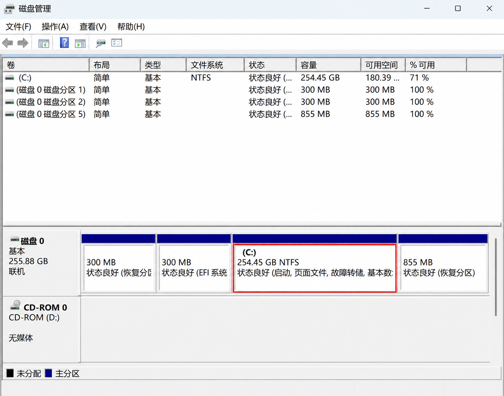
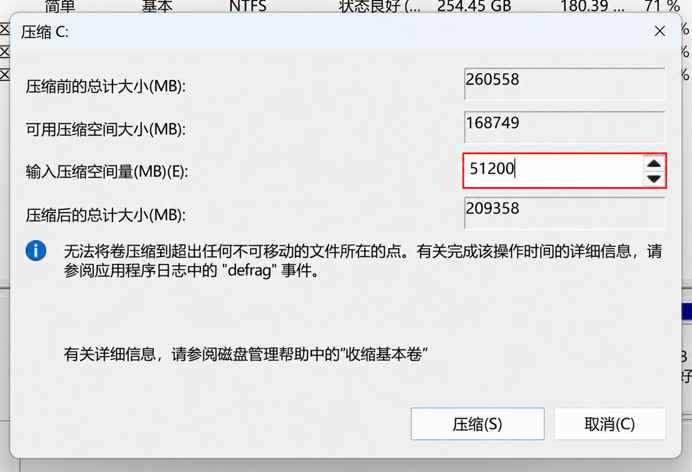
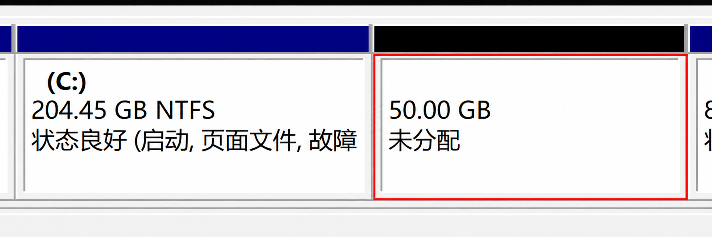
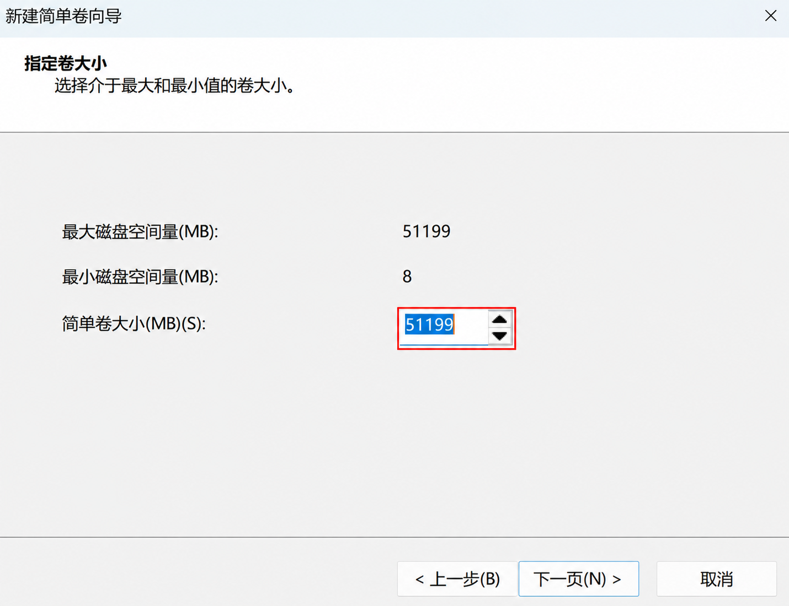
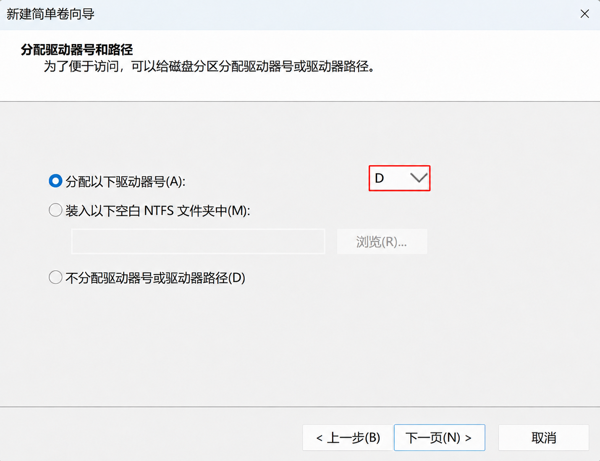
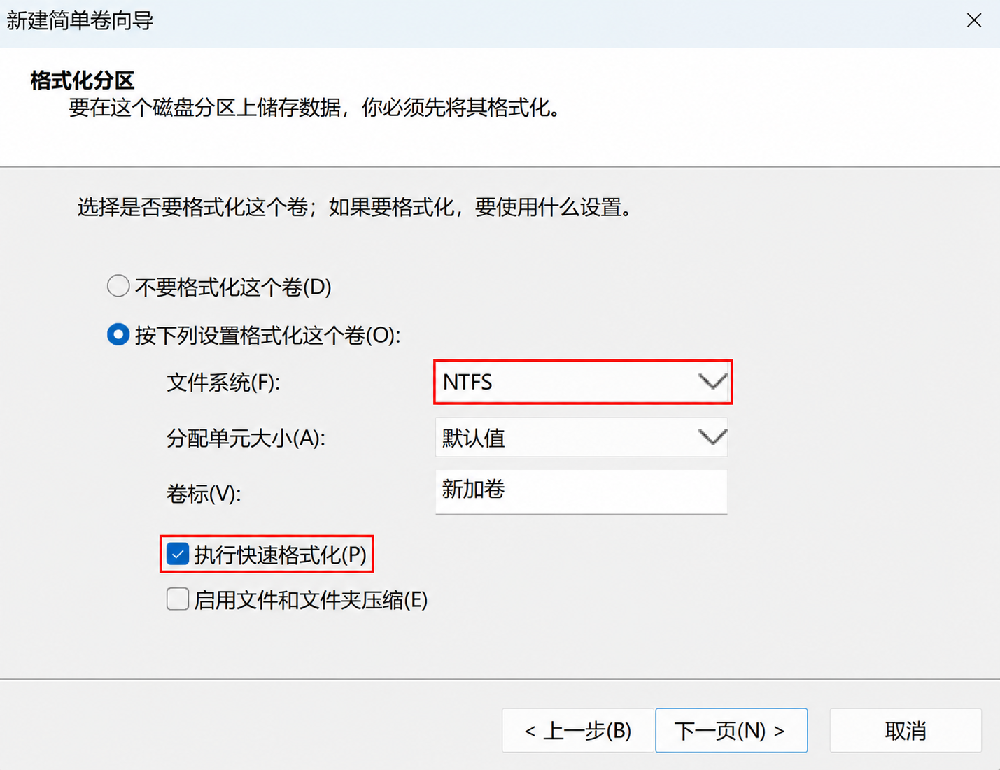
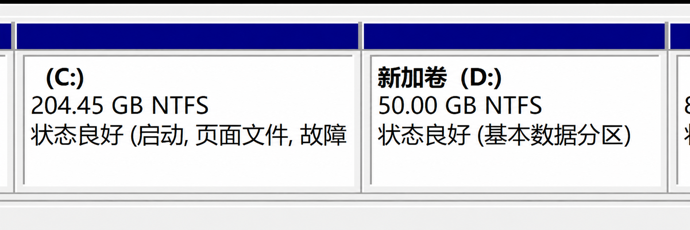
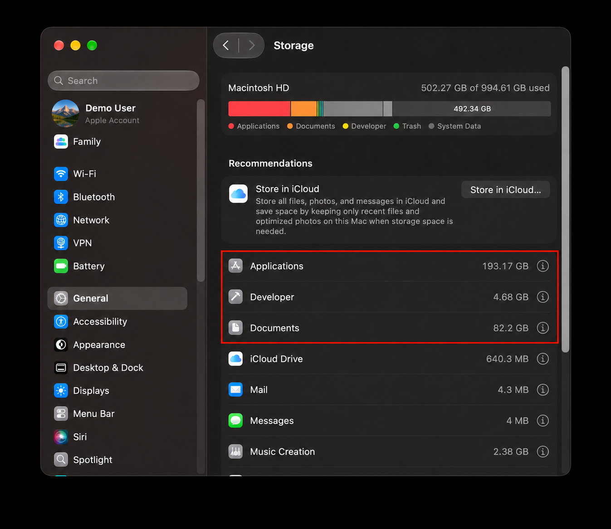

# Only a C: Drive? A Simple Guide to Disk Partitions

Have you ever opened “This PC” and found only a C: drive? Photos, coursework, games, and apps can all end up together. After a while, finding something can feel like rummaging through one big drawer. Perhaps a separate drive would make things a little easier to organize.

Let’s use Windows 11 to get to know partitions and see how to make a new drive from the space you already have.

The Windows screenshots show a Chinese-language interface; the instructions use the English menu names.

## One cabinet, several drawers

Think of a physical disk as a cabinet. A partition is like a separate drawer inside it. The C: and D: drives can be different areas on the same physical disk, giving you places to organize files in a way that suits you.

One thing to keep in mind: **partitioning does not create extra storage.** If C: and D: are on the same disk, both may be affected if that disk fails. A D: drive is therefore not a backup: keep important files on an external drive or in another independent location too.

## Before we start

1. **Back up the things you care about.** Copy coursework, photos, and other important files to an external drive or another independent location, then open a few copies to make sure they work.
2. **Check how much room you have.** The new drive takes space from an existing partition, so leave plenty on C: for Windows updates, apps, and everyday files.
3. **Find the right area.** We will use C: in this example, but your disk may look different from the pictures. Leave small partitions marked “Recovery” or “EFI,” and anything else you do not recognize, alone.

If your school or workplace manages the computer, it is a good idea to check with the administrator first. If anything looks unfamiliar or the disk seems to have a problem, pause and ask someone familiar with Disk Management for help. If you use AI for advice, check it before acting, as AI can make mistakes too.

## Step one: make room on the C: drive

Search for **Disk Management** in Windows, then choose **Create and format hard disk partitions** from the results. Wait for the window to load, find the area labeled `C:` in the lower part of the window, right-click it, and choose **Shrink Volume**.

Give Windows a moment to work out how much space it can free. Enter the amount you want for the new partition in MB. For example, `51200 MB` is approximately `50 GB`; it is only an example, so choose an amount that fits your computer. The number is the amount to free, not the final size of C:. Select **Shrink** after checking it.

When Windows finishes, an area marked **Unallocated** appears in Disk Management. It has no drive letter yet and will not immediately appear in “This PC.”

## Step two: give the new space a drive letter

Right-click the **Unallocated** space you just created, choose **New Simple Volume**, and follow the wizard:

1. Confirm the size. Keep the default if you want to use all of the space you just freed.

   

2. Choose an available drive letter. If D: is already in use, another letter is fine.

   

   The D: shown here was edited for illustration. Choose a letter available on your own computer.

3. Use the wizard's default format settings for this **new, empty volume**. Review the summary and select **Finish**.

   

Formatting removes data on the target volume, so take another look here: make sure you selected the unallocated space you just created, not C:, another data drive, or a recovery partition. When the wizard finishes, open “This PC” to find the new drive.

## Why can I not free more space?

If C: appears to have plenty of free space but Windows offers less than you expected, you are not alone. Some system files cannot be moved automatically, which can limit the available amount. Work within the limit shown or ask someone familiar with Disk Management for help. Do not delete system files simply to make the number larger.

Creating a partition does not automatically move your existing files. Copy the files you want to organize to the new drive yourself. Check that they open before deciding whether to delete the originals. Do not drag system files or installed applications to a new drive.

## What if your Mac is running out of space?

The steps above are for Windows. Mac users usually do not need to create separate partitions like C: and D: just to organize files. With the APFS format commonly used on Macs, multiple volumes in the same container can share free space, so you generally do not need a separate partition just to organize files. Adding a volume or partition does not increase the disk's physical capacity.

If your Mac is low on space, open **Apple menu → System Settings → General → Storage** to see what is taking up room. Check your Downloads folder, uninstall applications you no longer use, or copy large files you rarely need to an external drive. Make sure the copies open before deciding whether to delete the originals. Check the Trash before emptying it. iCloud storage optimization is another option; check your available cloud storage and sync settings first.

Partitions are simply one way to make things easier to organize. If folders already work well for you, it is perfectly fine to keep using them.

## References

1. Microsoft Support, Disk Management in Windows: https://support.microsoft.com/en-gb/windows/experience/storage-filemanagement/disk-management-in-windows
2. Microsoft Learn, Shrink a Basic Volume: https://learn.microsoft.com/en-my/windows-server/storage/disk-management/shrink-a-basic-volume
3. Microsoft Support, Backup and restore with File History: https://support.microsoft.com/en-us/windows/experience/backup-recovery/backup-and-restore-with-file-history
4. Apple Support, Free up storage space on Mac: https://support.apple.com/en-gb/102624
5. Apple Support, Add, delete, or erase APFS volumes: https://support.apple.com/en-ie/guide/disk-utility/dskua9e6a110/mac
