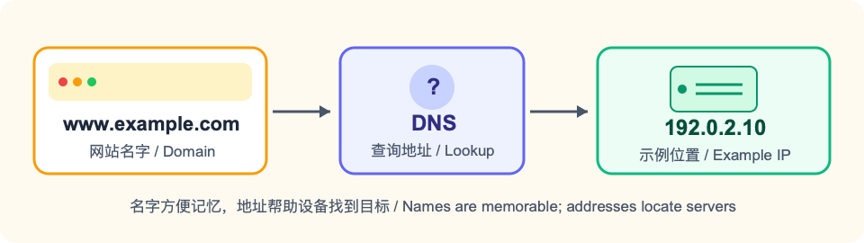
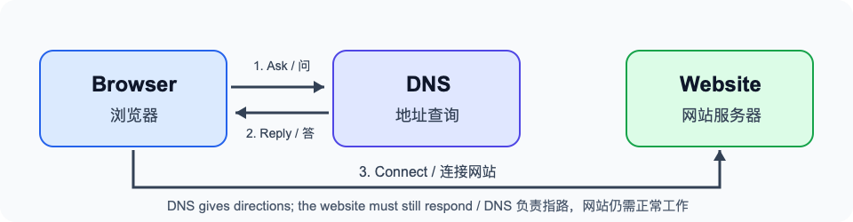
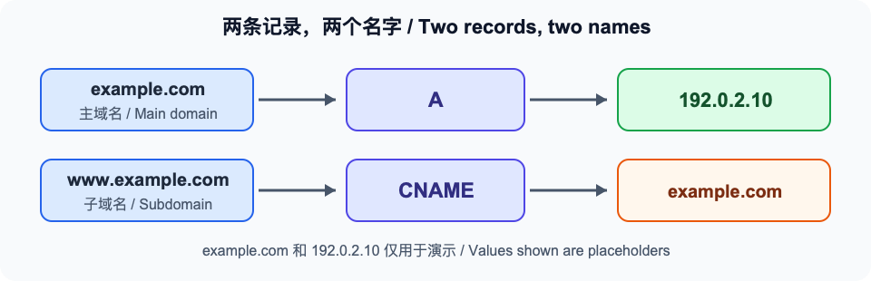

# 网址打不开？用一杯咖啡的时间弄懂域名解析

你给你自己做了一个个人网站，也买了一个好记的网址。把网址发给朋友后，朋友却说：“打不开。”这时先别急着改网页：网站已经做好，别人也未必知道它在哪里。**域名解析**做的，就是帮大家找到它。

## 网站也需要“地址”

想象你约朋友去一家新开的咖啡店。你只说店名，朋友还得查到地址才能过去。访问网站也差不多：`example.com` 是容易记住的名字，服务器的 IP 地址是设备用来寻找目标的信息。帮设备查找这些信息的系统叫 DNS。

这个比喻有个边界：DNS 负责回答“这个名字有哪些记录”，并不负责建设网站。知道咖啡店地址，不代表店一定开门；查到网站地址，也不代表网页一定能打开。

## 输入网址后，发生了什么？

你在浏览器里输入网址，设备就会向 DNS 问：“这个名字对应的地址是什么？”DNS 把结果告诉设备，设备再去尝试连接网站。若设备或帮它查询的服务保存过答案，查询还可能更快。

不需要记住背后的所有服务器。作为网站的主人，你先记住两件事：**名字要有正确的记录；网站服务器本身也要正常工作。** 接下来，我们就用一个例子把记录填好。

## 动手前，先准备两样东西

第一样是你买下的域名，第二样是建站平台给你的“连接信息”。如果你自己管理服务器，平台通常会给出服务器 IP 地址；如果你用的是托管建站服务，平台也可能要求你把域名指向它提供的另一个名字。先照着建站平台的绑定说明确认要填什么，再到 DNS 控制台操作。**不要把别人教程里的地址原样复制到自己的记录中。**

还要决定朋友会输入哪一种网址：`example.com`，还是带 `www` 的 `www.example.com`？两者看起来相似，在 DNS 中却是两个名字。如果希望两个都能访问，就分别配置，并在建站平台里确认两个网址都已绑定。选一个作为常用网址即可，另一个是否跳转到它，是网站平台里的另一项设置。

## 给自己的域名填两条记录

假设你的域名是 `example.com`，网站服务器的地址是 `192.0.2.10`。**它们只是教学示例，不能直接用于你的网站。** 实际操作时，请换成自己的域名和建站平台提供的真实地址。

打开负责你域名解析的控制台，找到“DNS 解析”或“域名记录”。如果域名是在一家平台购买、解析却交给另一家平台管理，就去实际管理解析的那一家填写。拿不准时，先查看购买域名的平台提供的“DNS 管理”说明，确认记录应该填在哪里。

先填主域名。这条记录叫 **A 记录**，它把名字指向一串像 `192.0.2.10` 这样的地址，技术上叫 IPv4 地址。很多控制台用 `@` 代表主域名 `example.com`：

- 类型：A
- 名称：`@`
- 记录值：你自己的服务器 IPv4 地址

再想想朋友会不会输入 `www.example.com`。它和 `example.com` 是两个不同的名字；如果也要让带 `www` 的网址可用，可以添加 **CNAME 记录**。它的意思是“请先去找另一个名字”：

- 类型：CNAME
- 名称：`www`
- 目标：`example.com`

现在替朋友走一遍：他输入 `www.example.com`，DNS 看到 `www` 的 CNAME，知道接着要找 `example.com`；主域名的 A 记录再给出服务器地址。他的设备拿着地址去找网站，网站回应后，页面才会出现。如果他直接输入 `example.com`，就从主域名的记录开始查。图里的箭头，表示的就是这两条路线。

有些控制台要求填写完整域名，而不是 `@` 或 `www`；以界面提示为准。如果 `www` 已经有 A 记录，先别直接再加同名 CNAME，两种记录会冲突。

## 保存后还是打不开，怎么办？

**先看两个名字是不是都填了。** 只配置 `example.com`，并不会自动保证 `www.example.com` 也能用；反过来也是一样。回到控制台，分别核对主域名和 `www` 的记录。

**再给旧答案一点时间。** DNS 的结果会被暂时保存，就像朋友手机里还有咖啡店的旧地址。你改了记录，别人使用的查询服务可能还在用旧答案。控制台里有个叫 TTL 的“缓存时间”选项，初次设置可以先保留默认值；它不是一个到点后所有人同时刷新的闹钟。确认记录填对后，稍等再试，比反复点“保存”更有用。

**最后看网站本身。** 如果域名已经指向正确地址，页面依然打不开，问题可能在服务器或网站程序。如果浏览器提示“连接不安全”，还要检查网站的 HTTPS 证书。DNS 只负责指路；找到门牌号以后，还要有人开门。

你可以先分别打开带 `www` 和不带 `www` 的网址，看看是不是只有其中一个出问题；再试试用手机流量和 Wi-Fi 访问，观察结果是否一致。这些尝试不能单独证明故障原因，却能帮你判断下一步该核对哪条记录、等待旧答案更新，还是去检查网站平台。把看到的现象记下来，比只说“打不开”更容易排查。

下次遇到“网址打不开”，按这个顺序想：**名字写对了吗？记录填对了吗？旧答案更新了吗？网站本身能用吗？** 一步步排查，就不用把所有问题都归咎于“域名坏了”。

## 参考资料

1. ICANN，《Authoritative Name Server》：https://www.icann.org/en/icann-acronyms-and-terms/authoritative-name-server-en
2. Cloudflare，《DNS record types》：https://developers.cloudflare.com/dns/manage-dns-records/reference/dns-record-types/
3. Cloudflare，《Manage DNS records》：https://developers.cloudflare.com/dns/manage-dns-records/how-to/create-dns-records/
4. Cloudflare，《Time to Live (TTL)》：https://developers.cloudflare.com/dns/manage-dns-records/reference/ttl/
5. IANA，《Example Domains》：https://www.iana.org/help/example-domains
6. IETF，《RFC 5737: IPv4 Address Blocks Reserved for Documentation》：https://www.rfc-editor.org/info/rfc5737/
