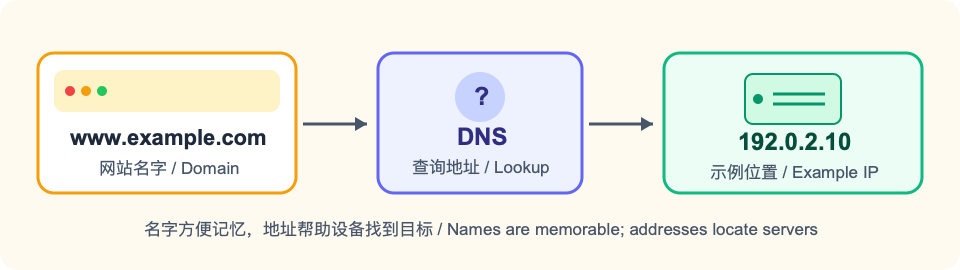
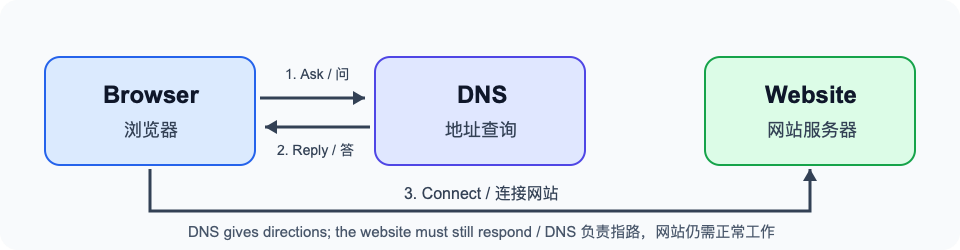
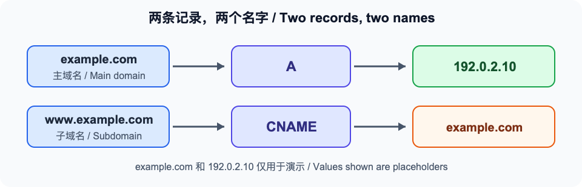

# Website Not Loading? Let's Talk About DNS Over Coffee

Imagine you've just finished building a personal website and picked a memorable address for it. You happily send it to a friend, only to hear, “Why won't it open?” Don't worry just yet. The address might not be taking your friend to the right place. That's where **DNS resolution** helps point the way.

## Websites Need an Address Too

Imagine you've invited a friend to a new coffee shop. If you only tell him the shop's name, he'll still need to look up its address. Visiting a website works much the same way. `example.com` is a name that's easy to remember, while a server's IP address gives a device the information it needs to find its destination. The system that helps look up this information is called DNS.

Finding the address is only the first step, though. You might know where the coffee shop is, but it still needs to be open when you arrive. In the same way, DNS helps look up the records, and the website itself needs to be running too.

## What Happens When You Enter an Address?

When you type an address into your browser, your device asks DNS, “What's the address for this name?” DNS returns an answer, and your device then tries to connect to the website. If your device or the service helping it has saved the answer from an earlier lookup, the process may be quicker.

You don't have to memorize all the servers working behind the scenes. For now, it's enough to know that the address needs to point to the right place and the website needs to be running. Let's walk through an example and see how to fill in the records.

## Two Things to Have Ready

Before we start, have two things handy: the domain you've registered and the connection details from your website provider. If you manage your own server, your provider will usually give you its IP address. If you use a hosted website service, it might instead ask you to point your domain to another name it provides. Check your provider's domain setup instructions first, then enter the details in your DNS dashboard. **The addresses in a tutorial are only examples—remember to use your own.**

You'll also want to think about which address your friend might type: `example.com` or `www.example.com`? They look similar, but DNS treats them as two different names. If you want both to work, set up a record for each and make sure your website provider has both names configured. You can pick one as the address you usually share; redirecting the other to it is a separate setting on your website platform.

## Add Two Records to Your Domain

Let's say your domain is `example.com` and your website server's address is `192.0.2.10`. **These are examples for documentation, so you can't use them for your own website.** Replace them with your actual domain and the address given to you by your provider.

Open the dashboard that manages your domain's DNS and look for “DNS” or “DNS records.” You may have bought your domain from one company and chosen another to manage DNS. If so, add the records where DNS is actually managed. If you're unsure, check the DNS management instructions from the company where you registered the domain.

Let's start with the main domain. An **A record** points a name to an address like `192.0.2.10`, known as an IPv4 address. Many dashboards use `@` to represent the main domain, `example.com`:

- Type: A
- Name: `@`
- Value: your own server's IPv4 address

Now, what if your friend types `www.example.com`? It's a different name from `example.com`. To make the address with `www` work too, you can add a **CNAME record**. It says, in effect, “Please look up this other name first”:

- Type: CNAME
- Name: `www`
- Target: `example.com`

Let's put those two records together and follow your friend. He types `www.example.com`, and DNS finds the CNAME for `www`, which points it to `example.com`. The main domain's A record then provides the server address. His device uses that address to reach the website, and the page can load if the website responds properly. If he types `example.com` directly, the lookup starts with the main domain's record. The arrows in the picture show these two routes.

Some dashboards ask for the full domain name instead of `@` or `www`, so follow the instructions on your screen. Also, if `www` already has an A record, don't add a CNAME with the same name alongside it—the two will conflict.

## Still Not Loading After Saving?

**Start by checking both names.** Setting up `example.com` alone doesn't automatically make `www.example.com` work, or the other way around. Take another look at the records for both names in your dashboard.

**Just changed a record? Give it a little time.** DNS answers are saved temporarily, a bit like your friend keeping the coffee shop's old address on his phone. Even after you update a record, someone else's lookup service might still have the old answer. Your dashboard may have a cache-time setting called TTL; leaving it at its default is fine when you're starting out. It's not an alarm that makes everyone's old answer refresh at exactly the same time. Once you've checked the record, waiting a little before trying again is more useful than repeatedly hitting “Save.”

**If the address looks right, check the website itself.** When the domain points to the correct address but the page still won't load, the server or website software may be the issue. If your browser says the connection isn't secure, check the site's HTTPS certificate too. DNS helps with directions; once someone finds the door, the website still needs to open it.

You can also try both addresses, with and without `www`, to see if only one has a problem. Try mobile data and Wi-Fi too, and see whether the results differ. These checks won't tell you the cause on their own, but they can help you decide whether to revisit a record, wait for an old answer to expire, or check your website platform. Writing down what you see makes it easier to troubleshoot than simply saying “it won't open.”

The next time an address doesn't work, you can take it one question at a time: **Is the name right? Are the records right? Has the old answer updated? Is the website itself working?** Each answer brings you a little closer to finding the problem.

## References

1. ICANN, “Authoritative Name Server”: https://www.icann.org/en/icann-acronyms-and-terms/authoritative-name-server-en
2. Cloudflare, “DNS record types”: https://developers.cloudflare.com/dns/manage-dns-records/reference/dns-record-types/
3. Cloudflare, “Manage DNS records”: https://developers.cloudflare.com/dns/manage-dns-records/how-to/create-dns-records/
4. Cloudflare, “Time to Live (TTL)”: https://developers.cloudflare.com/dns/manage-dns-records/reference/ttl/
5. IANA, “Example Domains”: https://www.iana.org/help/example-domains
6. IETF, “RFC 5737: IPv4 Address Blocks Reserved for Documentation”: https://www.rfc-editor.org/info/rfc5737/
