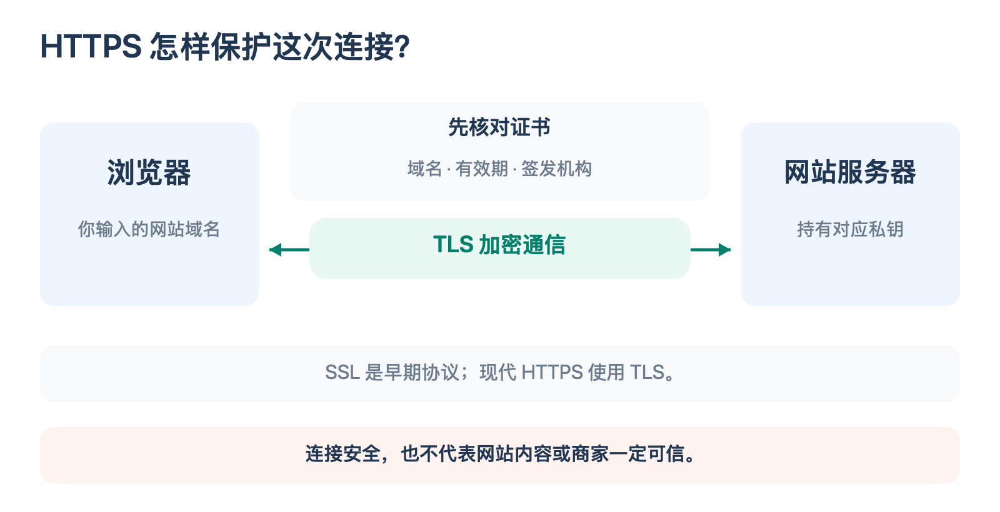
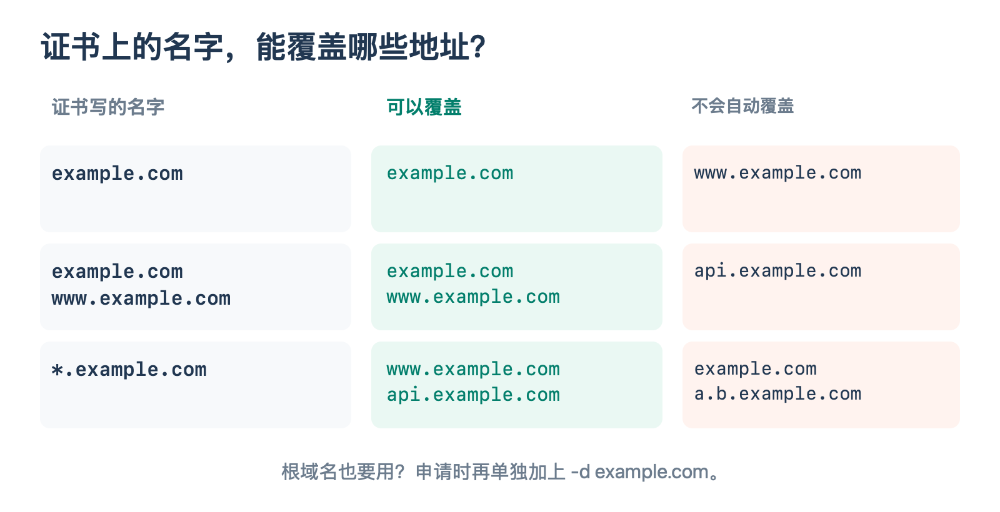
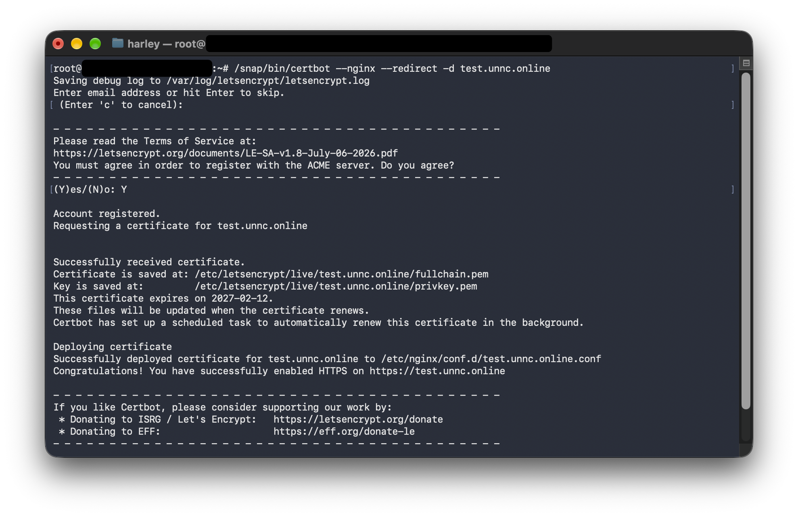
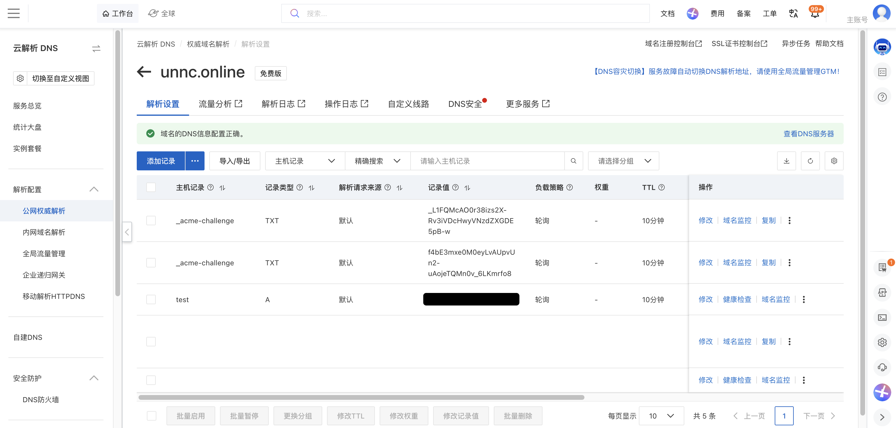
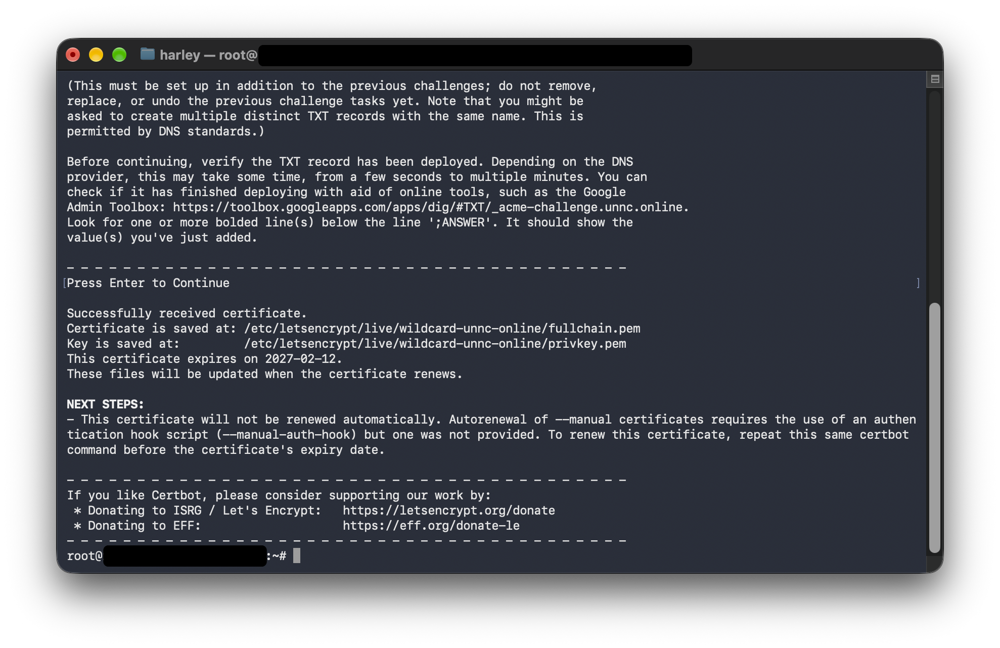
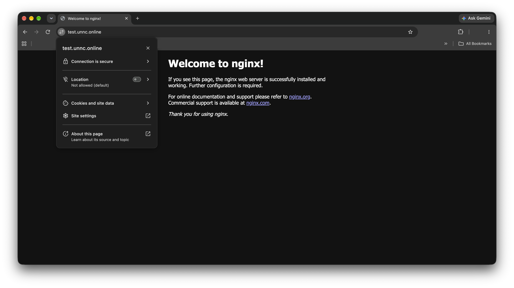
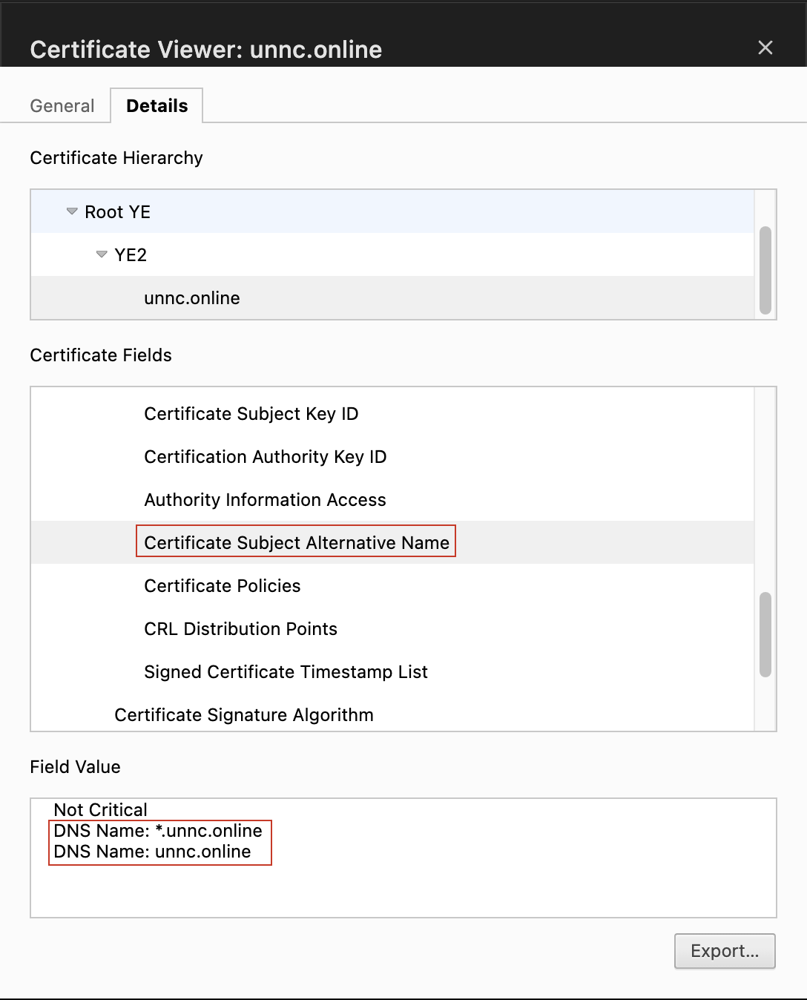
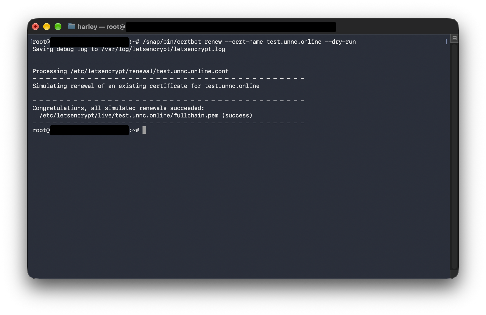

# HTTPS 和 SSL 证书：让自己的网站用上安全连接

朋友终于能打开网站了，浏览器却写着“不安全”。页面明明好好的，哪里还没准备好呢？这次聊聊 HTTPS 和 SSL 证书。

> 文中的 `unnc.online` 是自备的测试域名，**与宁波诺丁汉大学（UNNC）无关，也不是学校的官方域名**。

## 1. HTTPS 是什么，为什么网站需要它？

DNS 帮朋友找到网站，接下来还要登录、填表单。密码和联系方式传给网站，这一路也需要保护。

HTTPS 就是在 HTTP 通信上加一层 TLS 保护，帮浏览器核对网站身份、加密传输内容，并发现途中被改动的数据。这样，密码和表单就不用通过普通 HTTP 连接“明文裸奔”了。

## 2. SSL 证书在其中做什么？

证书像网站递来的一份身份证明。浏览器看看名字对不对、有没有过期，再沿证书链确认签发机构是否受信任；网站还得证明持有对应私钥，才能完成身份核对。

那为什么一会儿 SSL、一会儿 TLS？SSL 是早期协议，现在 HTTPS 用的是后来的 TLS，只是“SSL 证书”这个名字叫习惯了。

下图把这两件事连到了一起。不过，**连接安全不代表网站内容或商家一定可信**，仿冒网站也能给自己的域名申请证书，还是得看清网址哦。



## 3. 申请证书前要准备什么？

先准备好能管理的域名和服务器，确认能修改 DNS。解析有点生疏？可以翻翻《网址打不开？用一杯咖啡的时间弄懂域名解析》。

**服务器放在哪里，也别漏看了。** 中国大陆服务器上的网站，要先完成 ICP 备案及接入商要求的接入手续。**没完成备案，即使解析生效，网站访问仍会被拦截**，也可能让 HTTP-01 验证失败。这里看的是服务器所在地，不是访问者所在地。

接着想想，朋友会输入哪些网址？证书也“认名字”：单域名证书覆盖一个名字，多域名证书把几个名字放在一起。通配符 `*.example.com` 则能照顾 `www.example.com`、`api.example.com` 这样的一级子域名。

不过，星号只替代一层。如下图，**它不包含 `example.com` 本身，也不包含 `a.b.example.com`**。想让根域名也能用，就把它单独列进去。



签发机构还会确认：“这个域名确实归你管理吗？”常见验证有两种：

- **HTTP-01**：从网站的公网 80 端口读取指定临时文件。
- **DNS-01**：查询你按要求添加的 TXT 文本记录。无需网站开放 80 端口，Let’s Encrypt 的通配符证书使用这种验证。

## 4. 在同一台服务器上配置 HTTPS

东西齐了，动手试试。这次用一台运行 Ubuntu 24.04 的 2 核、2 GB 内存服务器：Nginx 提供网页，Let’s Encrypt 免费签发证书，Certbot 帮忙申请和配置。

示例网站用 `test.unnc.online`，通配符用 `unnc.online` 和 `*.unnc.online`。先让自己域名下的 `test` A 记录指向服务器**公网 IPv4**；本例只用 IPv4，有不用的 AAAA 记录时先移除，避免浏览器走到未配置的 IPv6 地址。入站规则和防火墙里的 TCP 80、443 也要放行。

**下面按这次实测的步骤来，和截图一样在服务器的 root 终端执行。** 命令保留实测域名和路径，自己跟着做时记得换成自己的。本次服务器已经装有 Snap；已有 Nginx 或 Certbot 的话，跳过对应的安装步骤即可。

### 普通域名：让 Certbot 帮个忙

先安装 Nginx，再看看它有没有运行起来：

```bash
apt update
apt install nginx
systemctl status nginx --no-pager
```

询问是否继续安装时，输入 `Y` 并回车。状态显示 `active (running)` 后，打开 HTTP 测试网址，应该能看到 Nginx 欢迎页。

接着给这个域名建站点配置。**下面会覆盖同名文件，已有文件先备份。** 再整块复制执行：

```bash
cat > /etc/nginx/conf.d/test.unnc.online.conf <<'EOF'
server {
    listen 80;
    server_name test.unnc.online;

    root /var/www/html;
    index index.html index.htm index.nginx-debian.html;
}
EOF
```

`cat` 把 `EOF` 之间的内容写进指定文件。`listen` 是端口，`server_name` 是域名，`root` 是网页目录，`index` 是默认页面。

保存好，检查并重载配置：

```bash
nginx -t && systemctl reload nginx
```

`&&` 表示检查通过后才继续重载。接下来安装 Certbot：

```bash
snap install --classic certbot
```

安装完成，再看一眼版本号：

```bash
/snap/bin/certbot --version
```

工具就位，先试跑一次申请：

```bash
/snap/bin/certbot certonly --nginx --dry-run -d test.unnc.online
```

`--dry-run` 用测试环境，不保存证书。看到 `The dry run was successful.` 后，先给 Nginx 配置留份备份：

```bash
cp -a /etc/nginx "/etc/nginx.before-https-$(date +%s)"
```

然后正式申请：

```bash
/snap/bin/certbot --nginx --redirect -d test.unnc.online
```

`--nginx` 帮忙申请并部署，`--redirect` 让 HTTP 转到 HTTPS，`-d` 指定域名。按提示填写邮箱、阅读并确认条款即可。

下图中间是签发结果、文件路径和到期日，下面是部署结果。**拿到证书以后，还得让网站真正用上它。**



### 通配符：手动完成 DNS 验证

只保护这个网站，前面就够了。想试试通配符，就继续：

```bash
/snap/bin/certbot certonly --manual --preferred-challenges dns \
  --cert-name wildcard-unnc-online \
  -d unnc.online -d '*.unnc.online'
```

这里 `certonly` 只申请，`--manual` 是手动验证，`--preferred-challenges dns` 选择 DNS。`--cert-name` 给证书起个本机管理名称；引号留着，避免星号被终端展开。

终端会给出 TXT 名称和值。截图中是 `_acme-challenge.unnc.online`；换成自己的域名时，以终端提示为准。如果面板会补全域名，名称填 `_acme-challenge`，值复制**本次终端生成的内容**。**回车先不急，等公共 DNS 能查到再继续。**

如果又出现第二个值，也不用慌。根域名和通配符可能各要一次验证，如下图，同名的两条 TXT 可以同时存在。第二条新增就好，第一条留到验证全部结束再清理。



文件路径在下图中部。下面还提醒：这次手动申请的证书不会自动续期，后面再聊怎么处理。



接着给原来的 `test.unnc.online` 换上通配符证书。和实测时一样，先备份站点文件：

```bash
cp -a /etc/nginx/conf.d/test.unnc.online.conf \
  "/etc/nginx/conf.d/test.unnc.online.conf.bak-$(date +%s)"
```

再替换配置里的证书和私钥目录：

```bash
sed -i 's|/etc/letsencrypt/live/test\.unnc\.online/|/etc/letsencrypt/live/wildcard-unnc-online/|g' \
  /etc/nginx/conf.d/test.unnc.online.conf
```

最后检查，通过后重新加载：

```bash
nginx -t && systemctl reload nginx
```

`sed` 只替换证书目录，网站域名仍是 `test.unnc.online`。目录中的 `fullchain.pem` 是证书及中间证书链，`privkey.pem` 是私钥，要保管好。以后新增子域名，也别忘了给它配解析和站点。

## 5. 怎么确认配置成功？

回浏览器看看吧。用无痕窗口打开自己的 HTTPS 测试网址（图中是 `https://test.unnc.online`），点地址栏左侧的网站信息。下图的 **Connection is secure**，就是浏览器认可这次连接了。



再打开证书详情看有效期，到 Details 页选 **Certificate Subject Alternative Name（SAN）**。下图底部 Field Value 列着 `*.unnc.online` 和 `unnc.online`，`test.unnc.online` 正好被前者覆盖。



想看看 HTTP 有没有自动转过去，也可以运行：

```bash
curl -I http://test.unnc.online
```

这次返回了 `301`，`Location` 指向 HTTPS，跳转也对上了。

没有一次成功也没关系，可以顺着现象找：域名不匹配就看看 SAN；证书过期就查浏览器是否还收到旧证书。网站前面有 CDN 或反向代理，要检查入口的证书。完全连不上，再查 443 端口和大陆服务器的备案状态；页面夹着 HTTP 图片或脚本，还可能有混合内容问题。

## 6. 证书到期后怎么办？

证书也有“保质期”，领完以后还得惦记着续期。普通 Nginx 路线可以先试跑续期，再看看 Snap 装好的定时器：

```bash
/snap/bin/certbot renew --cert-name test.unnc.online --dry-run
```

再看自动续期定时器：

```bash
systemctl status snap.certbot.renew.timer --no-pager
```

下图是换通配符之前，普通证书的续期测试。`--dry-run` 只是试跑，不会换掉正式证书；定时器里的 `enabled`、`active (waiting)`，表示定期检查已经安排上了。



不过，**手动填 TXT 的通配符证书不会因为有定时器就自动续期。** 到期前还要重新运行申请命令、填写新的 TXT，更新后重载 Nginx。想省去手动操作，可以再用 DNS API 插件，配合部署后的重载。

换好后，回浏览器核对新证书的到期日。旧证书不再用了，也等确认没有站点引用后，再交给 Certbot 清理。

## 参考资料

1. Certbot, Nginx on Linux: https://certbot.eff.org/instructions?ws=nginx&os=snap
2. Certbot, User Guide: https://eff-certbot.readthedocs.io/en/stable/using.html
3. Let’s Encrypt, Challenge Types: https://letsencrypt.org/docs/challenge-types/
4. Let’s Encrypt, FAQ: https://letsencrypt.org/docs/faq/
5. Nginx, Configuring HTTPS Servers: https://nginx.org/en/docs/http/configuring_https_servers.html
6. Ubuntu, Install Nginx: https://ubuntu.com/server/docs/how-to/web-services/install-nginx/
7. IETF, Service Identity in TLS: https://www.rfc-editor.org/rfc/rfc9525.html
8. 工业和信息化部，《非经营性互联网信息服务备案管理办法》（2024 修订，商务部转载）：https://policy.mofcom.gov.cn/claw/clawContent.shtml?id=100058
9. 腾讯云，网站/APP 阻断相关：https://cloud.tencent.cn/document/faq/243/20220
