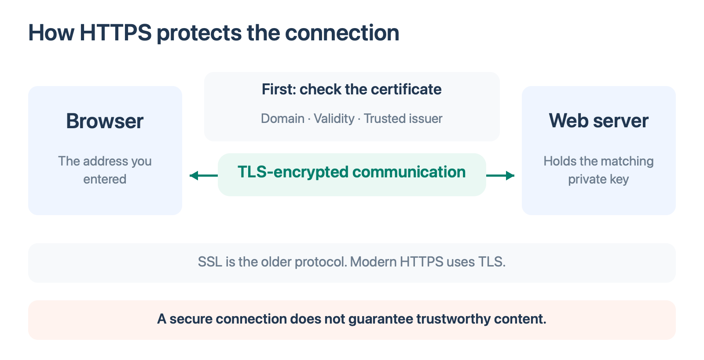
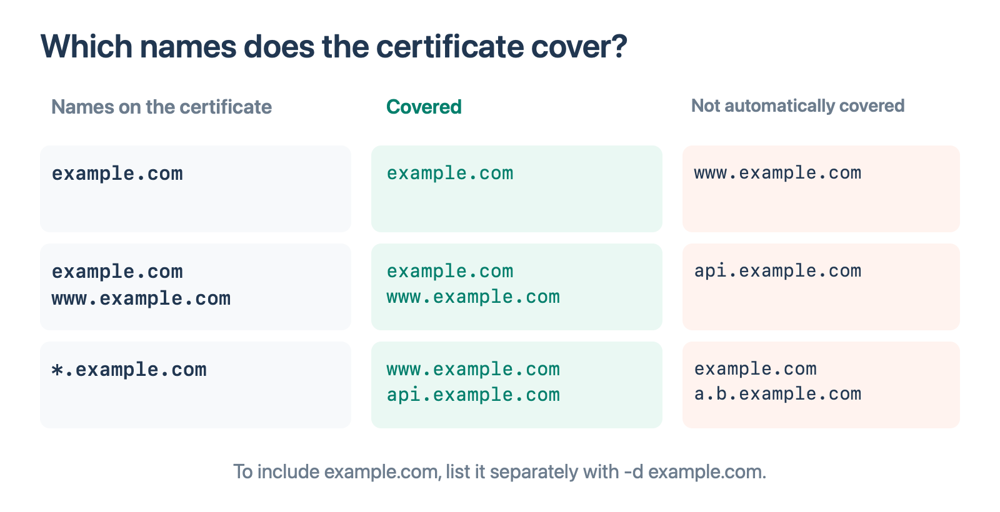
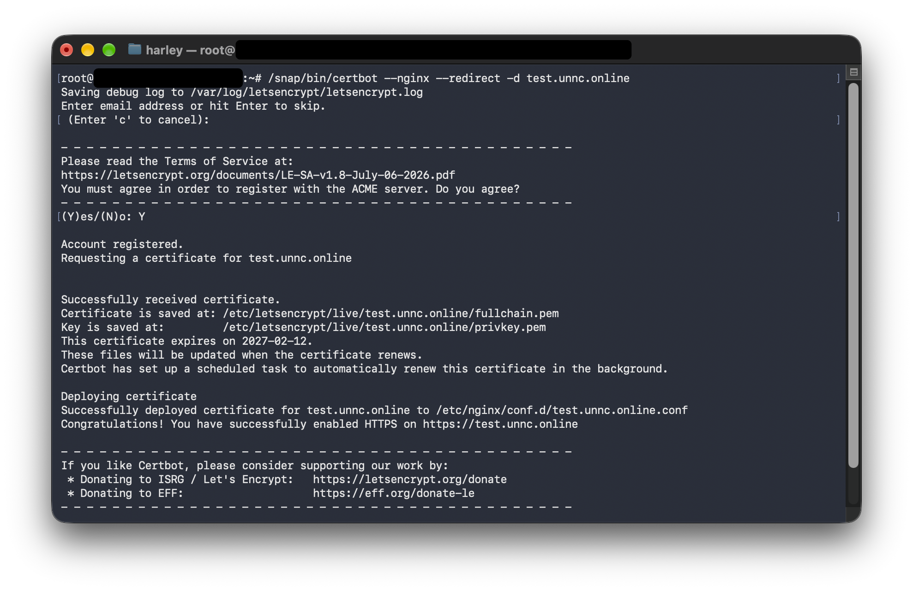
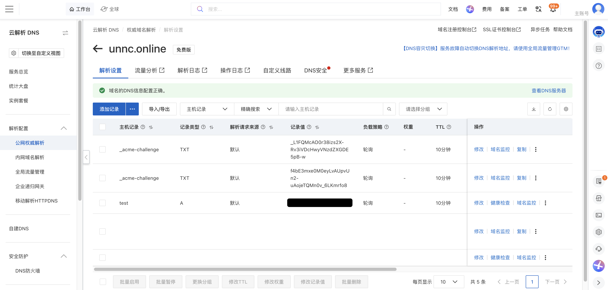
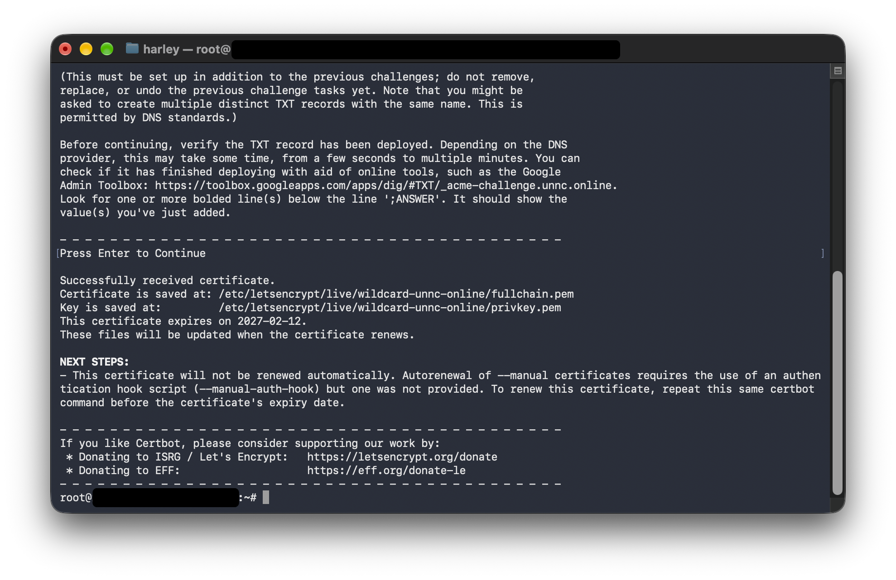
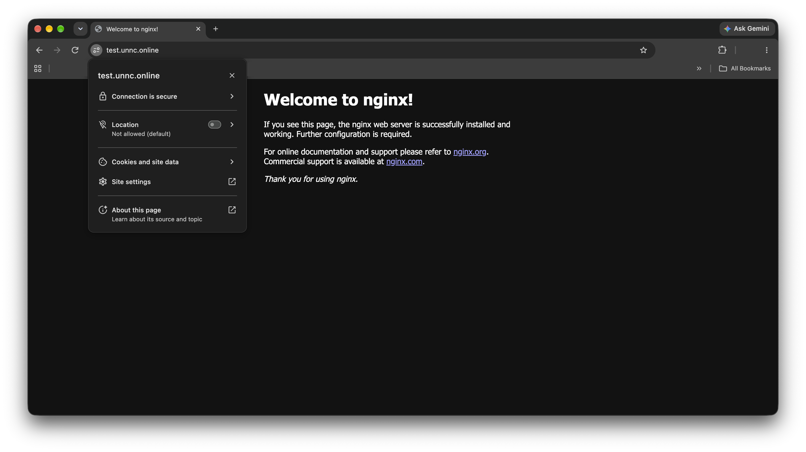
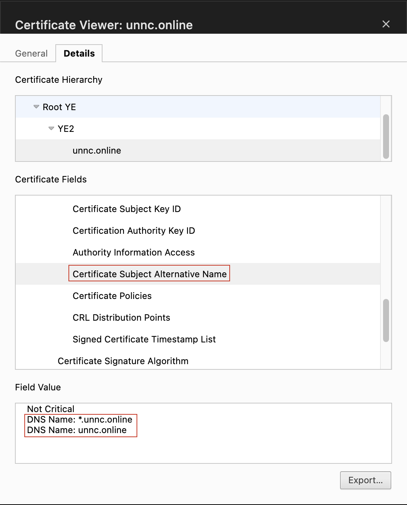
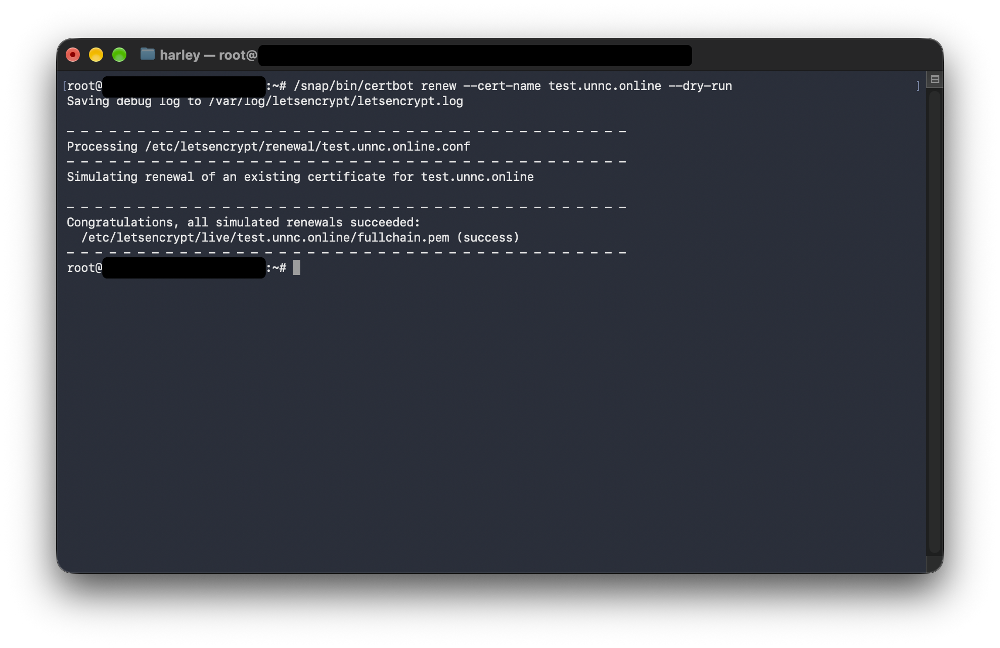

# HTTPS and SSL Certificates: Give Your Website a Secure Connection

Your friend can finally open your website, but the browser still says “Not Secure.” The page looks fine, so what's missing? Let's pick up where our DNS article left off and talk about HTTPS and SSL certificates.

> `unnc.online` is a personal test domain. **It is not affiliated with the University of Nottingham Ningbo China (UNNC) and is not an official university domain.**

## 1. What is HTTPS, and why does a website need it?

DNS helps your friend find the website. Next come things like logging in and filling out forms. Passwords and contact details go from the browser to the site, and they need protection along the way.

HTTPS adds TLS protection to HTTP communication. It helps the browser check the website's identity, encrypts data in transit, and detects changes made along the way. Passwords and form submissions no longer have to travel in plain sight over an ordinary HTTP connection.

## 2. What does an SSL certificate do?

A certificate is a bit like a piece of identification the website hands over. The browser checks that the name matches and the certificate hasn't expired, then follows the certificate chain to a trusted issuer. The website also has to prove it holds the matching private key to complete authentication.

So why do we keep switching between SSL and TLS? SSL is the older protocol; HTTPS now uses its successor, TLS. “SSL certificate” is simply the name that stuck.

The diagram below puts those checks and encrypted communication together. Still, **a secure connection doesn't guarantee trustworthy content or an honest business.** An impersonation site can get a certificate for its own domain too, so it's worth looking closely at the address.



## 3. What should you prepare before requesting a certificate?

Have a domain and server you can manage, and make sure you can edit the DNS records. A little rusty on DNS? You can revisit “Website Not Loading? Let's Talk About DNS Over Coffee” first.

**Don't forget to check where the server is hosted.** A website on a mainland China server needs an ICP filing and the current hosting provider's required access procedures completed first. **Without the required filing, website access is blocked even if DNS is already working.** HTTP-01 validation can fail for the same reason. What matters here is the server's location, not the visitor's.

Next, think about the addresses your friend might type. Certificates pay attention to names too. A single-domain certificate covers one name, while a multi-domain certificate puts several together. A wildcard such as `*.example.com` covers immediate subdomains like `www.example.com` and `api.example.com`.

The asterisk only replaces one level, though. In the diagram below, **it doesn't cover `example.com` itself or `a.b.example.com`.** Include the base domain separately if you want it covered too.



The issuer will also want to know, “Do you actually control this domain?” Two common ways to check are:

- **HTTP-01:** fetching a specified temporary file through the website's public port 80.
- **DNS-01:** querying a TXT text record you add as instructed. The website doesn't need port 80 open for this validation. Let's Encrypt uses this method for wildcard certificates.

## 4. Configure HTTPS on the same server

Ready to try it? We're using a server running Ubuntu 24.04 with 2 CPU cores and 2 GB of RAM. Nginx serves the page, Let's Encrypt issues a free certificate, and Certbot helps with the request and configuration.

The website uses `test.unnc.online`; the wildcard request covers `unnc.online` and `*.unnc.online`. Point the `test` A record under your own domain to the server's **public IPv4 address**. This example uses IPv4 only, so remove unused AAAA records to avoid sending the browser to an unconfigured IPv6 address. Allow TCP ports 80 and 443 through the inbound rules and firewall.

**Follow the steps from our actual test in a root terminal on the server, as shown in the screenshots.** The commands keep the tested domains and paths; substitute your own when following along. This server already had Snap installed. If Nginx or Certbot is already installed, skip its installation step.

### Ordinary names: let Certbot lend a hand

Install Nginx, then check whether it is running:

```bash
apt update
apt install nginx
systemctl status nginx --no-pager
```

If asked to continue the installation, enter `Y`. Once the status shows `active (running)`, open your HTTP test address. You should see the Nginx welcome page.

**This overwrites a file with the same name, so back up any existing file first.** Then copy and run the whole block to create the test site configuration:

```bash
cat > /etc/nginx/conf.d/test.unnc.online.conf <<'EOF'
server {
    listen 80;
    server_name test.unnc.online;

    root /var/www/html;
    index index.html index.htm index.nginx-debian.html;
}
EOF
```

`cat` writes the content between the `EOF` markers into the specified file. `listen` is the port, `server_name` is the domain, `root` is the web directory, and `index` lists default pages.

Check and reload the configuration:

```bash
nginx -t && systemctl reload nginx
```

The `&&` reloads only after the check passes. Next, install Certbot:

```bash
snap install --classic certbot
```

Once installed, check its version:

```bash
/snap/bin/certbot --version
```

With the tools ready, try a certificate request first:

```bash
/snap/bin/certbot certonly --nginx --dry-run -d test.unnc.online
```

`--dry-run` uses the test environment without saving a certificate. Once you see `The dry run was successful.`, back up Nginx's configuration:

```bash
cp -a /etc/nginx "/etc/nginx.before-https-$(date +%s)"
```

Then request the production certificate:

```bash
/snap/bin/certbot --nginx --redirect -d test.unnc.online
```

`--nginx` obtains and installs the certificate, `--redirect` sends HTTP traffic to HTTPS, and `-d` specifies the domain. Follow the email prompt, then read and accept the terms.

The middle of the screenshot below shows issuance, file paths, and the expiration date. Deployment appears farther down. **Once you've got the certificate, the website still needs to put it to use.**



### Wildcards: complete DNS validation manually

If this is the only website you need to protect, the ordinary certificate is enough. Curious about wildcards? Continue with:

```bash
/snap/bin/certbot certonly --manual --preferred-challenges dns \
  --cert-name wildcard-unnc-online \
  -d unnc.online -d '*.unnc.online'
```

Here, `certonly` only obtains the certificate, `--manual` means manual validation, and `--preferred-challenges dns` selects DNS. `--cert-name` sets its local management name. Keep the quotes so the shell doesn't expand the asterisk.

The terminal gives you a TXT name and value. The screenshot uses `_acme-challenge.unnc.online`; for your own domain, follow the terminal's prompt. If the DNS panel appends the domain, enter `_acme-challenge` as the name and copy **the value generated in your current request**. **Hold off on Enter until public DNS returns the record.**

If a second value appears, that's fine too. The base domain and wildcard may each need validation. In the first two rows below, both TXT records use the same name. Add the second and keep the first until all validation is finished, then clean them up.



The issued files' paths appear in the middle of the next screenshot. There's also a reminder below: this manually requested certificate won't renew automatically. We'll come back to that shortly.



Now switch the existing `test.unnc.online` site to the wildcard certificate. As in our test, back up the site file first:

```bash
cp -a /etc/nginx/conf.d/test.unnc.online.conf \
  "/etc/nginx/conf.d/test.unnc.online.conf.bak-$(date +%s)"
```

Then replace the certificate and private key directory in the configuration:

```bash
sed -i 's|/etc/letsencrypt/live/test\.unnc\.online/|/etc/letsencrypt/live/wildcard-unnc-online/|g' \
  /etc/nginx/conf.d/test.unnc.online.conf
```

Finally, check the configuration and reload if it passes:

```bash
nginx -t && systemctl reload nginx
```

`sed` only replaces the certificate directory; the website domain stays `test.unnc.online`. In that directory, `fullchain.pem` contains the certificate and intermediate chain. `privkey.pem` is the private key, so keep it safe. New subdomains still need DNS records and site configuration too.

## 5. How do you confirm the configuration worked?

Let's head back to the browser. Open your own HTTPS test address (`https://test.unnc.online` in the screenshot) in an incognito window and select the site information icon to the left of the address. **Connection is secure**, shown below, means the browser accepts this connection.



Open the certificate details to check its validity period, then select **Certificate Subject Alternative Name (SAN)** on the Details tab. At the bottom of the screenshot below, Field Value lists `*.unnc.online` and `unnc.online`. Our address, `test.unnc.online`, fits under the first one.



Want to check whether HTTP sends visitors over to HTTPS? Try:

```bash
curl -I http://test.unnc.online
```

This request returned `301`, with `Location` pointing to HTTPS. The redirect checks out too.

If it doesn't work on the first try, follow what you see. A domain mismatch calls for a look at SAN; an expired certificate might mean the browser is still receiving an old one. With a CDN or reverse proxy in front, check the certificate at that entry point. If it won't connect at all, check port 443 and the filing status for mainland China servers. HTTP images or scripts on the page can also cause mixed-content problems.

## 6. What happens when the certificate expires?

Certificates have a shelf life too, so there's still renewal to keep in mind. For the ordinary Nginx route, try a renewal test and check the timer Snap installed:

```bash
/snap/bin/certbot renew --cert-name test.unnc.online --dry-run
```

Then check the automatic-renewal timer:

```bash
systemctl status snap.certbot.renew.timer --no-pager
```

The screenshot below shows the ordinary certificate's renewal test before we switched to the wildcard. `--dry-run` is just a test and doesn't replace the production certificate. An `enabled`, `active (waiting)` timer means regular checks are scheduled.



But **having a timer doesn't automatically renew the wildcard certificate we obtained by entering TXT records manually.** Before expiry, repeat the request, enter the new TXT values, and reload Nginx after the update. To save the manual work, use a DNS API plugin together with a reload after deployment.

After the update, check the new expiration date in the browser. If an old certificate is no longer needed, wait until no site references it, then let Certbot remove it.

## References

1. Certbot, Nginx on Linux: https://certbot.eff.org/instructions?ws=nginx&os=snap
2. Certbot, User Guide: https://eff-certbot.readthedocs.io/en/stable/using.html
3. Let's Encrypt, Challenge Types: https://letsencrypt.org/docs/challenge-types/
4. Let's Encrypt, FAQ: https://letsencrypt.org/docs/faq/
5. Nginx, Configuring HTTPS Servers: https://nginx.org/en/docs/http/configuring_https_servers.html
6. Ubuntu, Install Nginx: https://ubuntu.com/server/docs/how-to/web-services/install-nginx/
7. IETF, Service Identity in TLS: https://www.rfc-editor.org/rfc/rfc9525.html
8. MIIT, Administrative Measures for the Filing of Non-commercial Internet Information Services (2024 revision, Chinese; reprinted by MOFCOM): https://policy.mofcom.gov.cn/claw/clawContent.shtml?id=100058
9. Tencent Cloud, Website/App Blocking FAQ (Chinese): https://cloud.tencent.cn/document/faq/243/20220
