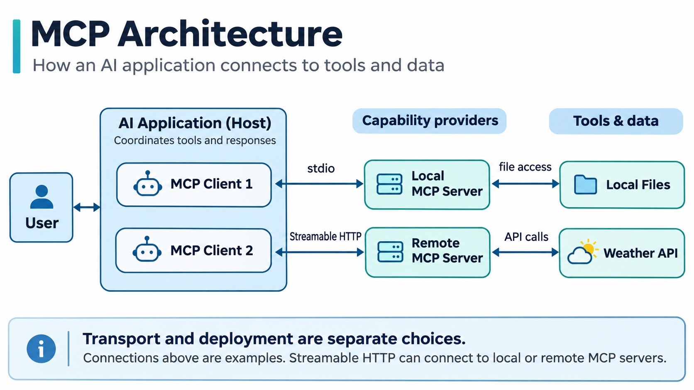

# MCP 是什么？AI 如何连接外部工具与数据

周末准备出门，你问 AI：“周六宁波会下雨吗？”

仅凭训练时学到的知识，AI 无法保证天气信息是最新的。它需要查询天气服务，再根据预报回答。读取文件、查看日程或查询数据库也是如此：模型需要借助外部工具，才能获取对话之外的信息。

那么，一个 AI 应用要怎样连接这些工具？MCP 为这类连接提供了一套标准化协议。

## 一、为什么需要 MCP？

MCP 的全称是 Model Context Protocol，中文通常称为“模型上下文协议”。它规定了 AI 应用与外部工具、数据源之间的一套交互方式。

没有 MCP，开发者也可以通过天气 API 获取预报，再把结果交给模型。但天气、日历、文件系统的接口各不相同，工具越多，适配工作也越多。

MCP 让工具提供方按统一方式描述功能，AI 应用则可以按协议发现和调用这些工具，减少重复的连接工作。

## 二、MCP 是怎样工作的？

MCP 架构里有三个常见角色。

- **Host（宿主）**：用户使用的 AI 应用，比如支持 MCP 的聊天助手或编程工具。
- **Client（客户端）**：Host 内负责 MCP 通信的组件，与 Server 建立连接并交换消息。
- **Server（服务器）**：向客户端提供具体能力，例如查询天气、读取文件或访问其他服务。

一个 Host 可以连接多个 Server，并通过对应的 Client 与它们通信。Server 不直接与大语言模型对话。

### 工具是怎么被找到和调用的？

假设某个 Server 提供天气查询功能。Client 发送 `tools/list` 请求，获取工具名称、功能描述和参数要求，例如天气查询需要提供城市名称。

Host 把工具信息提供给模型。用户提问后，模型可能选择天气工具，应用再通过 `tools/call` 发起调用。Server 返回查询结果，由 AI 组织回答。是否需要用户确认，取决于应用的权限设置。

除了可以执行操作的 **Tools（工具）**，MCP 还定义了用于提供数据的 **Resources（资源）**，以及可复用的 **Prompts（提示词模板）**。不同 Server 可以按需要提供其中一种或多种能力。

### stdio 和 HTTP 有什么区别？

MCP 使用 JSON-RPC 组织请求与响应，消息还需要通过具体的传输方式送到对方。

**stdio** 指标准输入和标准输出。AI 应用通常在本地启动一个 Server 进程，通过进程的输入、输出流交换消息。

**Streamable HTTP** 则通过 HTTP 传递消息，可以连接本机运行的 Server，也可以连接远程 Server。

容易混淆的是，**通信方式和部署位置不是一回事**。stdio 常见于本地进程通信，但本地 Server 也可以使用 HTTP；HTTP 也不等于一定要连接云端服务。

## 三、MCP 和 API 有什么不同？

API 负责定义某项服务提供什么功能、如何调用。例如，天气 API 接收查询参数并返回预报数据。

MCP 关注的是 AI 应用怎样发现和使用外部能力。开发者可以让 MCP Server 在内部调用天气 API，再把天气查询功能作为 MCP Tool 提供出去。支持 MCP 的客户端就能按统一规则获取工具信息、发起调用。

因此，MCP 和传统 API 并不冲突。实际的数据查询和业务处理依然可以由原有 API 完成。

## 四、MCP Server 一定要自己部署吗？

不一定。Server 可以在本地运行，也可以由第三方提供。

例如，想让 AI 读取电脑里指定文件夹的文档，可以使用本地文件类 MCP Server，并配置它允许访问的目录。

如果某家服务商已经提供远程 MCP Server，用户则可以在兼容的 AI 应用中填写服务地址，完成必要的身份认证后使用其开放的工具，无须自己运行服务器。

类似的连接也可以用于其他场景：编程助手通过 MCP Server 调用开发工具，知识检索应用读取获授权的文档库，办公助手访问日历或文件服务。实际可用的功能取决于 Server 开放的能力和应用授予的权限。

两种方式的区别在于谁运行 Server、数据经过哪里，以及谁管理访问权限。

## 五、MCP 的价值与局限

统一连接方式让工具集成更方便，也让 AI 应用可能接触更多数据。

查询公开天气信息，通常风险较低；如果连接邮件、文件系统或数据库，工具可能读取私人信息，甚至修改或删除内容。使用前需要弄清楚 Server 提供了哪些能力、授权范围是什么，以及数据会发送到哪里。

MCP 规范了交互过程，但不会自动替用户判断工具是否可信。具体能否使用某项能力，还取决于 AI 应用是否支持相应功能，以及 Server 实际开放了什么。重要操作仍然需要合理的权限控制和确认机制。

## 结语

MCP 可以理解为 AI 应用与外部工具之间的一套共同约定：Server 说明自己能做什么，Client 按协议获取并调用这些能力，Host 则负责把工具结果用于完成用户任务。

看懂这条链路，再分清 stdio、Streamable HTTP 与本地、远程 Server 的区别，就掌握了 MCP 最基础的工作原理。

## 参考资料

Model Context Protocol 官方网站：

https://modelcontextprotocol.io/

MCP Python SDK 入门文档：

https://py.sdk.modelcontextprotocol.io/get-started/first-steps/

MCP 官方 GitHub：

https://github.com/modelcontextprotocol
