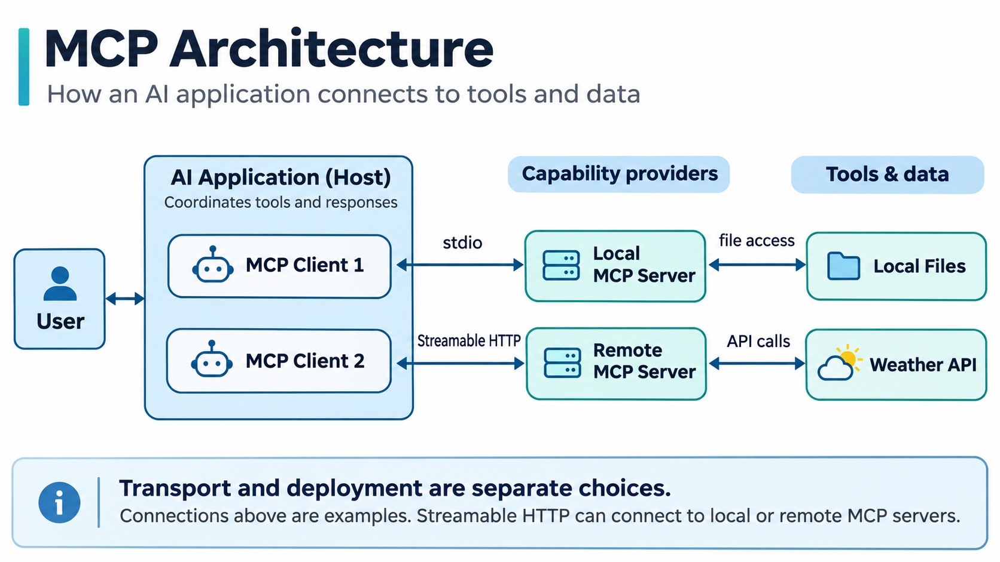

# What Is MCP? How AI Connects to External Tools and Data

Imagine you are planning to go out at the weekend and ask an AI assistant, "Will it rain in Ningbo on Saturday?"

The knowledge an AI model learned during training cannot guarantee that its weather information is up to date. To answer accurately, the application needs to query a weather service and use the latest forecast. The same applies when an AI assistant needs to read files, check a calendar, or query a database. It needs access to external tools to obtain information beyond the conversation itself.

How does an AI application connect to these tools? The Model Context Protocol (MCP) provides a standard way for applications to do this.

## 1. Why Do We Need MCP?

MCP stands for Model Context Protocol. It defines a common way for AI applications to interact with external tools and data sources.

Developers can already retrieve a forecast through a weather API and pass the result to a model. The difficulty is that weather services, calendars, and file systems all expose different interfaces. As the number of tools grows, developers have to write and maintain more integrations.

MCP gives tool providers a consistent way to describe their capabilities. An AI application can then discover and call those tools through the protocol, reducing repeated integration work.

## 2. How Does MCP Work?

An MCP setup commonly involves three roles:

- **Host**: The AI application a user interacts with, such as an MCP-enabled assistant or coding tool.
- **Client**: The component inside the Host that manages MCP communication, connects to a Server, and exchanges messages with it.
- **Server**: A program that makes specific capabilities available to the Client, such as checking the weather, reading files, or accessing another service.

A Host can connect to multiple Servers through their corresponding Clients. An MCP Server does not communicate directly with the large language model.

### How Are Tools Discovered and Called?

Suppose an MCP Server provides a weather lookup tool. The Client sends a `tools/list` request to retrieve the tool's name, description, and required parameters. For a weather lookup, for example, the tool may require a city name.

The Host makes this tool information available to the model. When the user asks a question, the model may select the weather tool, and the application then sends a `tools/call` request. The Server returns the result, which the AI application uses to form an answer. Whether the user must confirm an action depends on the application's permission settings.

MCP also defines **Tools**, which allow an application to perform operations; **Resources**, which provide data for an application to read; and **Prompts**, which provide reusable prompt templates. A Server can offer one or more of these capabilities, depending on its purpose.

### How Do stdio and Streamable HTTP Differ?

MCP uses JSON-RPC to structure requests and responses. A transport mechanism is needed to carry those messages between the Client and the Server.

**stdio** stands for standard input and standard output. An AI application commonly starts a Server process on the local machine and exchanges messages with it through the process's input and output streams.

**Streamable HTTP** carries messages over HTTP. It can connect to a Server running on the same machine or to a remote Server.

The transport method and the Server's deployment location are separate choices. stdio is commonly used for local process communication, but a local Server can also use HTTP. Using HTTP does not necessarily mean connecting to a cloud-hosted service.

## 3. How Is MCP Different from an API?

An API defines what a service can do and how another program can call it. For example, a weather API accepts query parameters and returns forecast data.

MCP focuses on how an AI application discovers and uses external capabilities. A developer can build an MCP Server that calls a weather API internally, then exposes the weather lookup as an MCP Tool. An MCP-compatible Client can discover the tool's description and parameters and call it through the standard protocol.

MCP and traditional APIs therefore serve different roles and can work together. Existing APIs can continue to handle the actual data retrieval and business logic.

## 4. Do You Need to Run Your Own MCP Server?

No. An MCP Server can run locally or be provided by a third party.

For example, if you want an AI assistant to read documents in a specific folder on your computer, you can use a local file-system MCP Server and configure which directories it is allowed to access.

Some service providers also offer remote MCP Servers. In that case, a user can enter the server address in a compatible AI application, complete any required authentication, and use the tools the provider makes available. There is no need to run the Server on their own computer.

The same approach can support different types of applications. A coding assistant may use an MCP Server to access development tools, a knowledge-retrieval application may search an authorized document collection, and an office assistant may access calendar or file services. The available functions depend on what the Server exposes and what permissions the application has been granted.

The main differences between local and remote setups are who runs the Server, where data travels, and who manages access permissions.

## 5. Benefits and Limitations of MCP

A standard connection method can make tool integration easier. It also means an AI application may gain access to more of a user's data.

Looking up public weather information is usually low risk. Connecting to email, a file system, or a database may allow a tool to read private information or even modify and delete content. Before connecting a Server, users should check which capabilities it provides, what permissions it requests, and where the data will be sent.

MCP standardizes the interaction process, but it does not determine whether a Server is trustworthy. Whether a particular capability can be used also depends on the AI application's support and the tools the Server actually exposes. Sensitive operations still require appropriate permission controls and confirmation mechanisms.

## Conclusion

MCP can be understood as a shared set of rules between an AI application and external tools. The Server describes what it can do, the Client discovers and calls those capabilities through the protocol, and the Host uses the results to complete the user's task.

Understanding this flow, along with the difference between stdio and Streamable HTTP and between local and remote Servers, provides a foundation for understanding how MCP works.

## References

Model Context Protocol documentation:

https://modelcontextprotocol.io/

MCP Python SDK getting started guide:

https://py.sdk.modelcontextprotocol.io/get-started/first-steps/

MCP official GitHub repository:

https://github.com/modelcontextprotocol
