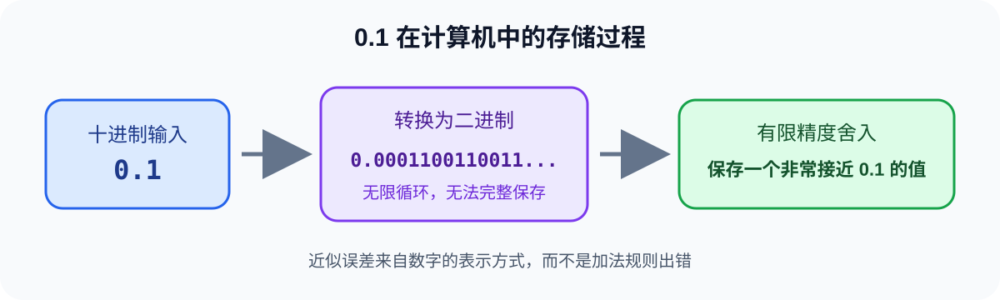
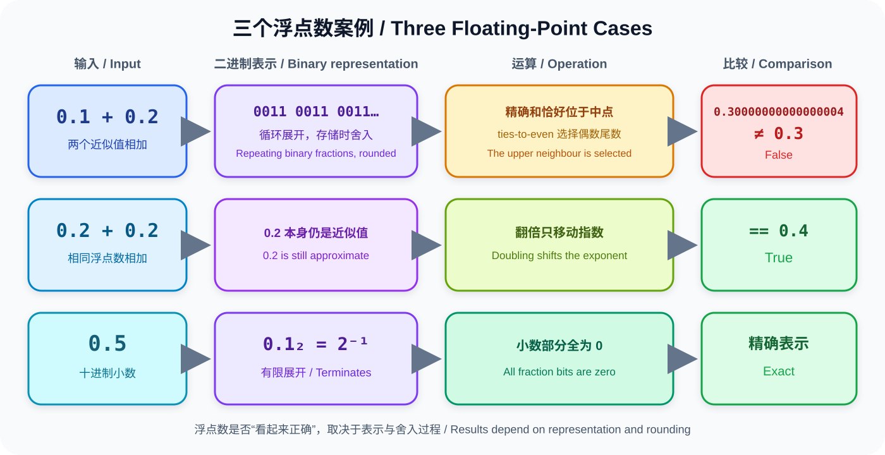

# Why Is 0.1 + 0.2 Not Equal to 0.3?

Running the following Python code may produce a surprising result:

```python
print(0.1 + 0.2)
```

```text
0.30000000000000004
```

This is not a Python bug. It happens because many decimal fractions cannot be
represented exactly using a finite binary fraction.

## From Decimal to Binary

The conversion process is illustrated below:



Values such as `0.5`, `0.25`, and `0.125` can be represented exactly in binary.
However, decimal `0.1` becomes a repeating binary fraction:

```text
0.00011001100110011...₂
```

Because computer memory is finite, the value must be rounded to a nearby
representable number.

## Why 0.5 Is Exact While 0.4 Only Looks Normal

The binary expansions of `0.1`, `0.2`, and `0.3` all contain the repeating pattern
`0011`, although the pattern starts at different positions. Each value is therefore
rounded when stored. The exact sum of the two stored approximations lands halfway
between two adjacent representable values. Under the round-to-nearest,
ties-to-even rule, the larger value is selected, producing
`0.30000000000000004`.

By contrast, `0.5 = 2⁻¹` can be represented exactly in binary, with all of its
fraction bits equal to zero. The value `0.4` is still an approximation, but
`0.2 + 0.2` happens to produce the same floating-point value as the literal `0.4`,
so their equality comparison returns `True`.



## Comparing Floating-Point Values

Python provides `math.isclose()` for checking whether two inexact values are
sufficiently close:

```python
import math

print(math.isclose(0.1 + 0.2, 0.3))
```

`math.isclose()` compares values using relative and absolute tolerances. Its default
settings are useful in many ordinary cases, but scientific and engineering programs
should choose tolerances that match the scale and acceptable error of the problem.

## When Floating-Point Error Matters

Imagine that a game character moves by `0.1` units in every frame. If the program
waits for the position to become exactly equal to a target, accumulated error may
prevent that condition from ever becoming true. The program should instead check
whether the character has crossed the target or use a comparison with a suitable
tolerance.

Financial calculations place greater emphasis on exact decimal results. A program
can store money as an integer number of cents or use `Decimal`. When creating a
`Decimal`, pass a string so that a binary floating-point approximation is not
introduced first:

```python
from decimal import Decimal

total = Decimal("0.1") + Decimal("0.2")
print(total)
```

```text
0.3
```

## Reference

Python: Floating-Point Arithmetic: Issues and Limitations

https://docs.python.org/3/tutorial/floatingpoint.html

Python: decimal — Decimal fixed-point and floating-point arithmetic

https://docs.python.org/3/library/decimal.html

IEEE Standard for Floating-Point Arithmetic

https://standards.ieee.org/ieee/754/6210/
