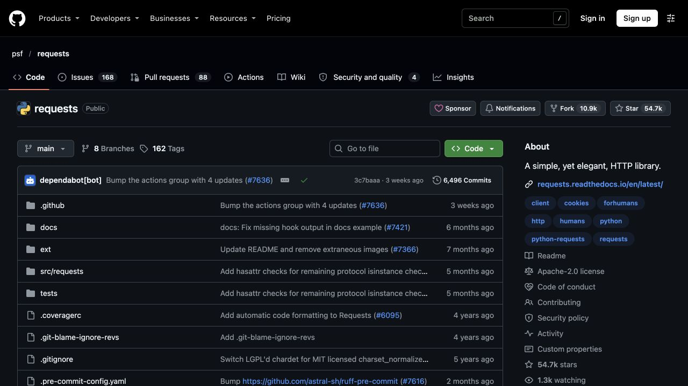
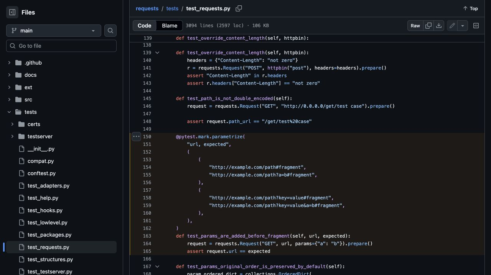

# 拿到一个 GitHub 项目，到底该从哪个文件开始看？

在 GitHub 上发现一个有意思的项目，看完演示、点下 Star，再把代码下载到电脑上，通常花不了几分钟。真正让人停下来的，往往是打开文件夹之后的那一刻。几十个文件摆在眼前，随便点开一个，光是弄清它调用了哪些东西，就足够花上一阵子。

初次阅读时，可以先给自己一个具体的目标，例如跑通 README 里的示例，再弄明白其中一个参数的处理过程。下面以 Python 的 HTTP 请求库 Requests 为例，看看怎样从使用文档走到源码，以及沿途有哪些容易忽略的细节。

## 从 README 找到一个值得追下去的问题

README 通常能回答项目的用途、安装方法和基本用法。阅读时可以留意它链接的文档站点，以及示例对应的版本。如果本地装的是旧版，网页上看的却是 `main` 的最新代码，就可能遇到参数、目录甚至函数名对不上的情况，可以在分支选择器里切到对应版本的 tag 再继续。

仓库里的文件也可以先按用途辨认。`docs/` 放文档，`src/` 放实现，`tests/` 放测试，`.gitignore` 指定 Git 应忽略的未跟踪文件。Requests 的 `.gitignore` 里有 `*.pyc`、`.venv/` 和 `.pytest_cache/`，能看出 Python、虚拟环境和 pytest 的使用痕迹。不同项目的目录名会有差异，实际位置仍要结合 README 确认。



*图 1 展示了 Requests 的仓库目录，右侧还可以找到许可证、贡献指南和安全说明。*

Requests 的入门示例会用到 `requests.get()`。假如我们想知道传入 `params` 的字典怎样变成网址参数，就可以先查快速入门中的相关章节，确认它接受什么输入，再去追实现。这样读源码时，手里已经有一组可以对照的输入和结果。

## 用一个参数串起源码和测试

Requests 是供其他程序调用的库，可以从刚用过的 `get()` 开始找。在 `src/requests/api.py` 中，它把参数交给通用的 `request()`，后者通过 `Session.request()` 继续准备请求。沿着准备过程，最终能找到 `src/requests/models.py` 中负责处理 URL 的 `prepare_url()`。

如果想看边界情况，可以转到 `tests/test_requests.py`。其中的 `test_params_are_added_before_fragment` 专门检查原网址带有查询参数和片段标识时，新参数应该放在哪里。先对照 `url` 和 `expected` 中的输入与预期结果，再看最后的断言，就能读出它期待的行为。



*图 2 的第二组数据保留了原来的 `key=value`，并把新增的 `a=b` 放在 `#fragment` 前面。*

装好 Requests 后，可以自己准备一个请求来验证，这一步只构造网址，尚未访问服务器。

```python
import requests

request = requests.Request(
    "GET",
    "https://example.com/search?lang=zh#results",
    params={"page": 2},
)
print(request.prepare().url)
```

输出结尾是 `?lang=zh&page=2#results`。把 `params` 的值换掉再试一次，比单看函数说明更容易理解参数如何被编码、已有查询字符串如何被保留。

## 复用代码前，单独读一读 License

准备把代码用进自己的项目时，需要确认许可证允许怎样修改和分发，以及要保留哪些声明。下面七种许可证都允许商业使用，各自附带的条件值得分开看，具体以对应版本的原文为准。

| 许可证 | 复用、修改和分发时值得关注的要求 |
| --- | --- |
| MIT | 随代码副本或实质部分保留版权和许可声明，允许闭源分发。 |
| BSD-3-Clause | 保留版权声明、许可条件和免责声明，未经许可不得借作者或贡献者的名义为衍生产品背书。 |
| Apache-2.0 | 提供许可证副本、保留相关声明并标明文件修改，包含明确的专利授权。原项目附带 NOTICE 时，还需按条款保留其中适用的归属声明。 |
| MPL-2.0 | 分发时，需要让接收者能够取得受 MPL 覆盖的文件及其修改的源代码。这些文件继续受 MPL 约束，独立文件可以采用其他许可证。 |
| LGPL-3.0 | 分发库及其修改时有提供源代码等义务。调用它的应用可采用其他许可证，但组合分发还需满足用户替换、重新链接库等条件。 |
| GPL-3.0 | 分发受 GPL 约束的修改版或衍生作品时，须按 GPL 授权并提供对应源代码，同时保留声明、标明修改。 |
| AGPL-3.0 | 分发时有沿用许可证、提供对应源代码等义务。修改后的程序通过网络与用户交互时，还须向这些用户提供取得该版本对应源代码的机会。 |

Requests 就有一个容易漏看的例子。它采用 Apache-2.0，根目录除了 `LICENSE`，还有记录归属信息的 `NOTICE`，复用时需要一起核对。遇到没有许可证的仓库，则应先联系作者确认授权，GitHub 默认的查看、fork 权限并未提供一般性的复用许可。

## 找不到贡献指南，也可以看看 .github

Requests 的贡献指南位于 `.github/CONTRIBUTING.md`，其中还链接了更详细的开发文档。准备提 PR 时，应先了解开发依赖、测试方法和补充测试的要求。使用中遇到疑问，也值得先看提问渠道，Requests 就明确把用法问题引导到 Stack Overflow，将 Issues 留给缺陷报告和功能请求。

参与讨论前可以读 `CODE_OF_CONDUCT.md`，了解社区行为约定和问题反馈渠道。报告安全漏洞时，应按 `SECURITY.md` 指定的方式联系维护者。查看版本变化，则可以找 `CHANGELOG.md` 或类似文件，Requests 对应的文件名是 `HISTORY.md`。

## 找到代码以后，怎样继续查它的来历

在 GitHub 登录后，代码搜索可以加上 `repo:psf/requests path:tests params`，把范围限定到这个仓库路径含 `tests` 的文件。结果过多时，换成更具体的函数名或异常文本，通常比只搜一个宽泛的功能词更容易定位。

想知道某行代码为什么这样写，可以打开文件的 Blame，沿提交信息查相关 Issue 和 PR。这里还有个细节，整库格式化可能让许多行显示同一次修改。Requests 用 `.git-blame-ignore-revs` 记录了自动格式化提交，本地在仓库根目录运行下面的命令，可以跳过这类提交，继续查找此前的修改。

```bash
git blame --ignore-revs-file .git-blame-ignore-revs -- src/requests/models.py
```

查到需要保存的代码时，还可以在 GitHub 文件页按 `y`，把分支链接换成固定提交的链接，再选择行号复制地址。这样以后翻笔记或与别人讨论时，打开的仍是当时那一版代码，行号也能对得上。

下次再打开收藏已久的项目，可以从跑通一个例子开始，把用到的函数、对应测试和固定版本链接记在一起。读完之后，除了知道某个功能如何实现，也留下了下次继续阅读的起点。

## 参考资料

> Requests 项目与图 1 来源，文中源码、NOTICE 和 HISTORY.md 均可在仓库中找到。https://github.com/psf/requests
>
> Requests 快速入门。https://requests.readthedocs.io/en/latest/user/quickstart/
>
> 图 2 参数测试源码。https://github.com/psf/requests/blob/6f66281a1d6326b1b9c4ac09ca30de0fc4e6ef43/tests/test_requests.py#L150-L165
>
> 常见许可证的条件对照及各许可证原文入口。https://choosealicense.com/appendix/
>
> Apache-2.0 原文，第 4 节说明再分发与 NOTICE 要求。https://www.apache.org/licenses/LICENSE-2.0
>
> GitHub 关于仓库许可证和默认权限的说明。https://docs.github.com/en/repositories/managing-your-repositorys-settings-and-features/customizing-your-repository/licensing-a-repository
>
> Requests 贡献指南。https://github.com/psf/requests/blob/main/.github/CONTRIBUTING.md
>
> GitHub 代码搜索语法。https://docs.github.com/en/search-github/github-code-search/understanding-github-code-search-syntax
>
> Requests 忽略格式化提交的记录。https://github.com/psf/requests/blob/main/.git-blame-ignore-revs
>
> Git blame 参数说明。https://git-scm.com/docs/git-blame
>
> GitHub 固定版本链接说明。https://docs.github.com/en/repositories/working-with-files/using-files/getting-permanent-links-to-files
