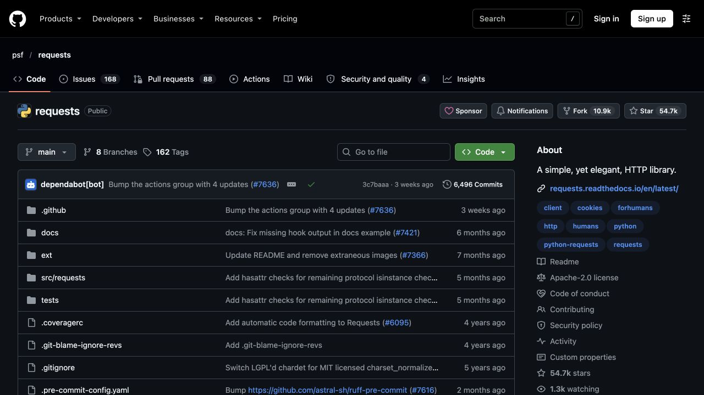
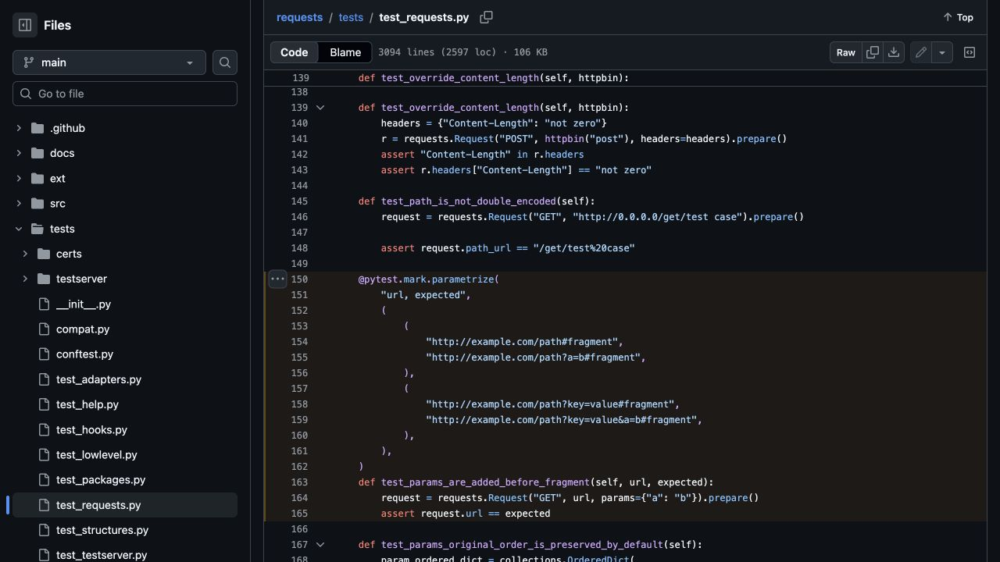

# You Found a GitHub Project. Which File Do You Read First?

Finding an interesting project on GitHub, watching its demo, giving it a star, and downloading the code usually takes only a few minutes. The harder part often comes when you open the folder. Dozens of files sit in front of you, and even figuring out what one of them calls can take a while.

For a first read, it helps to choose a specific goal, such as running an example from the README and then following how one of its parameters is handled. Using Requests, the Python HTTP library, we'll work from the documentation into the source and look at a few details that are easy to overlook along the way.

## Find a Question to Follow in the README

The README usually explains what a project does, how to install it, and how to get started. Pay attention to the documentation it links to and the version its examples describe. If you have an older release installed while browsing the latest code on `main`, parameters, directories, or even function names may differ. Use the branch selector to switch to the tag matching your version before continuing.

It also helps to recognize files by their purpose. `docs/` holds documentation, `src/` contains the implementation, `tests/` holds tests, and `.gitignore` specifies untracked files that Git should ignore. In Requests, entries such as `*.pyc`, `.venv/`, and `.pytest_cache/` give you clues about its use of Python, virtual environments, and pytest. Directory names vary between projects, so check the README for the actual layout.



*Figure 1 shows the Requests repository layout. The sidebar also links to its license, contribution guide, and security policy.*

The introductory examples for Requests use `requests.get()`. Suppose you want to understand how the dictionary passed to `params` becomes part of a URL. Start with the relevant section of the Quickstart to check what inputs it accepts, then follow the implementation. You'll have a set of inputs and results to compare with the code as you read.

## Follow One Parameter Through the Source and Tests

Requests is a library called by other programs, so you can start with the `get()` function you've just used. In `src/requests/api.py`, it passes the parameters to the general-purpose `request()` function, which uses `Session.request()` to continue preparing the request. Following that preparation process eventually leads to `prepare_url()` in `src/requests/models.py`, where the URL is processed.

To explore edge cases, turn to `tests/test_requests.py`. The test named `test_params_are_added_before_fragment` checks where new parameters belong when the original URL already contains a query string and a fragment identifier. Compare the input `url` with the `expected` result, then read the assertion at the end to see what behavior the test requires.



*In Figure 2, the second test case preserves the existing `key=value` and adds `a=b` before `#fragment`.*

Once Requests is installed, you can prepare a request yourself to check the result. This step constructs the URL before any connection to the server is made.

```python
import requests

request = requests.Request(
    "GET",
    "https://example.com/search?lang=zh#results",
    params={"page": 2},
)
print(request.prepare().url)
```

The output ends with `?lang=zh&page=2#results`. Change the values in `params` and try again to get a better feel for how parameters are encoded and how the existing query string is preserved.

## Take Time to Read the License Before Reusing Code

Before bringing code into your own project, check what its license permits you to modify and distribute, and which notices you need to retain. All seven licenses below allow commercial use, each with its own conditions. The text of the specific license version sets out the full requirements.

| License | Requirements to consider when reusing, modifying, or distributing code |
| --- | --- |
| MIT | Include the copyright and license notices with copies or substantial portions of the software. Distribution in closed-source products is permitted. |
| BSD-3-Clause | Preserve the copyright notice, license conditions, and disclaimer. The names of the copyright holder and contributors cannot be used to endorse derived products without permission. |
| Apache-2.0 | Provide a copy of the license, preserve relevant notices, and identify modified files. It includes an explicit patent grant. If the original project includes a NOTICE file, retain the applicable attribution notices as required by the license. |
| MPL-2.0 | When distributing the software, make the source for MPL-covered files and their modifications available to recipients. Those files remain covered by the MPL, while independent files may use other licenses. |
| LGPL-3.0 | Distributing the library and its modifications carries obligations such as providing source code. Applications using the library may have other licenses, but distributing a combined work also requires meeting conditions that allow users to replace or relink the library. |
| GPL-3.0 | Distribute modified versions or derivative works covered by the GPL under the GPL and provide the corresponding source code. Preserve notices and identify changes. |
| AGPL-3.0 | Distribution carries obligations such as keeping the same license and providing corresponding source code. When users interact with a modified version over a network, they must also be offered access to the corresponding source for that version. |

Requests provides an easy-to-miss example. It uses Apache-2.0 and has both a `LICENSE` file and a `NOTICE` file containing attribution information in its root directory. Check both when reusing it. If a repository has no license, contact the author to clarify permission. GitHub's default rights to view and fork a repository do not grant general permission to reuse its contents.

## Read the Contribution Guide Before Getting Involved

After reading the source, you may want to report a problem you've found or submit a change to the maintainers. Start by looking for `CONTRIBUTING.md`, commonly called the contribution guide. It usually explains how to report issues, submit pull requests, and meet the project's development and testing requirements, helping contributors understand how the project handles contributions.

Check the repository root first, where many projects place `CONTRIBUTING.md` alongside `README.md`. If you cannot find it there, look in `.github/` or `docs/`, or follow the Contributing link in the repository sidebar.

In Requests, for example, the guide is at `.github/CONTRIBUTING.md` and links to more detailed development documentation. Before submitting a pull request, use it to check the development dependencies, how to run the tests, and what tests you are expected to add. It's also worth checking where to ask usage questions. Requests directs those to Stack Overflow, reserving Issues for bug reports and feature requests.

Before joining a discussion, read `CODE_OF_CONDUCT.md` for the community's expectations and reporting channels. Report security vulnerabilities through the process specified in `SECURITY.md`. To review version changes, look for `CHANGELOG.md` or a similar file. In Requests, that file is called `HISTORY.md`.

## Trace the History Behind the Code

Once you're signed in to GitHub, a code search such as `repo:psf/requests path:tests params` restricts results to files in the Requests repository whose paths contain `tests`. If you get too many results, try a specific function name or exception message to narrow the search.

To investigate why a line was written a certain way, open the file's Blame view and follow the commit messages to related issues and pull requests. One detail can complicate this process. Formatting an entire codebase can leave many lines attributed to the same commit. Requests records its automatic formatting commit in `.git-blame-ignore-revs`. From the root of a local Requests checkout, run the following command to skip the listed commits and trace earlier changes.

```bash
git blame --ignore-revs-file .git-blame-ignore-revs -- src/requests/models.py
```

When you find code you want to save for reference, press `y` on its GitHub file page to turn the branch URL into a link to a specific commit. You can then select the line numbers and copy the address. When you return to your notes or share the code with someone, the link will still show the version you were reading, with the same line numbers.

The next time you open a project you've had starred for a while, start by running one example and keep notes linking the function you used, its tests, and the specific version of the code. Along with an understanding of how the feature works, you'll have a place to pick up your reading next time.

## References

> Requests repository and source of Figure 1. The source files, NOTICE, and HISTORY.md discussed in this article are available here. https://github.com/psf/requests
>
> Requests Quickstart. https://requests.readthedocs.io/en/latest/user/quickstart/
>
> Parameter test shown in Figure 2. https://github.com/psf/requests/blob/6f66281a1d6326b1b9c4ac09ca30de0fc4e6ef43/tests/test_requests.py#L150-L165
>
> Comparison of common license conditions, with links to the full license texts. https://choosealicense.com/appendix/
>
> Apache-2.0 license text. Section 4 covers redistribution and NOTICE requirements. https://www.apache.org/licenses/LICENSE-2.0
>
> GitHub's guidance on repository licensing and default permissions. https://docs.github.com/en/repositories/managing-your-repositorys-settings-and-features/customizing-your-repository/licensing-a-repository
>
> Requests contribution guide. https://github.com/psf/requests/blob/main/.github/CONTRIBUTING.md
>
> GitHub's guide to the purpose, locations, and links for contribution guidelines. https://docs.github.com/en/communities/setting-up-your-project-for-healthy-contributions/setting-guidelines-for-repository-contributors
>
> GitHub Code Search syntax. https://docs.github.com/en/search-github/github-code-search/understanding-github-code-search-syntax
>
> Requests record of the formatting commit to ignore. https://github.com/psf/requests/blob/main/.git-blame-ignore-revs
>
> Git blame options. https://git-scm.com/docs/git-blame
>
> GitHub's guide to permanent file links. https://docs.github.com/en/repositories/working-with-files/using-files/getting-permanent-links-to-files
