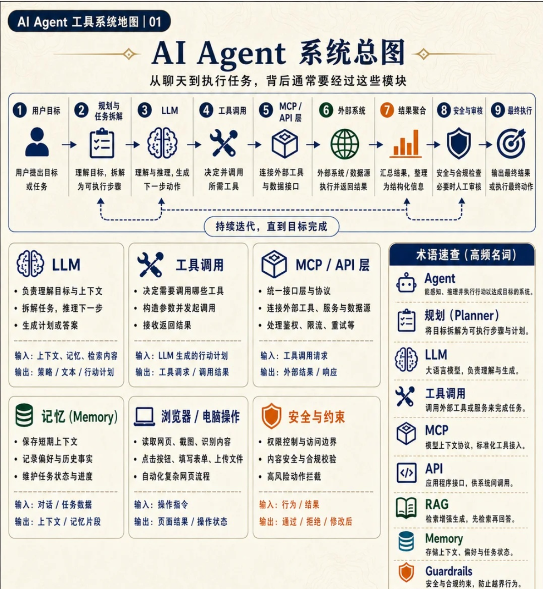
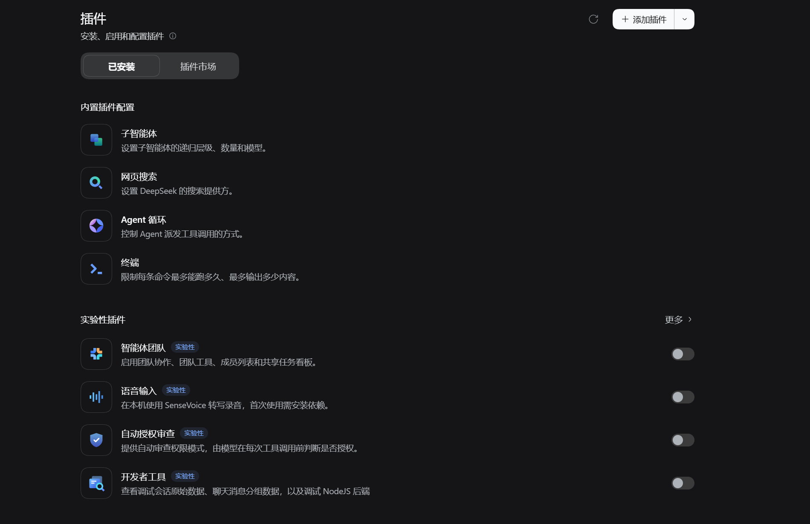
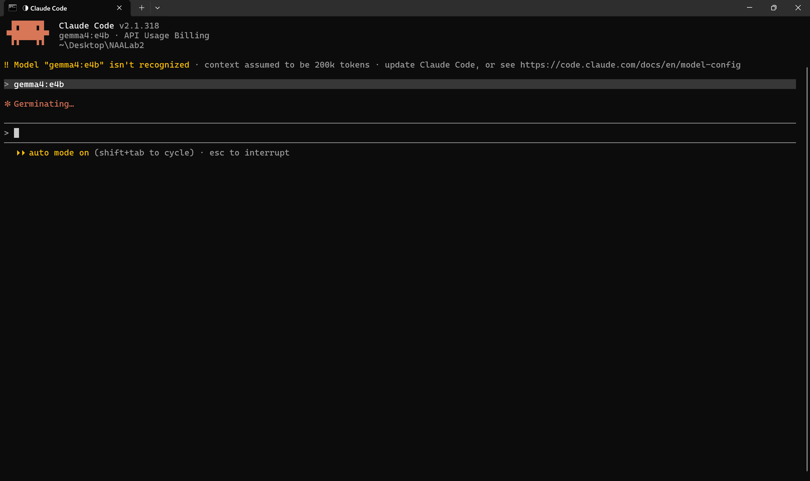

# A Beginner's Guide to Using Agents

## Introduction

After leaving the familiar, predictable world of high school for the diversity of university life, have you found yourself in situations like these? A classmate opens their laptop and already has an agent running tasks. Conversations with friends are full of unfamiliar terms. Your groupmates complete assignments remarkably quickly and to a very high standard. Do you feel anxious or confused? Do you want to put agents to work for you but have no idea where to start? **This article will walk you through the basics of agents and examples of how to use them, helping you get started quickly**. It will not go into much detail on specialized workflows in individual fields, setting up agents, or developing enterprise agents. (To save the experts some time: this is a very basic article.)

## Part One: Basics — The Difference Between Chat and Agents, AI Terminology, and a Guide to Using Most Agents

### Chat and Agents

(I Won't Paste the Official Definitions Here; They're Too Long. Ask an AI If You Want to Read Them.)

1. Chat is like a smarter search box.
2. An agent is like an employee. In general, using an agent gives you access to **more advanced models from the same company at higher reasoning effort levels**. Agents can also complete tasks more independently, such as operating your computer through the command line and using tools installed on it. I will go into these capabilities later. **In short, think of an agent as someone who works incredibly hard and is exceptionally capable in certain areas**.

### Common AI Terms (Items 6, 7, and 8 Are the Most Important)

1. API: Think of it as a tap. In an agent or on a website, you use an "API KEY" to connect to a large language model and access the computing resources its provider offers. Those resources flow into the interface like water. Of course, you need to pay for usage in advance, and your money will flow away just as quickly. Here is a useful rule of thumb: using AI through an API generally offers less value for money than buying a subscription plan for an official agent, so beginners generally do not need APIs, except when using DSH.
2. MCP: You can think of this as a protocol connecting a large language model to other software or websites. Through MCP, the model can quickly operate that software or those websites. (You will not need it for everyday use; I have not tried it myself yet.)
3. skill: Rather than "skills," I find **standardized operating rules** a much easier way to understand these. You give a model a set of rules for processing its input, and it follows those rules. For example, feed it a paper and install a skill, and out comes a lovely, digestible summary of the main findings and key data.
4. Prompts: Exactly what the name suggests: you tell the model what to do and guide it. That said, I have heard that many prompts can now limit a model's performance. It is hard to say, so I usually use less restrictive prompts. (In practice, that means fairly vague directions, because I am not entirely sure what I want either. The model follows my train of thought to help work out what I am really after.)
5. Experts: This concept is already outdated. You can ask an AI to dig into its history; I will not go into it here.
6. harness: The control layer around a large language model. It does not do the thinking; it manages tool calls, handles exceptions, and organizes the task loop. A harness has a major influence on how much of a model's capability can be put to use. This is why v4.1 in DSH does not feel like v4.1 elsewhere.
7. LLM: A large language model.
8. Oh, and one more important point: Agent = Harness + LLM.
9. Connectors: These connect an agent to other software, such as WeChat and QQ, and can be implemented through the MCP protocol.
10. Plugins: An agent has a kernel layer, a plugin layer, and a controller layer.

    - Kernel (kernel layer): A minimal Agent loop that only exposes extension points. It has no knowledge of any plugins and communicates only through Hook interfaces.
    - Plugin (plugin layer): Implements specific Hooks and attaches to an individual session to change the Agent's behavior.
    - Controller (controller layer): Orchestrates multiple sessions and can combine plugins, while the plugins themselves have no knowledge of the controller.

- Jailbreaking: Inducing a model to bypass its safety restrictions.
- Overfitting: When a model is overly influenced by its training data and its ability to generalize declines.

I cannot think of any other particularly important beginner terms for now. Feel free to look up any terms that catch your interest.

### An Agent's Basic Setup

An agent generally consists of a main chat window, connectors, skills, experts, and plugins. I have already explained these, so open an agent and take a look.

## Part Two: Major AI Models and Common AI Applications or Tools Available Today; Who Each Model Suits; Recommended Reasoning Effort Levels and Models for Different Tasks; Recommended Skills, Plugins, and Prompts

### WorkBuddy

WorkBuddy is easy to access and get started with, and it integrates with many tools in China’s software ecosystem. Its output quality still falls well short of what top models produce. Try it on a small task first to see whether it meets your needs.

### DSH (DeepSeek Harness)

DSH requires a model API, and costs depend on the provider and usage. You can install plugins to suit the task, and your plugin setup determines which features are available. In my experience, DSH runs quickly. When choosing a tool, you can compare output quality, runtime, and cost on the same task.

### Codex

I tend to use Codex for more demanding tasks. In my experience, Codex takes longer to connect and run than DSH. When choosing between them, consider the output quality your task requires, along with your network conditions, access, and budget.

### CC Switch

CC Switch is a desktop configuration tool for managing model providers, API settings, and MCP servers for tools such as Claude Code and Codex. If you are starting with one tool, learn its basic workflow first. Consider CC Switch when you need to switch providers or manage configurations for several tools.

### PI

1. PI is a minimalist, open-source harness. That means exactly what it sounds like: it has no model of its own, so you need to buy an API key to use it. By default, it only has a few tools for reading, writing, and editing files, plus bash. In other words, when you open it, you get a terminal, with no graphical interface or the other built-in features you may know from agents: plugins, connectors, built-in experts, and so on. Its advantages are a small footprint, both in storage and token usage; extensive customization (you can even use Claude Code); and extremely tight cost control. You need to add plenty of plugins yourself to make it useful.
2. Still, there is no need to focus on it too much at this stage. You do not need it yet, and it will be easy to learn once you are comfortable with the basics of agents.
3. This is my roommate's PI setup. As you can see, it runs without a graphical interface to keep memory use as low as possible. You can also see Claude Code in the screenshot. With plugins, PI can use other leading harnesses, which is a nice perk. 

## Part Three: Common Uses for AI Agents

### Browsing Website Information

You can copy a URL, send it to an agent, and ask it to organize the information on that website for you. **For websites that require a username and password, there is currently no completely safe way to use an agent to organize their information. Even running the agent in a sandbox carries a risk of exposing personal information. There have been cases of people getting hold of others' account details this way. The internet is full of idiots who enjoy doing this sort of disgusting thing**. (Here is how to recognize high-risk situations when using agents to browse: if you give an agent a URL and it reports that it cannot access the website without a password, that is a situation where you should not use an agent to browse.)

### Troubleshooting All Kinds of Mysterious Computer Problems

Have you ever had an unreliable internet connection, been unable to find a file, or had your computer malfunction for no apparent reason? Because an agent can read information on your computer and operate it with your permission, it can act as your computer's doctor and help diagnose problems. This can make using something as complicated as a computer much more pleasant and make your life easier. Whatever the problem (all sorts of problems), take a picture and send it to an AI!

### Finding and Organizing Files

In my experience, an agent can often act as an interface for operating your computer. Talking to it can make using your computer even easier than using your phone. Take finding files: when File Explorer is crammed with files, you often do not even want to open it. If you never developed a filing system in the first place, using your computer can feel like being in prison. At that point, ask an agent to find the file, give it a possible filename, have it tell you the path, and search for it in File Explorer's search bar. What a relief. I still recommend managing your files properly, but why not use an agent as a stopgap or to help organize them? **Using agents is making "your attention is everything" feel more and more apt.**

### Help With PDF and Word Document Layout

Are you still writing PDF and Word documents one word at a time? Perhaps you have been asked to write a proposal for the student volunteer association (青协), or prepare one for an HU interview. While other students and groups are still doing everything manually, you, my friend, can use an agent to leave your peers far behind. Give it the instructions, constraints, and perhaps some previous WeChat posts from your organization, and you can get a draft in a short time. Do you know why AI-written articles can look fine at first glance but turn out to be a pile of crap on closer inspection?

1. Too much waffle. Far too many sentences make a point and then immediately follow it by denying the opposite view. It is painfully long-winded.
2. There is a lot of defensive writing, with vague wording that makes it tiring to read.
3. AI uses sentence structures that feel very unnatural to human readers. For example, it tends to describe a situation before getting to the point.
4. Some AI systems really like to use lots of em dashes and colons.
5. Many AI-written articles lack detail and leave you feeling that they never quite get to the point. Look for relevant details in the surrounding context and add them.

### Extracting the Key Points From Papers

Finding papers exhausting to read? Ask an agent to cut through the waffle and extract useful information or whatever you need. Add a few handy skills and the process becomes much more pleasant. Be mindful of the boundaries: first read UNNC's AI use policy, or ask a senior student or teacher.

### Organizing Course Content

Struggling to keep up in class? Not sure where to start with independent study? Find an agent smart enough for the job, give it your course materials, and let it be your one-to-one tutor. **A little-known fact: top models are no less capable overall than some mediocre professors. (Of course, it is often still very useful to consult capable teachers. Some kinds of experience and personalized, face-to-face explanations remain far beyond AI.)**

### Help Finding Sources to Support a Paper

I do not recommend simply installing a skill in Codex or a similar agent and using it to search for and summarize relevant papers. Many academic websites have sophisticated anti-scraping mechanisms, so the AI may be unable to read enough papers. You can use a specialized academic search AI such as Undermind to help with the search.

### Vibe Coding

The key point: do not dump the entire task on an agent. Pay attention to demos, setting boundaries, concurrency, and similar issues. Covering these in detail would take too much space, and relatively few beginners need them. Come along to a CPU weekly tech-sharing session, find some experienced members, and ask them to recommend a learning path.

## Part Four: Understanding Agents' Limitations

- **Account security.** Using an agent to browse a website that requires a password can expose the password.
- **Website coverage.** An agent may be unable to read all the content on a page. The LLM may omit information from its summary, and the website’s measures against scraping can restrict access.

### Agents Struggle to Come Up With Original Research Ideas Independently, but Can Help You Explore Ideas

However capable AI may be, it still outputs existing information. After all, it relies on text-based training and probability. So, if you want to rely entirely on AI to produce an outstanding original idea, that will be difficult. You can install a skill called ARS-Codex. Discuss your idea with it, and it will question your thinking in depth, like Aristotle, until your idea is in excellent shape. You can look into this further online.

### Computer Troubleshooting Depends Heavily on the LLM's Intelligence

Weak models and agents can make this process an ordeal.

### Agents Write Poorly: You Can Tell at a Glance Whether a PPT, PDF, or Article Was Made by AI, and With Enough Exposure You Can Even Tell Which Agent Made It. The Results Are Readable, but Seeing Too Many Gets Sickening, So Put the Human Brain First When You Want to Create Something Beautiful

I have already discussed how to make AI writing more palatable. Let me emphasize it again: please use AI less often to churn out unreadable rubbish. We already spend enough time talking to AI every day. I really do not want to open a WeChat post only to find another article written by AI; I am worn out from reading them. By now, you should be able to tell that I wrote this article myself. In this age of AI everywhere, can you feel the effort I have put into it?

## Part Five: Some Pitfalls When Using AI Agents

1. For long-term work, use a project and set up a shared folder to make it easier to start new conversations. A conversation has a limited context window, and AI gets less capable when the conversation becomes too long. You could also consider installing a skill.
2. Use separate conversation windows for different types of tasks to keep the context focused.
3. Ask the AI to summarize the conversation so far in good time, to keep an overlong context from limiting its capabilities and improve the cache hit rate to save money. Those of you using DSH may already be familiar with this.
4. Respect the boundaries of AI use in academic work: do not have it write your work for you. An LLM may have been trained on other people's work, so watch out for their material appearing in your writing (citation).
5. Although LLMs are unprecedentedly capable, they only output existing content. Do not let their output undermine your creativity.
6. Rely more on your own reading skills, and be wary of becoming overdependent on AI to read texts for you.
