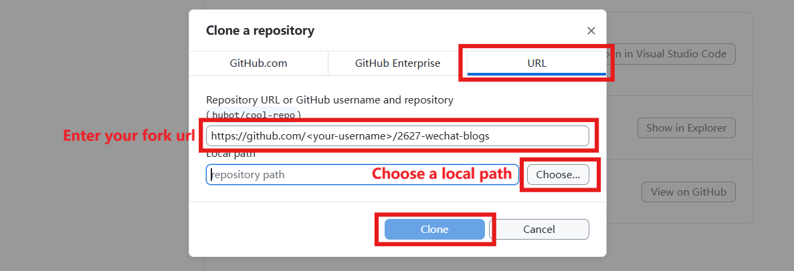
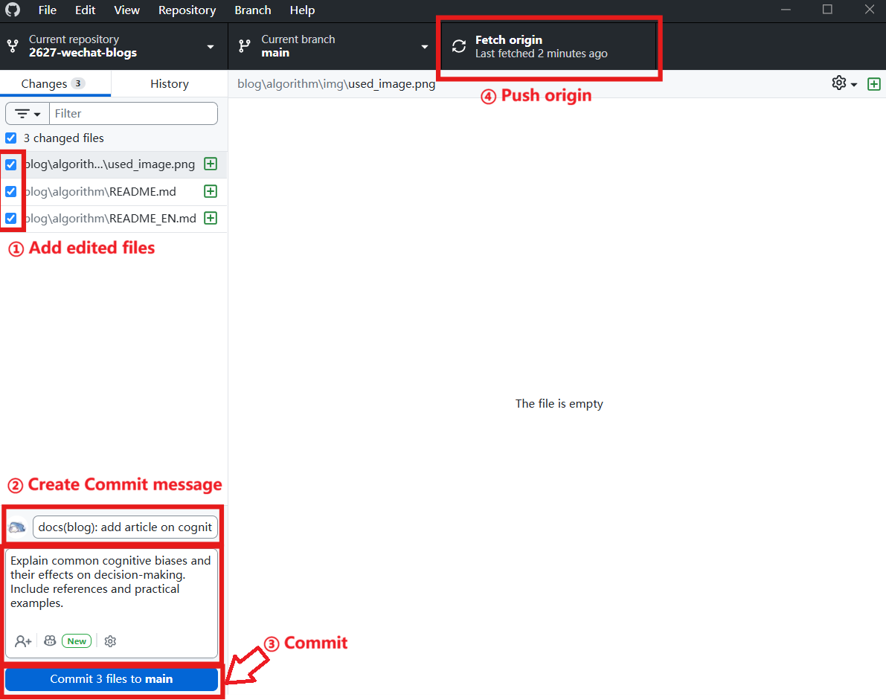

# 使用 GitHub Desktop 投稿 / Contributing with GitHub Desktop

[简体中文](#简体中文) | [English](#english)

---

## 简体中文

本教程介绍如何使用 GitHub Desktop 完成 CompPsyUnion 微信公众号文章投稿。GitHub Desktop 是 GitHub 官方提供的桌面应用程序，可通过图形界面管理 Git 仓库、分支、提交和推送，适合不熟悉命令行（CLI）的投稿者。请在网上搜索“GitHub Desktop”，并从 GitHub 官方网站下载和安装。

Issue 中仍然提出文章标题和大纲、确认认领及安排进度；大纲审核通过后，从初稿开始的稿件和修订都通过 Pull Request（PR）提交，不要把完整稿件贴到 Issue 评论中。

如果你还没有完成选题，请先按 [CONTRIBUTING.md](../CONTRIBUTING.md) 的说明在 Issue 提出标题和大纲，并等待审核通过（Issue 标记为 `Task`）后再开始写初稿。

### 1. Fork 仓库

打开[仓库主页](https://github.com/CompPsyUnion/2627-wechat-blogs)，点击 **Fork**，将仓库 fork 到自己的 GitHub 账号。确认 fork 创建完成后，继续在 GitHub Desktop 中克隆你账号下的 fork，而不是原始仓库。

### 2. 在 GitHub Desktop 中克隆 fork

打开 GitHub Desktop，登录你的 GitHub 账号，然后从 **File → Clone repository…** 打开克隆窗口。选择你的 `2627-wechat-blogs` fork，并指定本地保存位置。


在仓库列表中选择自己账号下的 fork。确认仓库所有者是你的 GitHub 用户名，不是 `CompPsyUnion`。



选择本地路径后点击 **Clone**，等待仓库下载完成。完成后 GitHub Desktop 会打开该本地仓库。


### 3. 创建并切换到新分支

在 GitHub Desktop 顶部确认当前仓库为 `2627-wechat-blogs`。点击 **Current Branch**，选择 **New Branch**，输入符合[分支命名规范](../CONTRIBUTING.md#分支命名规范)的名称，然后点击 **Create Branch**。请勿在 `main` 分支上直接编辑或提交。

例如，撰写算法类文章可使用 `docs/cognitive-biases`；修复问题和新增功能的分支请分别遵循 `fix/` 和 `feature/` 规则。创建后确认顶部显示的是新分支。

### 4. 创建文章文件夹并撰写中英文稿

在文件资源管理器中打开本地仓库。按文章类别，在对应目录创建以标题命名的文件夹：

- 软件类：`blog/software/<article_folder>/`
- 硬件类：`blog/hardware/<article_folder>/`
- 算法类：`blog/algorithm/<article_folder>/`
- 故事类：`blog/story/<article_folder>/`

`<article_folder>` 使用小写 snake_case，且不得包含中文或特殊字符。文件夹中创建以下内容：

```text
<article_folder>/
├── README.md       # 中文稿件
├── README_EN.md    # 英文稿件
└── img/            # 文章所需图片
    └── example_image.png
```

使用编辑器撰写 `README.md`，完成英文翻译并写入 `README_EN.md`。提交者必须通读英文稿并确认、修订译文，确保其准确、自然、完整；不能未经检查直接提交 AI 翻译结果。可参考 [translate-skill](https://github.com/CompPsyUnion/translate-skill)。将图片放入 `img/`，在 Markdown 中使用相对路径引用。写作、版权、Markdownlint 等要求请参照 [CONTRIBUTING.md](../CONTRIBUTING.md#markdown-文章内容要求)。

### 5. 检查改动并 Commit

保存文件后回到 GitHub Desktop。左侧 **Changes** 会显示新增或修改的文件。检查列表，确保仅包含本次文章文件夹中的稿件和图片；逐一查看 diff，确认没有遗漏或误提交文件。

在左下方填写 commit 信息：

- **Summary**：简短说明本次修改，例如 `docs(blog): add article on cognitive biases`；
- **Description**（可选）：补充文章内容或修改说明。

提交信息应遵循 [commit message 规范](../CONTRIBUTING.md#提交信息规范)，并不得加入 AI 署名 footer。确认当前分支不是 `main` 后，点击 `Commit to <branch-name>`。

### 6. Push 分支到自己的 fork

Commit 完成后，点击 GitHub Desktop 顶部的 **Push origin**（首次推送时可能显示 **Publish branch**），将当前分支发布到你自己的 GitHub fork。等待推送完成。



### 7. 创建 Pull Request

Push 完成后，在 GitHub Desktop 点击 **Preview Pull Request** 或 **Create Pull Request**。浏览器打开 GitHub 页面后，检查 PR 目标设置：

- **base repository**：`CompPsyUnion/2627-wechat-blogs`
- **base branch**：`main`
- **head repository**：你的 fork
- **compare branch**：刚才创建并 push 的工作分支

填写清晰的 PR 标题和说明，关联对应 Issue（例如 `Closes #123` 或 `Refs #123`），说明稿件内容及 Markdownlint 等检查结果，然后创建 PR。请仔细确认不是向自己 fork 的 `main` 或原仓库的错误分支提交。

### 8. 根据 Review 修改并更新 PR

维护者会在 PR 中 review 稿件。需要修改时，在本地同一个分支中编辑文件，保存后回到 GitHub Desktop检查 diff，再填写 commit 信息并 `Commit to <branch-name>`，最后点击 **Push origin**。变更会自动出现在原 PR 中，不要另开重复 PR，也不要把修订内容改贴到 Issue。

更多投稿流程、文章要求、分支及 commit 命名规则，请参阅 [CONTRIBUTING.md](../CONTRIBUTING.md)。

---

## English

This tutorial explains how to submit a CompPsyUnion WeChat article using GitHub Desktop. GitHub Desktop is GitHub's official desktop application for managing Git repositories, branches, commits, and pushes through a graphical interface. It is useful if you are not familiar with the command line (CLI). Search online for “GitHub Desktop” and download and install it from the official GitHub website.

Use the Issue to propose the title and outline, confirm the assignee, and track scheduling. Once the outline is approved, submit the first draft and all subsequent revisions through a Pull Request (PR)—do not paste the complete manuscript into Issue comments.

If you have not proposed your topic yet, follow [CONTRIBUTING.md](../CONTRIBUTING.md) to create an Issue with the title and outline. Wait for approval (the Issue should be marked as `Task`) before drafting.

### 1. Fork the repository

Open the [repository homepage](https://github.com/CompPsyUnion/2627-wechat-blogs) and click **Fork** to create a fork under your GitHub account. After the fork is ready, clone your fork in GitHub Desktop—not the original repository.

### 2. Clone your fork in GitHub Desktop

Open GitHub Desktop and sign in. Select **File → Clone repository…** to open the clone dialog. Choose your `2627-wechat-blogs` fork and select a local path.


Select the fork under your account. Verify that the owner shown is your GitHub username, not `CompPsyUnion`.


Choose where to save the local repository and click **Clone**. GitHub Desktop will open the repository after cloning completes.


### 3. Create and switch to a branch

In GitHub Desktop, confirm that the current repository is `2627-wechat-blogs`. Click **Current Branch**, select **New Branch**, enter a name following the [branch naming conventions](../CONTRIBUTING.md#branch-naming-conventions), and click **Create Branch**. Do not edit or commit directly on `main`.

For example, an article about cognitive biases could use `docs/cognitive-biases`. Bug-fix and feature branches must follow the `fix/` and `feature/` conventions. Confirm that the new branch is selected at the top of the application.

### 4. Create the article folder and write both manuscripts

Open the local repository in File Explorer. Create a title-named folder under the directory matching the article category:

- Software: `blog/software/<article_folder>/`
- Hardware: `blog/hardware/<article_folder>/`
- Algorithms: `blog/algorithm/<article_folder>/`
- Stories: `blog/story/<article_folder>/`

Use lowercase snake_case for `<article_folder>`; do not use Chinese characters or special characters. Add these files and directory:

```text
<article_folder>/
├── README.md       # Chinese manuscript
├── README_EN.md    # English manuscript
└── img/            # Images used in the article
    └── example_image.png
```

Write the Chinese manuscript in `README.md` and its English translation in `README_EN.md`. Contributors must read through the English version, verify it, and make corrections as needed to ensure it is accurate, natural, and complete. Do not submit unchecked AI-generated translations. You may refer to [translate-skill](https://github.com/CompPsyUnion/translate-skill). Store images in `img/` and reference them with relative paths in Markdown. For writing, copyright, and Markdownlint requirements, see [CONTRIBUTING.md](../CONTRIBUTING.md#markdown-article-content-requirements).

### 5. Review changes and commit

After saving your files, return to GitHub Desktop. The **Changes** list shows added or modified files. Confirm that it contains only the manuscript and images for your article, and review the diff to catch accidental or missing changes.

Enter a commit message in the lower-left panel:

- **Summary**: briefly describe the change, for example, `docs(blog): add article on cognitive biases`.
- **Description** (optional): add context about the article or changes.

Follow the [commit message conventions](../CONTRIBUTING.md#commit-message-conventions), and do not add an AI attribution footer. Confirm that you are not on `main`, then click `Commit to <branch-name>`.

### 6. Push the branch to your fork

After committing, click **Push origin** at the top of GitHub Desktop. On the first push, the button may be labeled **Publish branch**. This publishes your current branch to your GitHub fork.


### 7. Create a Pull Request

After the push completes, click **Preview Pull Request** or **Create Pull Request** in GitHub Desktop. On the GitHub page that opens, verify the PR targets:

- **base repository**: `CompPsyUnion/2627-wechat-blogs`
- **base branch**: `main`
- **head repository**: your fork
- **compare branch**: the working branch you just pushed

Provide a clear PR title and description, link the related Issue (for example, `Closes #123` or `Refs #123`), and summarize the manuscript and Markdownlint/check results. Before creating the PR, verify that you are not targeting your fork's `main` or an incorrect branch in the original repository.

### 8. Address review comments and update the PR

Maintainers will review the manuscript in the PR. To make changes, edit files locally on the same branch, save them, and return to GitHub Desktop to review the diff. Enter a commit message, click `Commit to <branch-name>`, then click **Push origin**. The existing PR updates automatically. Do not open a duplicate PR or move revisions into Issue comments.

For the complete submission process, manuscript requirements, and branch/commit naming rules, see [CONTRIBUTING.md](../CONTRIBUTING.md).
